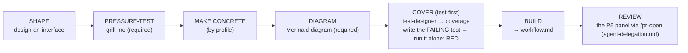

# Design Workflow (the _how_ of GATE 1)

Last updated: 2026-10-18 23:16

The Design leg of **Design → Code → Prove** (`workflow.md`): turn intent into a concrete, approved
design before any implementation. A `CLAUDE.md` instruction still wins, and the gate is never
skipped. A design is **approved** when it's concrete enough to build without guessing — for UI
that's rendered pixels + tokens + states; for a service the **API contract**; for a CLI/library the
**public interface**; for data the **schema/contract**; for meta/tooling (a hook/script) the
**trigger + input + exit-code/effect contract**. The executable form of that bar: **you can write a
RED test against the contract** (COVER below); if you can't, it isn't concrete enough yet.

## The design pipeline (universal spine)

- **SHAPE** — `design-an-interface` ("Design It Twice": 3+ radically different designs, compared on
  simplicity/depth/generality/misuse-resistance) → the chosen interface shape.
- **PRESSURE-TEST** *(required — the FIRST of two mandatory grills, `workflow.md` Adherence #5)* —
  `grill-me` → severity-tiered flaws. **Fold every finding back into the design doc** — a flaw
  noted only in the transcript didn't happen; the doc is what SHAPE hands to BUILD. **Grill your own
  solution against live state too**: tag each mechanism `[EXISTS]`/`[IMPOSSIBLE]`/`[NEEDED]`; an
  already-shipped or structurally-impossible mechanism never reaches BUILD. The second grill is on
  the PLAN after `writing-plans`, recorded in the plan's own `## Grill findings`; the `grill_gate`
  hook blocks committing a spec or plan whose `## Grill findings` is missing/empty.
- **MAKE CONCRETE** *(by profile)* — **Web UI** → the rendered-design sub-pipeline below;
  **Service/API** → OpenAPI/schema + example request/response pairs; **CLI/Library** → signatures,
  flags, exit codes, error types (a `--help` sketch); **Data** → input/output schema + sample
  fixtures; **Meta/tooling** → trigger event, inputs, exit codes, and the ALLOW/DENY or side-effect.
- **DIAGRAM** *(required)* — a **Mermaid diagram** of the approach (flow / state machine /
  architecture / interface) in the design doc; `/workflow-diagrams` picks it up at CLOSE.
- **COVER (test-first)** — **(1) coverage:** `test-designer` maps the contract's behaviours →
  a coverage doc (Mermaid for stateful flows, checklist otherwise); advisory, no test code.
  **(2) failing test:** write the behaviour test(s) (Web → `e2e/*.spec.ts`; API → integration test;
  CLI/lib → golden/signature test; data → fixture), then **run JUST that test**
  (`bin/test-lock -- <only this test>`) and confirm it fails RED for the right reason (assertion /
  404 / not-implemented — not a syntax error). ⚠ Not `/validate` — that's the full-suite GREEN gate
  at P4. **Binary, and BEFORE the plan:** each acceptance test is a 1/0 pass/fail against the
  contract, authored + confirmed RED at the *start* of P2, before `writing-plans` emits the plan; the
  plan names the test (path or id).
- **BUILD** — domain skills (web: `frontend-design`) turn the COVER red test green; `workflow.md`
  BUILD → VERIFY ⛔ owns it from here.
- **REVIEW** — the risk-tiered panel, dispatched only via `/pr-open` — roster, tiers, verdicts and
  `pr_gate` rules in **`agent-delegation.md`** (auditor role). Design-specific additions:
  `/security-review` and, for web, `web-design-guidelines`. **If the panel changes code, re-run
  VERIFY before merge.**

---

### Web-UI profile only — art direction, visual & tokens

> _Web UI only._ Other profiles satisfy GATE 1 at "MAKE CONCRETE" and skip to BUILD.

- **ART-DIRECT** _(premium/brand sites only)_ — `award-winning-web-design` → a `concept.md` with
  real tokens + motion specs. Internal tools skip this.
- **SOURCE A LOOK / TOKENS** _(optional)_ — `design-import` (lift an existing site → tokenized
  HTML + React + `IMPORT.md`), **or** port a claude.ai/design / Figma-Make export, **or** pull
  tokens from Figma.
- **POLISH** — `ui-aliveness-audit` → micro-feedback, loading/empty states, motion. **Every
  animation reduced-motion-gated.**

> **GATE-1 approves a RENDERED design, not a MECHANISM.** "Build frame 2:4 / mirror `DossierCard`"
> is a _build instruction_, not an approved look. Render the design to a **dev-only gated preview**
> (e.g. `/design-preview/<name>`), **screenshot desktop + mobile**, and get explicit human sign-off
> on _those pixels_ **before** wiring real routes/data. _(API: approve the contract, not the handler;
> CLI: approve the `--help`, not the parser.)_

> **Codify the approved look as a visual-regression check.** Once signed off, register the component
> in the dev-only `visual-preview/[name]` gallery + `e2e/component-visual.spec.ts` (golden
> self-screenshots at desktop/tablet/mobile widths, Linux baselines in the pinned Playwright image).
> Scaffolded into new web projects by default, inert until you register a component.

**Figma / Claude Design — quota-free first.** Never spend the Figma MCP quota (≈6 calls/month on
Starter) on iteration — only on the final, approved design. Free paths first: port a Claude Design /
Figma-Make export (it _is_ code), the `window.figma` browser API via a logged-in tab, Chrome
DevTools MCP / Playwright screenshots of `http://127.0.0.1:PORT` (the `local-browser-testing` plugin
skill), `html.to.design`; metered `get_design_context` / `get_variable_defs` only on the FINAL
design. Direction: `get_design_context` reads **Figma → code**; `use_figma` / `figma-generate-design`
go **code → Figma**. One project = one Figma file (named after the repo folder; key in
`FIGMA_FILE_KEY` in `.claude/worktrees.conf`) = one default talk-to-figma channel; `FIGMA_LAUNCH=1`
lets the `figma_launch` SessionStart hook bring the environment up. **The _how_ → `FIGMA-UI.md`**
(the `ct-core` plugin): the two-bridge split, Code Connect, project wiring + channel
mechanics, the reverse code → Figma mirror; the `figma-ui` skill is the per-change checklist.

## Skill interview convention (the before/after-skill feedback lifecycle)

A skill that takes choice-y arguments should not fire blind:

- **`## Interview` (BEFORE_SKILL).** An optional `## Interview` block in the `SKILL.md` — **≥4
  `AskUserQuestion` prompts, one at a time** — run at skill start. The one-at-a-time cadence is
  deliberate and not in tension with `autonomy.md` A4 (A4 batches unplanned blocker-questions; this
  is a designed sequential intake). `skill-audit` flags a choice-taking skill that lacks it. Author
  it through `writing-skills`.
- **`/to-questionnaire` (AFTER_SKILL).** After the skill finishes, turn any decision it surfaced but
  couldn't resolve into an async Markdown questionnaire for the human (`/questionnaire-me`).

For a skill *about a skill*, the AFTER_SKILL applier is **`/improve-skills`**: it consolidates
proposals from `skill-audit`, `skill-reinvent` and `/dev-reflect` and drives each human-approved
change through `writing-skills` (never auto-applying).

## See also

`FIGMA-UI.md` (Figma mechanics) · the `figma-ui` skill · `agent-delegation.md` (the review panel;
delegate parallel design exploration) · the `local-browser-testing` plugin skill ·
`/questionnaire-me` + mattpocock `to-questionnaire`/`grilling`.
