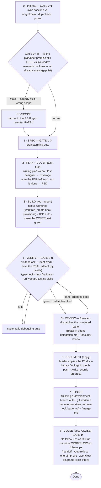
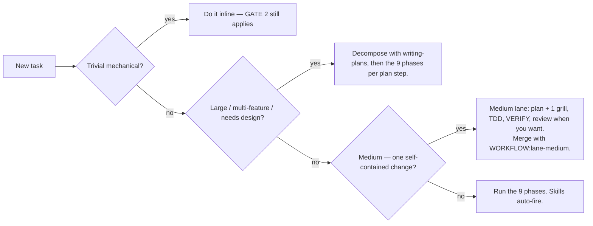

# Canonical Dev Workflow (every project, every session)

Last updated: 2026-10-19 02:08

> **THE LAW — Design → Code → Prove.** Shape it before you build it (GATE 1 ⛔), prove it
> with fresh evidence before you call it done (GATE 2 ⛔). Two hard gates, never skipped.
> The *how* of the Design and Prove legs lives in `design-workflow.md` / `verify-workflow.md`.

One workflow, everywhere — **any stack** (web · service/API · CLI/library · data). Only _how you
drive the real artifact_ in VERIFY and _make the design concrete_ in GATE 1 change by profile. The
**superpowers methodology is the ambient engine** — its skills auto-fire as their preconditions
match. Don't fight the gates. A `CLAUDE.md` instruction beats any skill, and the **HARD GATES** are
never skipped.

- **GATE 0 — Baseline before anything.** No design/code until you've synced to the current source of
  truth THIS session: confirm `git status` is clean (stash `-u` or commit in-progress work first);
  `git fetch`; check the behind-count vs `origin/main` (`git rev-list --count HEAD..origin/main`);
  **sync if behind** — an unpushed branch rebases onto `origin/main`, a pushed branch (PR or train
  member) runs `git merge origin/main` (one merge commit; never a force-push, never a raw `git pull`
  or `git reset --hard`). **Always compare against `origin/main`, never bare local `main`** —
  `git fetch` does not move local `main`. When a rebase drops a commit as "patch contents already
  upstream", **trust the drop** — your change already landed. **Verify the plan/brief premise too**:
  have research characterize the target against live code and emit a tagged
  `[EXISTS]/[PARTIAL]/[MISSING]` + file:line gap list; if the target already exists, re-scope to the
  real gap and re-enter GATE 1. A spawning plan is a hypothesis to falsify, not a contract.
  On a managed repo the "own worktree + primed" half is **machine-enforced** by the
  `session_prime_gate` check — see `autonomy.md` A5 for the mechanics and bypass tokens.
- **GATE 1 — Design before code.** No implementation until an approved design exists
  (`brainstorming`; for big work, decompose with `writing-plans`).
- **GATE 2 — Evidence before "done".** No "done/fixed/passing" claim without FRESH output THIS
  turn, across three legs (`verification-before-completion`, per `verify-workflow.md`): the
  **STATIC leg** (typecheck, lint, unit via `/validate`); the **BEHAVIORAL leg** (the behaviour-test
  suite under `bin/test-lock`); the **EXERCISE leg** (drive the **real artifact** by profile via the
  `run`/`webapp-testing` skills — `/validate` covers only STATIC). **SHOW the evidence in your
  report** (screenshot for UI · response body for API · stdout/exit for CLI · output rows for data).
  Run VERIFY **once per batch of accumulated changes**, not per micro-edit.

## The 9 phases



## Phase → tools

| # | Phase | Drives it (auto) | Commands / tools |
|---|-------|------------------|------------------|
| 0 | PRIME ⛔ | — | **read this file first · invoke `using-superpowers`** · **sync baseline first** (`git fetch` · behind-count vs `origin/main` · sync if behind) · **verify the plan premise vs live code** (gap list) · `gh issue list` (already tracked?) · **`/rc`** (concurrent-session check — avoid a shared-checkout collision) · `/prime-core` · `/project-status` · context-map |
| 1 | SPEC ⛔ | `brainstorming` | **grill-me (required)** · a **Mermaid diagram** of the design (required) · see `design-workflow.md` |
| 2 | PLAN + COVER (test-first) | `writing-plans` | **grill the PLAN** (2nd required grill — `grill-me` on step-sequencing / interfaces / failure-modes, recorded in the plan's `## Grill findings`; `grill_gate` blocks a plan commit without it) · **test-designer** (behaviour coverage) · **write the failing behaviour test** (web: **playwright-tester** → `e2e/*.spec.ts`) · **run JUST that test** (`bin/test-lock -- <it>`) → confirm **RED** (⚠ NOT `/validate` — that's the P4 full-suite green gate) |
| 3 | BUILD (red→green) | `test-driven-development` · `executing-plans` | **native worktree** (EnterWorktree / Agent `isolation: worktree` — the `worktree_create` hook provisions fetch·env·PORT·setup) · make the COVER red test green; add tests as code grows · domain skills |
| 4 | VERIFY ⛔ | `verification-before-completion` · `systematic-debugging` | `bin/test-lock -- <test cmd>` (touched/affected test files while iterating; a tier-2 full suite per PR at the final synced head) · **drive the real artifact** (by profile — the `run`/`webapp-testing` skills) · typecheck/lint · `/validate` · see `verify-workflow.md` |
| 5 | REVIEW | `requesting-code-review` → `receiving-code-review` | dispatch the **risk-tiered** panel **only through `/pr-open`** (`--full` forces tier 2, `--deep` adds the advisory lenses; a hand-dispatched panel is not a panel) **CONCURRENTLY in ONE message**: tier 2 = `code-reviewer` + `silent-failure-hunter` + `security-reviewer` + `test-quality-reviewer` (+ `docs-impact-agent` at tier ≥ 1 on a documented surface; advisory `code-simplifier` + `comment-analyzer` with `--deep`) · `/security-review` (distinct). Roster, tiers, fix rounds and the `pr_gate` merge axes: **`agent-delegation.md`** (auditor role). **Panel edits → re-run VERIFY.** |
| 6 | DOCUMENT (apply) | — | the builder applies the P5 **docs-impact-agent** findings in the next fix push (re-reviewed via `/pr-open`) · `/write` for progress.md/CLAUDE.md state · create-readme |
| 7 | FINISH | `finishing-a-development-branch` | `git worktree remove <path>` (the `worktree_remove` hook backs up untracked files + an uncommitted patch first) · `/merge-prs` |
| 8 | CLOSE (docs-CLOSE) ⛔ | — | **file every follow-up / known gap / deferred nit as a GitHub issue** (`gh issue create`) or `WORKFLOW:no-follow-ups` — your discipline (the Stop-time close gate was removed in the hook diet) · HANDOFF/TASKS ← real PR#/merge state · `/handoff` · `/dev-reflect` (ONCE per session, even multi-PR) · then **offer** `/improve` and `/improve-skills` (offer only — the human invokes them) · `/workflow-diagrams` (best-effort; skip headless) · remember · **emit worktree teardown** — `git worktree remove <path>` (the `worktree_remove` hook backs up + frees the PORT); the branch survives — `git branch -d <branch>` once merged |

## Behaviour tests & real-artifact verification

Coverage AND the first failing test happen at COVER (P2), BUILD turns them green, VERIFY runs them —
two layers:
- **Codified regression:** `bin/test-lock -- <test cmd>` (per-repo lock spans all worktrees).
  **Cadence** (canonical in `verify-workflow.md`): touched/affected test files while iterating; a
  full suite per PR for a tier-2 PR only, as a single local full-suite run under `bin/test-lock`
  at the final synced head; a test-runner / setup-script change or a release / train close always
  gets a full run regardless of tier.
- **Drive the real artifact** *(green ≠ works — by profile)*: **Web UI** → Chrome DevTools MCP at
  `http://127.0.0.1:$PORT` (`webapp-testing`, never the blocked Claude-in-Chrome extension — the
  `local-browser-testing` plugin skill); **Service/API** → hit endpoints, assert status+body;
  **CLI/Library** → run it, assert stdout+exit code; **Data** → run on fixtures, assert output
  schema/row counts; **Meta/tooling** *(hooks/scripts/a template like this repo)* → run the suite
  AND fire the changed unit against a real input, assert its effect. Codify anything you verify
  interactively as a test.

## How much process? (the only thing you decide)



- **Trivial** → inline, but GATE 2 still applies. **Medium** → a lighter lane for a single
  self-contained change: write a PLAN (no separate spec), grill it ONCE into its `## Grill findings`
  (the plan interview is waived — commit with `WORKFLOW:lane-medium`), keep TDD + VERIFY, and run the
  review panel only when you want; merge with `WORKFLOW:lane-medium` (waives the four marker axes,
  not CI/mergeable/head-match). **Standard** → the 9 phases. **Large** → decompose
  with `writing-plans` (brainstorming per feature), then the phases per plan step.
- **Batch RELATED items into one branch/PR** — the per-PR gates amortize across a batch. Never
  bundle UNRELATED concerns to save gate cost: review quality and revert granularity lose more.
- **Many small/medium INDEPENDENT tasks at once → an integration train, not one PR each.** Each
  builder works on its own branch in its own worktree with its own spec/plan (the coordinator checks
  it before merging the member in). The panel reviews each **branch diff** on the `/pr-open` contract
  (tier, `Open:` / `Fix rounds:` lines), recorded per member as a `train-member:` comment on the
  draft PR — never a `pr-open:tier` marker. **Member reviews are sized by risk and batched (R7):**
  low-risk work (docs, manifests, probes, test registration) gets `code-reviewer` only, plus
  `test-quality-reviewer` when it adds real assertions; the full panel is reserved for secrets,
  hooks, CI, merge gates and third-party code ingestion. Related train members are reviewed in one panel dispatch with a verdict per member, not one panel each. Review-clean branches merge (merge
  commit) into one integration branch with one **draft PR**; a single local full-suite run under
  `bin/test-lock` at the current head is the PR's one full suite, and once `Open:` is `none`, `security-reviewer` and `test-quality-reviewer` re-review the delta diff and post a normal verdict at the new head. At the end: one release step, `/pr-open` on the integration PR — its panel on the
  **integration delta only** (merge resolution + release step; a gated-path delta escalates to the
  full-diff panel) — and a **merge commit** (not a squash) so each task stays revertable. On a red
  result the failing test points to its branch: eject it by **rebuilding** the train from
  `origin/main` without that member as a fresh branch + draft PR (no force-push; never revert a merge
  — re-merging later would silently drop the reverted changes), re-post the kept members'
  `train-member:` comments, close the old draft as superseded. Large structural changes keep their
  own PR.
- **Delegate substantial work** to subagents (see `agent-delegation.md`). Trivial things stay
  inline. Auditors/reviewers hold no locks — **dispatch them async and keep working**.

## Adherence — mandatory, not optional

The gates are easy to *know about* and still skip under time pressure. They are not advisory. A
growing subset is machine-enforced (the enforcement/gate-roster reference lists what BLOCKs, what
WARNs, and every `WORKFLOW:no-*` bypass token).

1. **Design → Code → Prove is mandatory.** GATE 1 and GATE 2 apply to every task, trivial ones at
   reduced weight. Skipping a gate because a change "looks simple" is the failure mode the gate
   exists to catch.
2. **GATE 0 reads the workflow docs, not just the code.** The live files are authoritative, not your
   recollection (this file; project Phase-0 mechanics in the `ct-core` plugin's
   `docs/workflow/WORKFLOW.md`).
3. **Creative/feature work always starts with `brainstorming`, scaled to the task** — scale the
   *depth*, not whether it runs.
4. **GATE 0's baseline-sync order runs every session, before touching anything.**
5. **PRESSURE-TEST is mandatory at TWO gates — grill the DESIGN and grill the PLAN.** (1) `grill-me`
   on the design before the spec/ADR, each finding + disposition in its `## Grill findings`; **grill
   your own fix against live state** — tag each mechanism `[EXISTS]` (drop) / `[IMPOSSIBLE]`
   (redesign) / `[NEEDED]` (build). (2) `grill-me` again on the plan's step sequencing, interfaces,
   failure modes, recorded in the plan's own `## Grill findings` before any code. Disposition vocab:
   fixed / parked-with-ruling / deferred / accepted / resolved / mitigated / addressed. The
   `grill_gate` check blocks committing a spec, plan (`docs/superpowers/plans/**`) or ADR whose
   `## Grill findings` is missing or empty (bypass a trivial doc with `WORKFLOW:no-grill`). Plan-mode
   `~/.claude/plans/*.md` is your discipline to grill.
6. **P6 DOCUMENT is a HARD GATE.** After any change, `docs-impact-agent` (never a grep sweep) finds
   the docs the change made stale; the builder applies its findings in the next fix push. Enforced
   teeth: `pr_gate`'s review panel (`docs-impact-agent` at tier ≥ 1) and its merge axes.
7. **Authoring or editing a skill goes through `writing-skills`** — never hand-edit a `SKILL.md`.

## Worktrees, locks & the merge queue

- **Native worktrees are the isolation mechanism for BUILD** — `EnterWorktree`, or the Agent tool's
  `isolation: worktree` for parallel writers. The `worktree_create` hook provisions each one
  (`git fetch origin` + behind-warn, gitignored `.env*` carry-in, `SETUP=npm` install, a
  collision-free `PORT` in `.claude/worktree.env`). Teardown is `git worktree remove <path>` — the
  `worktree_remove` hook first backs up untracked/ignored files plus an uncommitted-changes patch to
  `~/.local/share/claude-template/backups/` and frees the PORT. One writer per worktree; read-only
  auditors/researchers need no worktree.
- **Suite serialization is `bin/test-lock -- <cmd>`** — one lock per repo, shared across every
  worktree; a contended run prints the holder and exits 75. **Agents use
  `bin/test-lock --wait [--timeout SECS] -- <cmd>`** (FIFO; exit 75 only on timeout) — never
  hand-roll a retry loop. The `test_lock_enforce` check denies raw suite runs.
- **Parallel PRs → merge queue.** Each PR lives in its own worktree; build, fix rounds, panel
  reviews and targeted tests run concurrently. The **full suite is serial on purpose** (one lock;
  concurrent suites make timing tests flaky), so it runs by slot:
  1. The builder runs only targeted test files, pushes, reports `READY FOR SUITE <pr#> <sha>`, waits.
  2. The coordinator grants a slot to one PR at a time.
  3. At its slot the builder syncs: `git fetch` → `git log --stat HEAD..origin/main` (read it in the
     same minute as the merge — an earlier behind-count is stale on a repo with concurrent sessions)
     → `git merge origin/main` (a merge commit, never a force-push) → repo-specific sync steps →
     targeted tests → push. The full suite (R4) is a single local run under `bin/test-lock` at the slot's synced head — that run is the PR's one full suite (there is no CI). If the runner keeps a
     green-run memo (this repo's `tests/run.sh` does), pass `--full` — `bash tests/run.sh --full` —
     so the slot's evidence is a real run, never a memo replay.
  4. Review runs through `/pr-open` and finishes **before** the slot: round 1 is the tier's full
     panel plus `docs-impact-agent` (tier ≥ 1). A fix round does not re-dispatch a panel on the `Open:` lenses (R6) — prove each finding fixed with a test that fails before the fix and passes
     after; `code-reviewer` reviews the fix delta every round; the gating lenses re-review the delta
     diff (or the full PR diff when the delta touches a gated path or a lens answers `NEEDS-FULL`)
     and post their verdicts at the new head. Never bump a version in a fix round — only at the slot
     — except a fix that edits a hook file, which always carries its own hooks-version bump +
     fingerprint rewrite.
  5. Once the local full suite finishes green, `/pr-open` posts the verdict markers bound to that
     head sha; the coordinator squash-merges, then grants the next slot.

  ```mermaid
  flowchart LR
      B["builder: targeted tests · push"] --> R["READY FOR SUITE pr sha"]
      R --> S{"slot granted"}
      S --> Y["fetch · merge origin/main · repo sync steps"]
      Y --> T["full suite once (bin/test-lock)"]
      T --> M["verdict markers @head sha"]
      M --> Q["squash-merge → next slot"]
  ```
- **Teammates are in-process Agent-tool spawns** (SendMessage coordination); the `teammate_idle`
  hook keeps one working while it still owns tasks.
- **Merge mechanics** — `gh pr merge` with `main` or the PR branch checked out in ANY worktree
  fails its LOCAL cleanup but the REMOTE merge already succeeded: don't re-merge, confirm
  `git log origin/main` shows the squash, then `bin/pr-merge-recover [<pr#>]`. A self-authored
  `gh pr merge` is gated by the auto-mode classifier even WITH a bypass token and needs
  `--match-head-commit <full-40char-headRefOid>`; if denied, hand it to the user's terminal — do not
  retry the bypass form. A stale `.git/worktrees/<name>` entry can pin `main`: clear it with plain
  `git worktree remove <path>` then `git worktree prune` (startup reaps merged clean worktrees but
  never force-removes). Full detail: the `ct-core` plugin's `docs/workflow/WORKFLOW.md`.
- **Rules vs. hooks:** judgment/style → a **rule** (this file and its siblings); deterministically
  checkable at a tool call → a **hook** (`PreToolUse` deny; blocking events block via exit code; the
  rest inject context). See the hook layer's reference doc for the boundary.

## See also

- Extended workflow reference docs (FIELD-GUIDE · WORKFLOW · HOOKS · ENFORCEMENT · FIGMA-UI ·
  CRON) ship in the `ct-core` plugin under `docs/` — start at `FIELD-GUIDE.md`.
