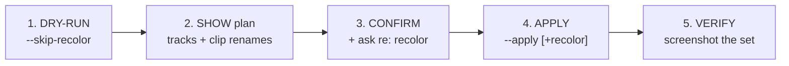

# Tidy Ableton Session — a linter for your set

`scripts/ableton-tidy.py` is **dry-run by default**; this skill drives the safe
review→confirm→apply flow (pure logic lives in `sidekick/librarian/{session_tidy,session_health,palette}.py`).

## Modes

- **`--report`** — read-only **Session Health** score (0–100) + tiered findings (empty clips, default
  names, scratch/duplicate tracks), each tagged `[auto]/[propose]/[aesthetic]/[manual]`. Never writes.
  Start here.
- **`--fix-safe`** — the `[auto]` tier: delete empty MIDI clips (re-verified empty first). Dry-run default.
- **`--colour-scheme`** — colour every track by musical FUNCTION per `docs/product/ableton-style-guide.md`
  (Foundation purple · Rhythm reds · Harmony blues · … · group = darker child), then repaint clips.
  Needs a captured palette (`scripts/capture-palette.py`). **Aesthetic → opt-in; overwrites clip colours.**
- **`--name-clips`** — STANDALONE clip naming only (no track renumber/recolor): the same merged
  pass as classic step 2 below, for when you want just that.
- **`--curate`** — the clip keep/discard front-door: DELETE every red-verdict clip
  (`color_verdict.classify_clip_color`), keep every green/neutral one. **DESTRUCTIVE.**
  `--apply` REQUIRES `--set-path <the working .als>` and version-backs it up FIRST (Henri's
  `<name>_v<N>.als` convention, confirmed on disk) before a single clip is touched; refuses
  outright (no delete sent) on an unsaved set (`--set-path` missing or the file isn't on disk).
  Never renames. This is the "curate before recolor" step §1a/the guardrail below assumed Henri
  did by hand — now it's a command: `--curate --apply --set-path <path>` BEFORE `--colour-scheme`.
- **(no mode)** — the classic three passes below (Henri, 2026-07-26: clip naming is now the DEFAULT,
  not a separate opt-in mode).

## The three classic passes

1. **Track renumber** — prefix each track name with its 1-based position (`"Pads B"` → `"3 Pads B"`).
2. **Clip numbering + naming (merged, default since 2026-07-26)** — every occupied clip gets its
   scene number; a chord/MIDI/key clip (`docs/product/ableton-style-guide.md` §2) is numbered but kept
   **VERBATIM** otherwise (`"iii-v - G#mM7add11"` → `"3 iii-v - G#mM7add11"`); everything else is
   ADDITIONALLY standardized to `"<scene#> <track> · <desc>"` (`"test"` → `"10 Kick · test"`). A
   **blank-named** occupied clip (an empty name, not an empty slot) is numbered with just the track
   name — `""` in scene 8 of `20 Granular Texture` → `"8 Granular Texture"` (no bare `"<n>"`; skipped
   only when the track itself is unnamed).
3. **Clip recolor** — paint each clip its track's colour. **⚠️ DESTRUCTIVE to the keep-discard
   signal** — see the guardrail below.

## ⚠️ The one load-bearing rule — recolor is OFF by default

Pass 3 overwrites per-clip colours, **including the red/green keep-discard signal** Henri uses for
clip curation (CLAUDE.md; `docs/guides/OSC-TOOLKIT-HOWTO.md`). This skill **cannot know** whether
Henri has already curated (deleted the reds), so:

- **Default: run with `--skip-recolor`** (passes 1+2 only — always safe).
- **Only add recolor when Henri explicitly confirms** "curation is done / the reds are already
  deleted / go ahead and recolor." Never infer it.

## Workflow

1. **DRY-RUN** — `python3 scripts/ableton-tidy.py --skip-recolor` (preview passes 1+2). Never start
   with `--apply`.
2. **SHOW** — surface the printed plan (track renumbers + clip renames) to Henri.
3. **CONFIRM** — get the go-ahead. **Ask explicitly**: "recolor clips too? (only if you've already
   curated the red/green keep-discard clips)". Default no.
4. **APPLY** — `python3 scripts/ableton-tidy.py --apply --skip-recolor` (or drop `--skip-recolor`
   only after an explicit yes to recolor).
5. **VERIFY (GATE-2)** — screenshot the set; confirm tracks renumbered + clips renamed as planned.
   One OSC client (the script's `connect(crew="ableton-tidy")` holds it).

## Auto-tidy via the daemon (TidyWatch, DEFAULT-ON since 2026-08-26)

The gateway daemon runs a background **TidyWatch** (`sidekick/gateway/tidy_watch.py`) that
auto-applies the naming passes **when you add a track or scene** — no manual run needed:

- **Trigger:** polls `(num_scenes, per-track (colour, occupied-clip count))` every ~3s — fires on a
  track add, scene add, **clip add**, or **track-colour change** (auto-recolour follows a track
  recolour). Excludes clip names/colours so tidy's own writes never self-retrigger.
- **Debounce ~5s:** it never renames while you're mid-edit — a change restarts the timer; it only
  fires once the signature has settled.
- **Naming + KEEP-SAFE recolour:** renumbers tracks, numbers/names clips, AND repaints clips to
  their track colour — but **never overwrites a red/green keep-discard clip** (and never paints a
  clip INTO the reserved band). Never deletes.
- **Opt out:** `SIDEKICK_TIDY_WATCH=0` in the daemon env (restart the daemon after changing).
  Runs on the same per-address-locked transport as RackSaveWatch (one-client rule honoured).

Running `/ableton-tidy` by hand still works and is the way to also recolour green/red clips or
delete empty clips — things TidyWatch deliberately won't do automatically.

## Notes

- Scratch/working tracks (e.g. `BASS BAKE`) get numbered too — delete or accept them first.
- The script resolves and writes **by index within one connection**; don't add/delete tracks mid-run.
