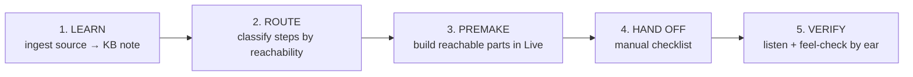

# Tutorial → Ableton (learn + premake)

Two products from one ingest: **LEARN** (a KB note that teaches) and **PREMAKE** (build the reachable
parts in the live set). The guru is read-only toward Live; the sidekick/bridge does the building.
The step→action classifier now ships in two legs — `tutorial_match.routes_to_progression_matcher`
(composition/MIDI) and `tutorial_rack.routes_to_rack_builder` (rack/sound-design, #376). Both honour
the FIDELITY marker (an uncertain transcription refuses rather than guesses). Steps outside those two
legs are still routed by hand using the reachability tags the KB note carries.

## The 5-Phase Decomposition (proven reusable template)

Tutorial ingestion decomposes into five sequential phases:

- **LEARN:** Dispatch `ableton-guru` to fetch and distill the tutorial into an original, attributed KB note with per-step reachability tags.
- **ROUTE:** Manually classify each step as AUTO-OFFLINE / AUTO-LOM / HYBRID / MANUAL using the note's tags + `references/reachability.md`. Ask "can this be a **file**?" first — an offline `.adg` beats a live write on cost and risk.
- **PREMAKE:** Write Python scripts to automate reachable steps — Slice B (composition/MIDI) uses `stage_chords`; Slice C (sound design) uses `DeviceParameters` + parameter OSC discovery.
- **HAND OFF:** For every MANUAL step, create a checklist item with action / params / why + deep-link to the source.
- **VERIFY:** Play the session, listen on headphones/monitors, adjust by ear. GATE-2 discipline: OSC queries show structure; ears show truth.

This template is applicable to any tutorial (realistic-bongos, congas/tumbao, Collision physical modeling, etc.). Reuse the phases without redesigning the workflow each time.

## Workflow

### 1. LEARN — ingest the source into a KB note
Dispatch the **`ableton-guru`** agent to ingest the source (it has WebFetch/WebSearch, no Bash, and is
read-only toward Live). It produces an ORIGINAL, attributed note in the house style — technique
essence, concrete steps, **stock-Live device mapping** (name the stock equivalent when the source uses
a 3rd-party synth), parameter starting points, when-to-use/when-not, a `Source:` link, and a
per-step/element **reachability tag** (`stock` / `partial`/`hybrid` / `manual`).

- File it by KIND (see `docs/guides/INGESTION-QUEUE.md`): a **track breakdown** → `docs/ableton-docs/bible/deconstructed/<slug>.md`; a **technique/how-to** → `docs/ableton-docs/bible/guides/<slug>.md`. Ambient-doctrine composition notes still live under `sidekick-starter/music-production-bible/notes/<slug>.md`.
- Genre fidelity: a source's own "ambient" tag is not doctrine — confirm from the fetched BODY, not the title (club/techno articles routinely carry "ambient" titles).
- Source readability: plain-article sites (e.g. Attack Magazine) are readable by the guru's WebFetch. A JS-rendered page is not — route it through `queue render-drain` (headless render → `racks/_tutorial/rendered/<slug>.txt`) and have the guru **Read that sidecar file** instead of WebFetch. A Cloudflare-gated page (`needs_browser`) needs the claude-in-chrome real-browser fallback; headless render can't pass Cloudflare (spike-verified 2026-09-26).

### 2. ROUTE — classify each step by reachability
For every distilled step, decide AUTO / HYBRID / MANUAL. Use the note's own reachability tag as the
starting point, then confirm against `references/reachability.md` (the canonical 12.3.2 table). Two
hard rules:
- **Classify on the STATE CHANGE, not the gesture verb.** "Add emojis to the track name" sounds like a UI trick but is a plain `set_track_name` write (AUTO); "right-click > save" as a GUI gesture is MANUAL, but saving a **rack** is not — build the `.adg` offline and write it to disk instead of reaching for the menu.
- **FIDELITY override:** any step whose params carry the `(unclear - verify at MM:SS)` marker routes to MANUAL unconditionally — never auto-execute an uncertain transcription against a real set.

### 3. PREMAKE — build the reachable steps
- **Composition / MIDI** (chord progression, drum pattern) → **Slice B**: `match_progression(query, index)` then `stage_chords` (`sidekick/librarian/tutorial_match.py`; stage in `sidekick/librarian/stage.py`). This is a MATCH against Henri's already-indexed MIDI library (~7,920 progressions / 165 patterns), NOT text-to-notes generation — if nothing matches, say so honestly, never fabricate.
- **Clip PATTERN data — extract on-demand from the SOURCE at build time, fabrication-free.** A distilled KB note carries the device skeleton + technique but usually NOT concrete clip patterns (rhythm grid / tempo / key); most Deconstructed-style articles are impressionistic prose, not bar-by-bar (verified live: "Da Funk" states no tempo/key/rhythm — "The Bells" is the outlier). When a step needs real MIDI clips, RE-FETCH the source article and extract ONLY what it explicitly states:
  - **Encode a rhythm ONLY if the text states it** ("four-on-floor", "offbeat", "1/8-note"). A gap → leave it to Henri's ears; **never invent a pattern and cite a section for it.** A fabricated pattern that looks sourced is worse than an honest gap — this rule exists because a real live build wrote a clap rhythm and cited a section that gave none.
  - **Target drum-pad ROLES** (kick/hat/ride/clap), resolved to the loaded kit's real notes via `/live/device/get/drum_pads` (`get_drum_pad_notes`) at build time — never hardcode pad note numbers (preset-specific).
  - **No bar-by-bar arrangement transcription** — that's the article's creative analysis (distill-not-mirror), and the live mute/unmute performance is taste anyway.
  - **Velocities/durations are taste starting defaults.**
  - Reference format for the rare note worth pre-baking: the `## Premake pattern` section in `docs/ableton-docs/bible/deconstructed/jeff-mills-the-bells-909.md`. Pre-bake such a section ONLY when the article states concrete patterns; otherwise keep the note lean and extract on-demand.
- **Sound-design / device params** (pad/drone/texture patch, param settings on stock devices) → **Slice C**: `build_patch(...)` and the `SidekickClient.get_device_parameter` / `set_device_parameter` primitives (`sidekick/librarian/build_patch.py`, `sidekick/client.py`). Recipe shape = `PatchStep{device, parameter, value, reachability}`. `build_patch` creates its own MIDI track; to target an EXISTING track, drive the load + `set_device_parameter` primitives directly.
- Live stock-device load URIs: `query:Synths#<Name>` (instruments) / `query:AudioFx#<Name>` (effects). Note Live 12's real names (e.g. Chorus = "Chorus-Ensemble").
- Verify every write by read-back with the RELATIVE-tolerance comparator — real Live param ranges are often normalized `[0,1]` despite Hz/cents/seconds display names, so a flat absolute tolerance false-verifies a wrong write (proven live). The per-unit epsilon table is provisional; calibrate against the real read-back range, not the param name.

### 4. HAND OFF — the manual checklist
Everything MANUAL → a checklist item carrying the note's `action` / `params` / `why` + the `Source:`
deep-link, so Henri can execute it by hand and trace it back. Never silently drop a MANUAL step.

## Hard walls on 12.3.2 (see `references/reachability.md` for the full table)
Only two classes are genuinely out of reach: a **third-party plugin with no stock equivalent**, and
an **ear judgement**. Plus one real device gap: **spring reverb** (Hybrid/Convolution Reverb
approximates). A recipe hitting one must REFUSE + report it, and continue to later reachable steps.

**Corrected 2026-07-22 — do not reinstate the old list.** Macro mapping, chain-select zones, param
values and `.adg` saving are **AUTO-OFFLINE** via `sidekick/racksmith` (build the `.adg` on disk).
**Exception:** writing into the **User Library** is default-refused unless you go through
`guarded_save(adg, path, client)` — that path needs a live connection, so it is not Live-free. **Loading devices into a rack chain is AUTO and already shipped** —
`load_into_rack_chain` (`sidekick/librarian/rack_chain_stage.py:215`), live-verified; see
`docs/guides/LOAD-INTO-RACK-CHAIN-HOWTO.md`. racksmith itself *cannot* add devices.
**Rack construction is NOT walled** — `/live/device/insert_chain` + `/live/device/chain/insert_device`
(`device.py:339-340`) are **live-proven on 12.3.2** (probe returned `device:insert_chain`,
`chain:insert_device` on both an outer and a nested rack). The old "hand-drag only" rule is dead;
only chain *deletion* is still manual. Automation-envelope drawing is **AUTO-LOM** via the fork's
`/live/clip/create_automation`, proven live (`created=1`). Ask **"can this be a file?"** before "can
this be an OSC write?" — an offline `.adg` needs no running Live, no consent gate, and carries no
live-write risk. Only saving the **`.als` set** still lacks an API (GUI keystroke path; confirm the
file on disk before claiming it).

## Safety rails for any live write (non-negotiable)
- **Additive only.** New track / append device / set param on a device you just loaded. Never delete or replace an existing device, never touch another track, never the master chain.
- **Never save / save-as / overwrite the working `.als`** (there is no OSC save verb anyway; also policy).
- **Telemetry gate.** The ableton-mcp side-car must run with `DISABLE_TELEMETRY=1` and be PROVEN inert before any side-car call. If you can't prove it, stop.
- **Single OSC client.** Only one process drives AbletonOSC at a time (reply address is last-sender-wins). A coordinator must not become a second client during a teammate's live drive.
- **Direct user consent for the hard-to-undo write.** A live parameter/state write needs the user's OWN confirmation in the driving process — a relayed "they said go" does not clear a consent gate. Load + additive-read is a lower bar than mutate-existing-state; split the drive so those are authorized separately.
- **Stop on surprise.** If the active set changes underneath (track count/names shift), the target track isn't found, or anything is unexpected — STOP and report, never write blind.

## Verify before "done"
Offline: run the suite through the lock — `cc-worktrees test -- python3 -m pytest -q` (never a bare
run; the shared worktree has no arbitration). Live: RUN → READ → SHOW — read the created track /
loaded devices / set params BACK and show the before→after evidence; a side-car "success" reply is
never trusted without a real AbletonOSC re-read.

## Queue-drain mode — the single discovery front door
Discovery is a durable, deduped queue (`tutorial_queue` in `library.db`), fed by a git-committed seed
(`sidekick/tutorial_sources.yaml`), by publishers/channels registered in the `tutorial_sites` registry
(git seed `sidekick/tutorial_source_sites.yaml`, synced via `tutorials.py sites reconcile`), and by the
daily `/loop` + manual adds. This skill is the one place sources get ingested:
- **Given a URL** ("learn this / premake this: <url>") → `python3 scripts/tutorials.py queue add <url>`
  then ingest it (LEARN + PREMAKE below).
- **Given no URL** ("drain the queue / ingest what's pending") → `python3 scripts/tutorials.py queue reconcile`
  (pull in any new seed), then `queue drain` claims each `pending` row; ingest each claimed URL and set
  its status: `tutorials.py queue` is the ledger, so on success mark `ingested`, on a blocked fetch
  `failed_fetch` (retry locally — cloud egress blocks music sites), on a bad transcription
  `failed_parse`, on a JS-rendered/unreachable page `skipped_unreachable`. Never drop a claimed row
  silently — every claim ends in a recorded status.
- **Recover a transient fetch miss** (a 503/timeout marked `failed_fetch`) → `queue retry-failed`
  re-pends every `failed_fetch` row for a local re-drain. ⚠ A 403/Cloudflare/JS block is NOT
  transient — that is `skipped_unreachable` (needs a headless render), and retry-failed won't touch it.
- **Recover a stranded drain** (a row left `in_progress` by a mid-ingest crash) → `queue requeue-stale`
  flips every `in_progress` row back to `pending`.
- **Render a JS-gated / unreachable source** → `queue render-drain` claims each `skipped_unreachable`
  row and runs the headless render (`scripts/render-fetch.mjs`, real browser UA). On success the
  rendered body text is written to `racks/_tutorial/rendered/<slug>.txt` and the row stays `in_progress`
  for LEARN to **Read that file instead of WebFetch**; a Cloudflare/anti-bot page → `needs_browser`; a
  render error → back to `skipped_unreachable` (retry next run).
- **`needs_browser` (Cloudflare)** → drive **claude-in-chrome** (your logged-in Chrome) to open the URL,
  capture the page text into `racks/_tutorial/rendered/<slug>.txt`, then ingest from that file. Headless
  render CANNOT pass Cloudflare's challenge (spike-verified 2026-09-26); a real browser session can.
- **Dedup is automatic** — a URL already ingested (its slug in `tutorial_guides`) reconciles as
  `skipped`; don't re-ingest.

## Tooling — the current CLI surface
The tutorial pipeline is now scripted end-to-end; don't hand-roll what these already do:
- `python3 scripts/tutorials.py {seed,status,index,list,url,for,preset,premake}` — the ledger +
  human-readable `TUTORIALS-INDEX.md` + the **premake** (tutorial → offline `.adg` rack scaffold in
  `racks/_tutorial/`). See `docs/guides/TUTORIAL-PREMAKE-HOWTO.md`.
- `python3 scripts/index-tutorials.py` — rebuilds the `tutorial_guides` + `preset_tutorials` tables in
  `sidekick/library.db` (matched against User-Library presets; mirrored to Supabase).
- The RACK premake reduces a `RackDescription` → frame-verbatim `RoleSpec` (`tutorial_rack.py`),
  consumed by the `offline_rack` `PatchStep` in `build_patch.py` (built offline, then browser-loaded).

## Known gap
The classifier's two legs (composition + rack) cover MATCH-to-library and rack-construction steps;
a step outside both (novel device chains with no rack frame, arrangement-level moves) is still routed
by hand using the KB note's tagged steps + `references/reachability.md`.
