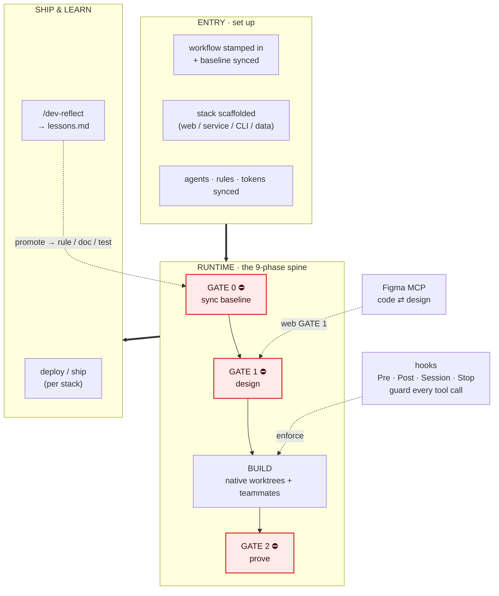
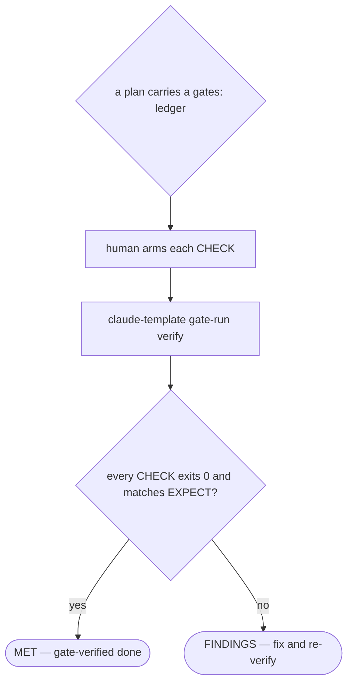
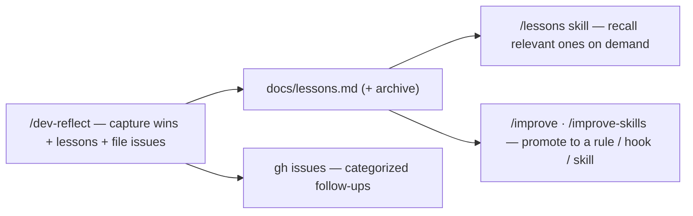
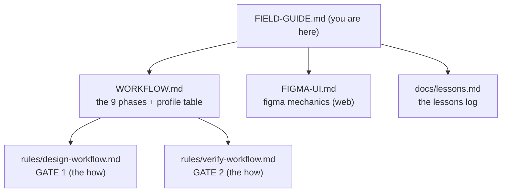

# claude_template — Field Guide

Last updated: 2026-10-18 15:04

Snapshot at `origin/main` · 14 hooks · 56 skills · 16 agents · 14 commands · 39 bin scripts · 9 core rules · 199 test suites. (Plugin versions live in `plugin.json` — not snapshotted here, to avoid per-bump drift.)

**The at-a-glance index to the whole harness — and now the single entry point** (the former `OVERVIEW.md` narrative and `workflow/DECIDING-DONE.md` "how done is decided" map have been folded in below). For depth: [`workflow/WORKFLOW.md`](workflow/WORKFLOW.md) · [`workflow/HOOKS.md`](workflow/HOOKS.md) · [`workflow/ENFORCEMENT.md`](workflow/ENFORCEMENT.md). This page is the fully-enumerated inventory — every hook, skill, script, agent, rule, and token in one place; the linked docs own the mechanics.

A scaffolding template that turns Claude Code into a disciplined autonomous engineer. Every session runs one law — **Design → Code → Prove** — held in place by 14 deterministic hooks, 56 skills, a fleet of review agents, and a runtime of shell helpers. You write the spec; the harness enforces the rest.

---

## What it is — and the two laws

claude_template is the **operating discipline** a Claude Code session inherits, regardless of stack (web · service/API · CLI/library · data). Two mechanisms catch the plausible-but-wrong before it ships: **rules** (judgment prose the model *should* follow) and **hooks** (deterministic guards a tool call *can't* evade). Everything ships as **plugins** so a scaffolded project stays thin and a whole **fleet** stays in sync from one source of truth.

The law is **Design → Code → Prove**: **GATE 0** sync the baseline · **GATE 1** design before code · **GATE 2** fresh evidence before "done". Never skipped.

**The whole machine, end to end.** Entry stamps the workflow in; the runtime carries a task through
the three gates while **hooks** guard every tool call; ship deploys it and `/dev-reflect` feeds
hard-won lessons back to the top of the next loop.

---

## The 9 phases (P0 → P8)

The full phase spine + diagram lives in `rules/workflow.md`. The only thing you decide is *how much
process*: trivial → inline (GATE 2 still applies); standard → the 9 phases; large → decompose with
writing-plans, then run the phases per step.

---

## 9 always-core rules

The stable conventions `@`-imported into every session's `CLAUDE.md` — ambient prose the model should follow. Scoped or enforceable concerns live in trigger-fired skills or hooks instead, so this list stays small.

| Rule | Governs |
|---|---|
| `workflow.md` | The canonical 9-phase Design→Code→Prove workflow + the two hard gates + the Adherence section (seven mandatory commitments) |
| `autonomy.md` | Decide-by-default; proceed on mechanical forks, stop only for real blockers |
| `engineering-conventions.md` | R4–R8: edit-over-create, justify deps, security, YAGNI, cross-repo git |
| `agent-delegation.md` | Which subagent per role; model routing; parallel-batch plan rules |
| `lean-output.md` | Default to concise chat; evidence & deliverables never trimmed |
| `mermaid-conventions.md` | Prefer inline Mermaid for flows / state / architecture over images |
| `design-workflow.md` | The *how* of GATE 1: SHAPE→grill→concrete→diagram→COVER→BUILD→REVIEW |
| `verify-workflow.md` | The *how* of GATE 2: RUN→READ→SHOW fresh evidence; silent-failure check |
| `doc-conventions.md` | D1–D3: Last-updated stamps, backfill from git, `@`-import only always-core |

---

## The 14 hooks, wired by event

Each hook is a stdlib-only Python script with a byte-parity Node twin, registered in `hook-wiring/registry/*.json`. **BLOCK** = can deny a tool call / exit-block a stop. **WARN** = injects context or nags. Per-hook detail (triggers, exit semantics, config) → [`workflow/HOOKS.md`](workflow/HOOKS.md); the gate roster and what fails CLOSED → [`workflow/ENFORCEMENT.md`](workflow/ENFORCEMENT.md).

> **Hook twins:** each Python hook (`hooks-py/hooks/*.py`) has a Node `.cjs` twin (`hooks-node/`), so a
> repo picks its stack; the only non-identical pair is `post_tool_use_lint.py` ↔ `post_tool_use_format.cjs`.
> Parity is asserted by `tests/test_hook_twin_parity.sh`.

### SessionStart (5)
| Hook | Kind | Purpose |
|---|---|---|
| `session_start` | inject | GATE-0 baseline: one fetch → behind/ahead-count + stale-local-main; H12 rules-load check; prime-gate cue; worktree prune + merged-sibling reap; concurrent-session warning; prev-session crumb; HANDOFF/TASKS. Concise reminder on compact/resume |
| `rules_refresh` | REFRESH | Byte-sync always-core `.claude/rules/*.md` from the plugin's bundled copy (startup only, clean tree) |
| `figma_launch` | inject | Opt-in: open the Figma file + talk-to-figma bridge (async) |
| `cloud_session` | inject | Cloud-only (`CLAUDE_CODE_REMOTE=true`, `startup\|resume`): docker up, lockfile re-sync, `supabase start`, `.env.local`/`.env.test`, seed, and the B2 drift check — missing `# cloud: env` keys reported by name. One stdout `systemMessage`, never a value |
| `session_autoff` | FF/WARN | Fleet-freshness Trigger B: safely fast-forward this repo's main checkout when behind — unless a peer session is on the primary (then WARN-only); sideways WARN-only if a fleet repo's claude_template plugin-source is stale. A DECLINED direct ff surfaces its reason on stdout as a `systemMessage` (a genuine up-to-date noop stays silent) |

### PreToolUse (2 wired entries) — the hard guards
Since hook consolidation PR 6, the local PreToolUse gates are ONE process, `pre_tool` — it reads stdin
once and runs every group below in a fixed order, joining all DENY reasons into one block. `pr_gate`
stays separate (network-bound). The retired names (`session_prime_gate`,
`grill_gate`, `stale_base_guard`, `tdd_gate`, `nocommit_guard`, `test_lock_enforce`,
`plan_interview_gate`, `parallel_gate`) had their forwarder files **deleted** in PR C's post-propagate
cleanup; the `pre_tool --only <name>` seam is kept for the test harness, and `pre_tool_use.py` is kept
as the stack-probe sentinel.

| Wired hook | Kind | Purpose |
|---|---|---|
| `pre_tool` | BLOCK | The single PreToolUse entry. Groups, in order: the H1–H11 guards (destructive-git, secrets, giant files — see below) · template-owned edit · plugin-cache edit (`~/.claude/plugins/**` disposable copies) · session-prime (worktree+primed) · grill (`## Grill findings`) · tdd (test-before-code) · nocommit (NOCOMMIT/debug markers) · test-lock (raw suite run) · plan-interview (`## Questions resolved`) · parallel (batch file-collisions) · stale-base (behind `origin/main`, fetch last, ≤5 s cap) |
| `pr_gate` | BLOCK | Block PR merge without code-review `APPROVE@head` + security-review + test-quality + suite `PASS@head` markers |

### PostToolUse (2) — lint, the recorders
Hook consolidation PR 4 folded 11 PostToolUse hooks into two entries; the hook diet then removed the
advisory `post_nudges` entry entirely (its guidance moved to `rules/*.md`), leaving lint + telemetry.
Each runs its modules in one process and emits at most one `systemMessage`. The retired names'
forwarder files are removed; the `--only <module>` seam is kept for the test harness.

| Hook | Kind | Purpose |
|---|---|---|
| `post_tool_use_lint` | WARN | Auto-lint / format edited files after a Write\|Edit |
| `telemetry` | log | Every tool call. Module: `tool_events` (metadata-only row to `tool-events.jsonl`). Gated by the `_telemetry_gate` opt-out. (`compact_suggester`/`loop_detector`/`capture_iterations`/`capture_failures` were removed in the hook diet.) |

> `post_nudges` (the 8-module WARN hook: `skill_nudge`, `grill_nudge`, `parallel_nudge`,
> `scope_creep`, `suite_overrun_nudge`, `rtk_nudge`, `merge_autoff`, `spawn_count_nudge`) and
> `context_nudge` (SubagentStop) were removed in the hook diet — their guidance now lives in
> `rules/*.md` (`agent-delegation.md`, `engineering-conventions.md`, the `rtk` skill).

### Stop (1) — the recorders

| Hook | Kind | Purpose |
|---|---|---|
| `stop_record` | log | Module: `stop_log` (session-log row). (`cost_telemetry` and `improvement_proposer` were removed in the hook diet.) |

> `stop_gate` (which had folded `close_issue_gate`, `close_gate`, `docs_gate`, `plan_gate` into one
> Stop-event BLOCK) was removed in the hook diet — its CLOSE-phase intent (file follow-ups, run
> `/dev-reflect`, reconcile docs, close out a plan's checked boxes) now lives in `rules/*.md` as
> discipline, not a machine BLOCK. GATE-2's enforced teeth remain in `pr_gate`'s review panel +
> merge axes.

### PreCompact / SessionEnd (1)
| Hook | Kind | Purpose |
|---|---|---|
| `session_crumb` | log | Write a session crumb for later resume |

### WorktreeCreate / WorktreeRemove / TeammateIdle (3)
| Hook | Kind | Purpose |
|---|---|---|
| `worktree_create` | block | Provision a worktree: fetch, `.env` carry-in, SETUP install, collision-free PORT |
| `worktree_remove` | block | Back up untracked files + an uncommitted patch, free the PORT |
| `teammate_idle` | inject | Keep an idle teammate working while it still owns tasks |

---

## The H-guards (inside `pre_tool`)

The single most-loaded hook runs a numbered battery of command checks — **H1–H11** (H4 retired) plus **H-prune**. Full semantics + bypasses → [`workflow/ENFORCEMENT.md`](workflow/ENFORCEMENT.md).

| Guard | What it does | Kind |
|---|---|---|
| H1 | Deny bare test-runner invocations unless wrapped in `bin/test-lock -- …` | BLOCK |
| H2 | Enforce conventional-commit `type(scope)!: subject` grammar on inline `git commit -m` | BLOCK |
| H3 | Secret-scan a staged diff (AWS key, private-key header, generic token) | BLOCK |
| H5 | PR-review reminder at merge time | inject |
| H6 | Docs-staleness reminder at commit time | inject |
| H7 | Danger-guard: block force-push to main, `git reset --hard <remote>`, `rm -rf` | BLOCK |
| H8 | Protected-branch: block `git commit` when on main / master | BLOCK |
| H9 | Block staging a file over `CT_MAX_FILE_MB` (default 10) via git add / commit | BLOCK |
| H10 | Block staging a secret *file* by name (`.env*` allow-list) — complements H3 | BLOCK |
| H11 | Block *reading* an obviously-secret file (`cat .env`, `~/.ssh/id_rsa`) | BLOCK |
| H-prune | Nudge that `git worktree prune` only clears DEAD worktrees | inject |

---

## bin/ scripts

**SCAFFOLD** = shipped into every project · **PLUGIN** = runs at project runtime via the `claude-template <helper>` dispatcher · **SOURCE** = template-maintenance only.

| Script | What it does | Class |
|---|---|---|
| `claude-template` | Dispatcher that resolves & execs plugin-runtime `bin/` helpers from the plugin cache | PLUGIN |
| `plugin-doctor` | Report/fix `installed_plugins.json` drift — DEAD/STALE/LEGACY entries, MAIN-BEHIND marketplace dirs | PLUGIN |
| `test-lock` | Per-repo suite serialization — atomic mkdir mutex; exit 75 on contention, or `--wait` to queue FIFO | SCAFFOLD |
| `run-py-hook` | Resolve a Python ≥3.11 interpreter and exec a hook through it — kills uv's per-hook startup tax | SCAFFOLD |
| `gate-run` | Canonical-env wrapper around the gate executor (`arm` / `verify` / `status`) | PLUGIN |
| `stamp-docs.sh` | Enforce / backfill `Last updated:` doc stamps from git history | SCAFFOLD |
| `git-merge-docstamp.sh` | Surgical merge driver that auto-resolves stamp-only conflicts | SCAFFOLD |
| `git-merge-plugin-version.sh` | Surgical merge driver: a version-only plugin-manifest conflict → max+1, the fingerprint stays a conflict to regenerate (#963) | SOURCE |
| `pr-merge-recover` | Finish `gh pr merge` cleanup after a local-cleanup failure; verifies MERGED, then safely ffs the primary's trunk (#924) | PLUGIN |
| `cron-run.sh` | Sync an `origin/main`-pinned worktree, then exec a scheduled command | SCAFFOLD |
| `workflow-diagrams` | Collect the repo's committed Mermaid blocks into a browsable HTML page | SCAFFOLD |
| `docs-drift.sh` | Verify narrative docs against live code; report drift | PLUGIN |
| `churn.sh` | Rank files by git touch-count for refactor targeting | PLUGIN |
| `agent-spend` | Per-agent spawn-count report from `.claude/telemetry/tool-events.jsonl` (counts only, no cost); `--session <id>` narrows | PLUGIN |
| `classify-ownership.sh` | Single source for which repo owns an asset | PLUGIN |
| `harvest.sh` | Reverse harvest: sweep managed repos for meaningful drift from template-owned files, local-LLM triage → human-gated /improve proposals | ROOT |
| `fanout-status` | Integrate-readiness across leaf gate ledgers (ALL MET) | PLUGIN |
| `mutation-check` | Negative control — break a covered line, prove the test goes RED, restore | PLUGIN |
| `test-quality-run` | Run a gate ledger → emit the `test-quality:PASS@sha` marker | PLUGIN |
| `gate/gate-check.mjs` | Execute gate oracles, update evidence, coordinate scopes & leases | PLUGIN |
| `gate/gate-lint.mjs` | Audit whether a gate ledger is worth passing | PLUGIN |
| `sync-generated.sh` | One command to regen / `--check` every derived artifact | SOURCE |
| `sync.sh` | Unified sync dispatcher: `rules`/`tokens` (human-run) + `plugin-rules`/`plugin-bin` (derived, `--check`) | SOURCE |
| `build-hook-wiring.sh` | Regenerate hook wiring JSON from the registry fragments | SOURCE |
| `hooks-fingerprint.sh` | Couple the hooks-plugin version to a hook-content SHA | SOURCE |
| `parity-cache-check` | Compare installed plugin-cache hooks against repo hooks | SOURCE |
| `build-cloud-bundle.sh` | Validate core plugin assets against the cloud-bundle allowlist | SOURCE |
| `cloud-env-block` | Names-only secrets helper: builds a claude.ai cloud environment's env block from a repo's dev env file | SOURCE |
| `harness-sweep` | Read-only fleet audit of template-managed repos | SOURCE |
| `harness-fix` | Write-side: refresh drift-flagged fleet repos via setup.sh | SOURCE |
| `fleet-sweep.sh` | One command to roll the current template to the fleet AS PRs: per apply-safe repo (from `propagate.sh --manifest-only`) delivers content via `propagate --apply --only`, then on any working-tree change branches · stages ONLY propagate's delta (tracked mods + newly-appeared untracked paths, snapshot-diffed so pre-existing untracked dirt the manifest permits is never swept in) · commits · pushes · `gh pr create`; idempotent on an **open PR** for the sweep branch (a stray branch without a PR is retried, not skipped), `--dry-run` shows each repo's propagate plan, `--only`/`--branch`/`--root`. Fail-soft, each FAIL carrying its reason. Stops at the PR (self-authored merges are classifier-gated to the user) | SOURCE |
| `agent-roster` | Regenerate the sub-agent roster table from agent frontmatter | SOURCE |
| `plugin-dev-link.sh` | Point the installed core plugin at this local checkout (dev link) | SOURCE |

### Plugin installs

`~/.claude/plugins/installed_plugins.json` drifts: dead project-scope entries pile up after a
worktree is removed, and a repo's project-scope install wins over the user-scope one so it can stay
pinned to an old version. `claude-template plugin-doctor --check` (or `--apply`) reports/fixes
DEAD/STALE/LEGACY entries and a MAIN-BEHIND marketplace dir — fast-forward the primary checkout's
main first, it's never auto-fixed. `worktree_remove` prunes a removed worktree's own entries on its
own. `/project-status` and `/cleanup` run the check automatically when the helper is available.

---

## 56 skills

Packaged procedures the model invokes as its task matches them — the Superpowers engine plus this template's own. Zero token cost until their trigger context appears.

**Workflow & process (11):** `context-map` · `what-context-needed` · `refactor-plan` · `component-refactoring` · `codebase-design` · `design-an-interface` · `depth-fanout` · `gates` · `loop-me` · `wait-test` · `field-guide`

**Design & frontend (10):** `design-import` · `figma-bridge` · `figma-ui` · `shadcn-figma-kit` · `site-to-figma` · `frontend-code-review` · `frontend-testing` · `e2e-tester` · `local-browser-testing` · `web-accessibility`

**Testing & verification (4):** `tdd` · `code-review` · `security-review` · `model-routing-audit`

**Interview & grilling (6):** `grill-me-interview` · `grill-me-socratic` · `grill-with-docs` · `grilling` · `interview-me` · `to-questionnaire`

**GitHub & issues (4):** `github` · `github-solve-issues` · `prd-to-issues` · `triage`

**Docs & memory (9):** `create-readme` · `conventional-commit` · `meeting-minutes` · `remember` · `claude-handoff` · `notebooklm` · `graphify` · `stop-slop` · `lessons`

**Meta & self-improvement (9):** `audit-claude-code` · `improve` · `improve-skills` · `skill-audit` · `skill-creator` · `skill-reinvent` · `context-floor-audit` · `hook-creator` · `unlazy`

**Shell & lint (3):** `shell-scripting` · `ruff-fix` · `rtk`

---

## Three plugins

- **claude-template-core** — canonical workflow assets: 56 skills, 16 agents, 14 commands, the `scripts/` runtime helpers (via dispatcher), and the `docs/workflow/*` reference docs.
- **claude-template-hooks-py** — Tier-1 workflow hooks on the Python runner, synced from canonical `hooks/`.
- **claude-template-hooks-node** — the same 14 hooks on the Node runner, a byte-parity twin.

You edit the canonical `hooks/` sources and run the sync; both hook plugins stay parity twins, and a fingerprint couples each plugin version to its hook content so a SHA-pinned cache can never serve stale hooks.

---

## 14 commands

`/validate` · `/pr-open` · `/merge-prs` · `/dev-reflect` · `/handoff` · `/prime-core` · `/project-status` · `/verify-adversarial` · `/questionnaire-me` · `/workflow-diagrams` · `/cleanup` · `/ui-aliveness-audit` · `/triage-lessons` · `/write`

---

## 16 subagents

Two own **gating verdicts** (the `PASS@head` markers the merge gate demands); the rest are advisory/exploratory. All review agents are read-only.

- **Gating:** `code-reviewer`, `security-reviewer`, `test-quality-reviewer`
- **Review (advisory):** `silent-failure-hunter` (may escalate), `code-simplifier`, `comment-analyzer`, `docs-impact-agent`, `pr-test-analyzer`, `type-design-analyzer`
- **Design/explore:** `test-designer`, `codebase-explorer`, `critical-thinking`, `web-researcher`, `playwright-tester`
- **Crew:** `crew-coordinator` (never edits source), `crew-implementer` (owns all source edits)

---

## The gate lane

Attended-only: a plan's `gates:` acceptance ledger (`skills/gates/SKILL.md`) makes "done"
command-verified instead of self-attested. A gate is MET only when its `CHECK` exits `0` and matches
`EXPECT` — the anti-theater property — and the human arms each CHECK (`claude-template gate-run
verify`) rather than a Stop hook re-feeding unchecked boxes unattended. The autopilot/ralph unattended
lane (`build_loop`, `unattended_answer`, `/autopilot`, `/ralph-loop`, `/ralph-plan`) was removed —
the attended gate lane is the sole surviving "done" mechanism alongside GATE-1's rendered-pixel Figma
approval (`FIGMA-UI.md`'s design → preview → Figma validation loop). Both serve the same law: "done"
is fresh evidence this turn, never the agent's say-so.

---

## setup.sh & the files a project carries

`setup.sh` bootstraps a new project with the canonical workflow — it stamps `CLAUDE.md`, `project-context.md`, the `.claude/` config + hooks + rules, and installs the `bin/` helpers. Reference docs ship plugin-native, so setup prunes stale local copies. It is idempotent and re-runnable.

**Key flags:** `--update` (refresh workflow/reference docs only, never project-owned files) · `--update-hooks` (refresh `.claude/hooks` + rules) · `--init-missing` (reconcile `settings.json` hook wiring) · `--dry-run`/`-n` (preview) · `--force`/`-f` (bypass the dirty-tree guard).

| File | Holds |
|---|---|
| `CLAUDE.md` | The root instructions: two laws + stack/commands + the always-core `@`-imports |
| `project-context.md` | The "constitution" every implementation agent loads |
| `.claude/worktrees.conf` | Per-repo config: SETUP, PROFILE, BASE_PORT, TEST_CMD, FIGMA_LAUNCH, DOCS_GLOBS, DOCS_HISTORICAL |
| `.claude/settings.json` | Permissions + enabled plugins + hook wiring |
| `HANDOFF.md` | Gitignored session-continuity note; validated by nothing |
| `docs/lessons.md` | The lessons-learned log, appended by `/dev-reflect` at CLOSE |
| `.claude/telemetry/tool-events.jsonl` | Metadata-only tool-event log, gitignored; consumed by `/improve` |
| `.claude/telemetry/suite-durations.jsonl` | Per-case-file suite wall-clock (one row per file: `ts`·`session_id`·`file`·`seconds`·`jobs`·`mode` full/subset), written by the test runner, gitignored; trended by `/improve` to spot the slowest suites and summed per-session by the `bin/session-friction` digest (`suite_time:` line) |

---

## The fleet & cloud system

**"Managed repos"** are the ~17–18 fleet repos marked by `.claude/worktrees.conf`, all sharing one source of truth — the global rules plus this template's committed plugins. The propagation loop keeps them from drifting:

- **`harness-sweep` → `harness-fix`** — a read-only audit classifies every repo (managed / dirty / drifted); the write side refreshes the drift-flagged, manifest-safe ones via `setup.sh --update-hooks` (dry-run by default, `--apply` to write).
- **Cloud delivery (`CLOUD_VENDOR=1`)** — a cloud session's repo clone carries no installed plugins, so a repo opted in with `CLOUD_VENDOR=1` (`.claude/worktrees.conf`) receives a **copy of the committed `plugins/` tree** plus `scripts/cloud-materialize.sh` (cloud-devendor T6). A cloud SessionStart regenerates the gitignored `.claude/{skills,agents,commands,hooks}` from `plugins/`; skills/commands/agents also load from the account `@synced` marketplace. `CLOUD_VENDOR=0` removes the copy-delivered tree. (The earlier filtered-vendoring path — `bin/vendor-tooling.sh` + a `vendor.lock`, plus `fleet-vendor-audit.sh` — was retired in #1296; a stray legacy `vendor.lock` is dropped from the index on the next `propagate --apply`.) Cloud hooks load only in **single-repo** sessions — a multi-repo cloud session never sees them. What stays laptop-only regardless (global `~/.claude` rules/`CLAUDE.md`/`RTK.md`, local model runners, LSPs, the chrome-devtools browser) and the rest of this per-project contract is `docs/CLOUD.md`, generated by `setup.sh` into each scaffolded project.
  - **Delivering new template content to a managed repo is a propagate `--apply`, not a plugin update.** A repo that still disables the plugin sets `enabledPlugins.<plugin>:false` (G0: project scope beats user scope), so `claude plugin update` is **inert** for it. The fleet refresh is **`propagate.sh --apply`**, which **copy-delivers `plugins/`** to every `CLOUD_VENDOR=1` repo. `claude plugin update` only reaches genuinely plugin-served repos (`enabledPlugins:true`).
- **`cloud-env-block`** — the companion for app secrets: builds a claude.ai cloud environment's env block from a repo's dev `.env*`, driven by `.env.example`'s `# cloud: env | credential | skip` markers. Prints key names only; values go to the clipboard, cleared after a delay, and it refuses a `.env.prod` source. `ANTHROPIC_API_KEY`, which claude.ai drops from cloud sessions, is exported as `CLOUD_ANTHROPIC_API_KEY`.
- **`build-cloud-bundle.sh`** — validates the core plugin's skills/commands/agents against the `cloud-bundle.yaml` allowlist (`--check`, never mutates).
- **`parity-cache-check`** — compares installed plugin-cache hooks against the repo's plugin hooks; fails loud on divergence.

---

## Lessons & self-improvement

The harness closes its own feedback loop — a mistake becomes a captured lesson, an on-demand recall, and eventually an enforced guardrail.

**Capture** at CLOSE (`/dev-reflect`) — appends to `docs/lessons.md` AND files each surfaced follow-up as a categorized GitHub issue (reading per-session friction from `bin/session-friction`), **recall** on demand (the `/lessons` skill surfaces lessons by keyword relevance when you ask — no longer pushed into every prompt), **promotion** when a lesson recurs (`Seen ≥3×`) — `/improve` mines it plus telemetry into human-gated proposals for rules, hooks, or `CLAUDE.md`; `/improve-skills` applies the skill-targeted ones. A lesson that lives only in the log forever is one nobody acted on.

---

## WORKFLOW bypass tokens

Every hard gate has a named override — drop the token in the commit / merge command for a genuinely trivial case. They exist for the exception, not to route around a gate under time pressure. Which gate each fails CLOSED and the full roster → [`workflow/ENFORCEMENT.md`](workflow/ENFORCEMENT.md) (exception: `WORKFLOW:no-rebase-check` works only on a merge commit — otherwise stash → `git merge origin/main` → apply).

| Token | Bypasses |
|---|---|
| `WORKFLOW:no-grill` | grill_gate |
| `WORKFLOW:no-design` | design gate |
| `WORKFLOW:no-interview` | plan_interview_gate |
| `WORKFLOW:no-parallel` | parallel_gate |
| `WORKFLOW:no-tdd` | tdd_gate |
| `WORKFLOW:no-verify` | verify gate |
| `WORKFLOW:no-review` | review panel |
| `WORKFLOW:no-security` | pr_gate security-review |
| `WORKFLOW:no-test-quality` | pr_gate test-quality |
| `WORKFLOW:no-suite` | pr_gate suite |
| `WORKFLOW:no-nocommit` | nocommit_guard |
| `WORKFLOW:no-rebase-check` | stale_base_guard (merge commits only — ignored on a normal commit) |
| `WORKFLOW:no-worktree` | session_prime_gate (isolation check) |
| `WORKFLOW:no-prime` | session_prime_gate (primed check) |
| `WORKFLOW:force-merge` | pr_gate merge block |

---

## The sync & drift system

Because the template fans out to a fleet, every derived artifact has a deterministic regenerate-and-`--check` path. Drift fails loud rather than rotting silently.

- `sync-generated.sh` — orchestrator: regen / `--check` all derived artifacts in order.
- `sync.sh` — unified sync dispatcher (`rules`/`tokens` + the derived `plugin-rules`/`plugin-bin`, driven by `sync-generated.sh`).
- `build-hook-wiring.sh` — regen the hook wiring JSON from registry fragments into both hook plugins.
- `hooks-fingerprint.sh` — record `version=V sha=S` so a SHA-pinned cache can't serve stale hooks.
- `parity-cache-check` — compare installed plugin-cache hooks vs repo hooks; fail loud on divergence.
- `build-cloud-bundle.sh` — validate core plugin assets against the cloud-bundle allowlist.
- `stamp-docs.sh` — enforce / backfill `Last updated:` stamps from git history.
- `docs-drift.sh` — verify narrative docs against live code (deterministic detectors).

---

## Doc map — which page when

| Doc | Read it when |
|---|---|
| [`workflow/WORKFLOW.md`](workflow/WORKFLOW.md) | new here, or the canonical 9-phase workflow + stack profiles |
| `rules/design-workflow.md` | satisfying GATE 1 (idea → approved design) — the always-core rule; `workflow/FIGMA-UI.md` is its web-only Figma-mechanics companion |
| `rules/verify-workflow.md` | satisfying GATE 2 (proving it works) — the always-core rule |
| [`workflow/FIGMA-UI.md`](workflow/FIGMA-UI.md) _(web)_ | Figma-MCP mechanics, quota strategy |
| [`workflow/HOOKS.md`](workflow/HOOKS.md) / [`workflow/ENFORCEMENT.md`](workflow/ENFORCEMENT.md) | per-hook detail + the gate roster |
| `docs/lessons.md` | the hard-won lessons log |
| `/workflow-diagrams` | run this command to generate this project's browsable page of every committed Mermaid diagram, by topic |

---

*A living map of a moving harness — counts and versions drift with every merge. Generated from a live-verified inventory of the codebase at `origin/main`. Interactive version available as a Claude artifact.*
