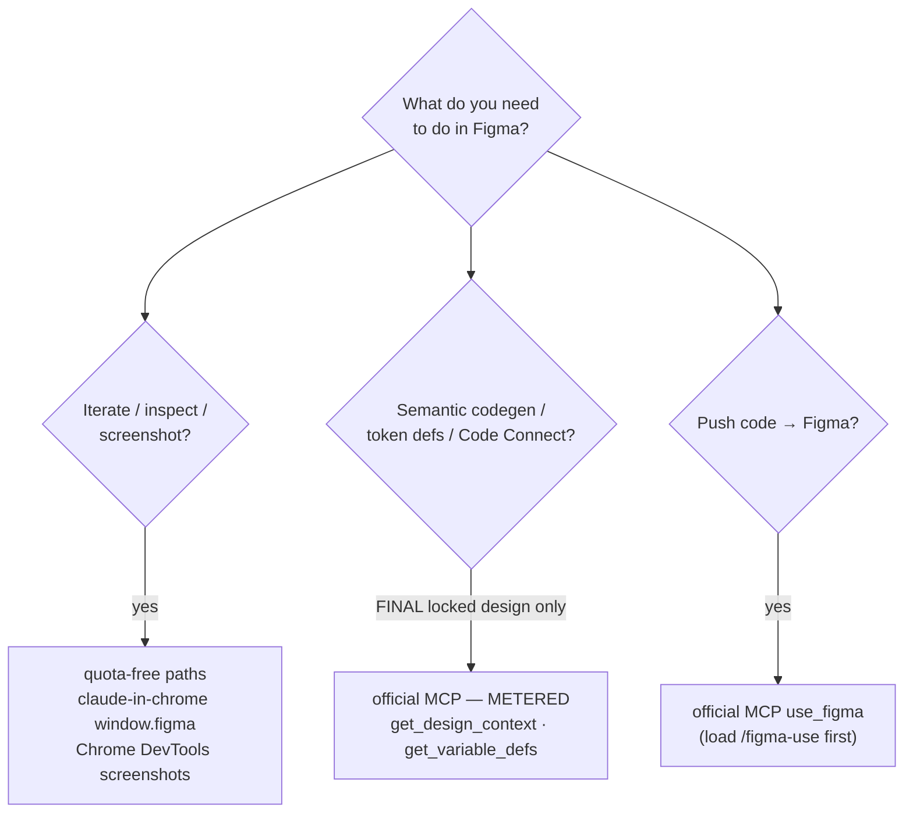
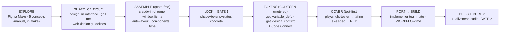
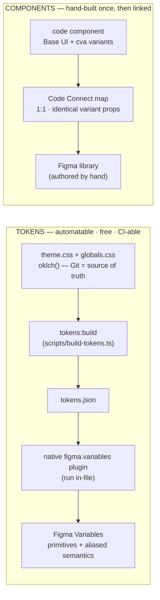
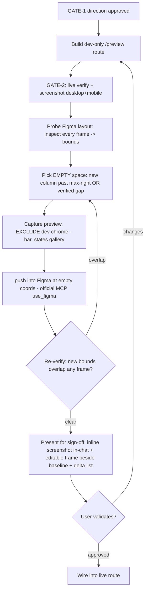

# Figma → Make-Quality UI (the _how_ of DESIGN-WORKFLOW's VISUAL/TOKENS → BUILD legs)

Last updated: 2026-10-13 22:26

Slots into `rules/design-workflow.md` between **VISUAL/TOKENS** and **BUILD**, and is the **single home**
for Figma-MCP mechanics (don't spawn sibling docs — extend this one). Goal: Figma-Make-grade UI out
of Claude Code while keeping **GATE 1** (approved design) and **GATE 2** (fresh evidence) intact
(`WORKFLOW.md`). `CLAUDE.md` wins; gates never skipped. Primary direction is **Figma → code**; the
**reverse leg** (code → Figma mirror) is the last section.

> **Consolidation note:** the old local **talk-to-figma** _loose scripts_ (`svg-to-figma`,
> `tokens-to-figma`, `page-to-svg`, `set_variable`, etc.) are consolidated into ONE CLI — the
> **`figma-bridge` skill** (`plugins/claude-template-core/skills/figma-bridge/`), still driving the
> quota-free relay (websocket `:3055`, per-project `FIGMA_CHANNEL`; the `figma_launch` hook brings it
> up). Use `figma-bridge` for relay-based token-sync / page→svg / rebind work. The two higher-fidelity
> paths are unchanged: the **official Figma MCP** (`claude_ai_Figma` — `get_design_context`,
> `get_variable_defs`, `use_figma`, Code Connect, `get_screenshot` — metered) and **claude-in-chrome**
> (the `window.figma` browser path and Chrome DevTools screenshots — quota-free).

> **Thesis — best practice:** quality comes less from a better prompt than from **Code Connect** —
> with it, `get_design_context` emits your _actual_ components instead of guessing. Treat it as the
> highest-value thing to _try first_; the design brief matters too (see _Design brief_), just second.

## One split: quota-free first, metered reads last

The **official Figma MCP** owns everything semantic, but its reads are metered
(**~6 reads/month on Starter** ⚠️ _verify current Figma metering — it changes_). Everything
iterative goes through the **quota-free** paths first:

| Need | Path | Cost |
| --- | --- | --- |
| Iterate on a design IN Figma | **claude-in-chrome** `window.figma` (logged-in tab) | 0 |
| Screenshot the live app | **Chrome DevTools MCP** @`127.0.0.1:PORT` | 0 |
| Port a design that already exists as code | serve + render the export | 0 |
| Semantic codegen from the FINAL design | official MCP `get_design_context` | **metered** |
| Token definitions from the FINAL design | official MCP `get_variable_defs` | **metered** |
| Component ↔ code mapping | official MCP Code Connect suite | **metered** |
| Push code/designs INTO Figma | official MCP `use_figma` / generate-design | seat-dependent |

**Never spend the Figma MCP quota (≈6 calls/month on Starter) on iteration — only on the final,
approved design.** The canonical free→paid ladder:

| Path                                                                                                   | Cost      | Fidelity                  | Use when                                                                                   |
| ------------------------------------------------------------------------------------------------------ | --------- | ------------------------- | ------------------------------------------------------------------------------------------ |
| **Port a Claude Design / Figma-Make export** (`DesignSync get_file` the React export → serve → render) | **0**     | exact (it _is_ code)      | the design already exists as code — the most faithful path                                 |
| **`window.figma` browser API** (`mcp__claude-in-chrome__javascript_tool`, logged-in tab)               | **0**     | exact (native plugin API) | iterating in Figma — bypasses the 6/month quota **and** the 3-page cap, unlimited          |
| **Chrome DevTools MCP / Playwright** (own browser, `http://127.0.0.1:PORT`)                            | **0**     | exact render              | screenshotting the live app — immune to the blocked extension (the `local-browser-testing` plugin skill) |
| **`html.to.design`** plugin (incl. localhost extension)                                                | **0**     | ~70-80%                   | bootstrap a running site → editable Figma layers for review                                |
| **Figma MCP `get_design_context` / `get_variable_defs`**                                               | **quota** | 95%+ semantic             | one-shot codegen / token-sync from the FINAL design (unlimited on a Dev seat)              |

### The Variables nuance

Full-fidelity Variables (**aliases + light/dark modes**) come from a **native `figma.variables.*`
plugin run inside the file** (an imported dev plugin running in the plugin sandbox, where
`figma.variables` actually exists). It creates OKLCH→sRGB primitives plus aliased semantics — e.g.
`red/600` resolving to a Tailwind v4 value and `semantic/primary` as a true `VARIABLE_ALIAS` → its
primitive. ⚠️ `figma.variables` via `window.figma` in a plain logged-in **page** tab does not
work — the plugin API lives in the sandbox, not the page `window`. Use the imported-plugin path.

### Native variable plugin — gotchas + how to verify

- **`documentAccess: dynamic-page` → use the ASYNC reads.** Under it, the sync
  `figma.variables.getLocalVariableCollections()` / `getLocalVariables()` **throw**. Use
  `getLocalVariableCollectionsAsync()` / `getLocalVariablesAsync()` and `await` them (creates /
  `setValueForMode` stay sync).
- **Run it in a FRESH draft.** Re-running into a file that already has a same-named collection
  (e.g. `tw/colors`) **merges** into it — messy. A blank draft = a clean system.
- **Verify the push — spot-check anchors, never just "it ran":** a known token resolves to the
  right value (Tailwind v4 `red/600` = `#e7000b`, not v3 `#dc2626`), and a semantic token is a real
  `VARIABLE_ALIAS` → its primitive (`primary` → `neutral/900`), not a flat color. ⚠️ The official
  MCP's `get_node_info`-style reads can strip `boundVariables` — verify bindings from inside the
  file (the plugin / `window.figma`), or you'll chase a phantom "unbound" gap.

## The pipeline (maps onto DESIGN-WORKFLOW's stages)

| Stage            | DESIGN-WORKFLOW leg   | Skill / agent                                                                                                                                                                                                      |
| ---------------- | --------------------- | ------------------------------------------------------------------------------------------------------------------------------------------------------------------------------------------------------------------ |
| EXPLORE          | pre-SHAPE ideation    | Figma Make (manual) — ideation > codegen; official MCP can later fetch the Make project as a resource (Make → production is one hop)                                                                               |
| SHAPE + CRITIQUE | SHAPE + PRESSURE-TEST | `design-an-interface` (Design-It-Twice) → **`grill-me`** as the design critic (score 1–10, revise once) + `web-design-guidelines`. The blog's "design-critic agent" is already these skills — no new agent needed. |
| ASSEMBLE         | VISUAL/TOKENS         | claude-in-chrome `window.figma` (quota-free): frames, auto-layout, component instances, typography. Iterate free.                                                                                                  |
| LOCK             | GATE 1 approval       | shape + tokens + key states concrete enough to build without guessing                                                                                                                                              |
| TOKENS+CODEGEN   | VISUAL/TOKENS → BUILD | official MCP, the metered reads: `get_variable_defs`, `get_design_context`, Code Connect                                                                                                                           |
| COVER            | COVER (test-first)    | after LOCK/tokens, before BUILD: `test-designer` → coverage, then `playwright-tester` writes a failing `e2e/*.spec.ts` against the approved flow → **run it alone → RED** (⚠ not `/validate` — that's the P4 gate). Hands the red spec to BUILD. |
| PORT → BUILD     | BUILD                 | the implementer teammate; `WORKFLOW.md` BUILD→VERIFY owns it, turning the COVER red spec green. MCP output is a _representation_: swap raw Tailwind for design-system tokens, reuse `src/components/ui`.           |
| POLISH+VERIFY    | POLISH + REVIEW       | `ui-aliveness-audit` (reduced-motion-gated) → **GATE 2**: drive the live site, screenshot as evidence. Figma carries ~0% of the dynamic UI.                                                                        |

## Code Connect — the highest-leverage 20 minutes (try first, then measure)

One-time; then `get_design_context` emits _your_ components instead of guessing. Run it and confirm
the codegen actually references `src/components/ui` before treating it as the default:

1. `get_code_connect_suggestions` → Figma proposes node↔component maps against your repo.
2. Review → `send_code_connect_mappings`; `add_code_connect_map` for manual ones.
3. Capture the resulting design-system conventions yourself into `skills/figma-ui/SKILL.md` (this repo's
   per-change checklist; there is **no** `create_design_system_rules` MCP call) so later
   `get_design_context` codegen stays consistent.

For the CLI path (outside the MCP), the web profile scaffolds **`bin/code-connect.sh`** +
`figma.config.json`; the full runbook is **`CODE-CONNECT.md`** (this dir). ⚠ Code Connect
publish/view/MCP-read are **paid** — Figma Org/Enterprise + Dev seat; `parse`/`dry-run` are free. It's
a scoped per-project exception to the no-paid-SaaS default, never on by default.

## Design brief + two-pass critique (the prompt half)

Don't ask "design a screen" — brief Claude as a **senior designer inside an existing system**, then
critique once.

- **Brief:** persona ("Staff Product Designer"), references (Linear/Stripe/Vercel/Notion), hard rules
  (8pt grid, ≤4 type styles, auto-layout everywhere, whitespace over borders, accessible contrast,
  variables not raw values), output (mobile-first, design-system components).
- **Structure before visuals:** user goals → IA → wireframe → hi-fi. Don't jump to a screen.
- **Two-pass:** generate → `grill-me` (score hierarchy/spacing/alignment/consistency/a11y/balance
  1–10, propose fixes) → revise once. Beats model-swapping.
- **Reuse, don't invent:** read real components + tokens first; assemble from them.

## Project wiring

The one-project/one-Figma-file/one-default-channel setup (the patched panel hosts multiple channels
in one window — default 5 rows named `<fileKey>_<fileName>_1..5`, where fileKey = the open file's
immutable `figma.fileKey`; row 1 auto-joins that base, which the CLI then auto-discovers from the relay
`/status` endpoint (name-agnostic), falling back to the offline default `<FIGMA_FILE_KEY>_<folder>` only
if the relay is unreachable; an unsaved file with no key falls back to the file name alone; extra rows
are manual additions for parallel agents), the `figma_launch` SessionStart hook (macOS
auto-run, `FIGMA_AUTOLAUNCH_PLUGIN` gating), and the `FIGMA_FILE_KEY`/`FIGMA_LAUNCH` conf keys are
covered in `rules/design-workflow.md`'s "Project file + channel" section — not restated here.

**Pin the expected file (`FIGMA_FILE_FINGERPRINT`).** To catch a wrong file loaded at launch, record
the file's fingerprint once: with the intended file open and the plugin connected, run
`node plugins/claude-template-core/skills/figma-bridge/scripts/figma/figma.mjs probe --channel=<channel>`
and copy the `fileKey` (8-hex) into `FIGMA_FILE_FINGERPRINT` in `.claude/worktrees.conf`. `figma_launch`
then WARNs + skips its screenshot on a mismatch at the next session start (fail-open; see
`docs/workflow/HOOKS.md`).

## The reverse leg — code → Figma (design system as a derived mirror)

When **code is canonical** and you want a Figma library that mirrors it. The trap: "source of truth"
is **two** questions, and fusing them is how design and code silently diverge.

**Rule:** don't let the styled set own the tokens. Promote tokens to a first-class artifact with **one
origin** that generates _both_ the Tailwind theme and the Figma Variables. Components are
code-canonical; Figma is a **mirror**, not an authoring surface. Base UI is **headless** — Figma
mirrors only the _skin_ (Tailwind + tokens + variant matrix); your `cva`/`tailwind-variants` config is
the machine-readable bridge (each variant axis → a Figma component property with identical values, or
silent desync).

> **Portable full-fidelity token bridge (shadcn/ui + Tailwind v4 → Figma Variables):** the shape is
> a `buildTokens(theme.css, globals.css)` step → `tokens.json` (OKLCH→sRGB primitives + light/dark
> **aliased** semantics), a `tokens:build` npm script, and a native `figma.variables` plugin (import
> its manifest once in the project's Figma file, Run). `globals.css` stays the single source of
> truth; Figma Variables are the derived mirror, so designs use exactly the values the code renders.
> **Keep it honest:** after every `tokens:build` + plugin-import cycle, run a `tokens:verify` step
> that diffs the LIVE Figma Variables against `tokens.json` and fails loud on drift. On Starter,
> Figma holds the **light mode only** (the semantic collection's mode is named `light`; dark values
> live in `tokens.json` until `FIGMA_INCLUDE_DARK=1` on a paid plan). Re-imports are idempotent.

Pushing a rendered page/component INTO Figma goes through the official MCP (`use_figma` /
generate-design — load `/figma-use` first), not the retired SVG-relay scripts. Any pushed
capture is a **flat snapshot, no library link** — a mockup, not a system. **No tool** turns a code
library into a maintainable, variant-structured Figma library: author it **once**, keep it 1:1 via
Code Connect, **never wholesale-regenerate** per push. Tokens flow automatically; structure doesn't.

### Design → preview → Figma validation loop

GATE-1 approves a *render*, not a mechanism — so sign off a NEW design **beside** its baseline via
this loop, wiring the live route only after the pixels are approved (the two annotations below carry the
non-obvious steps):

- Sign-off is an **editable frame** beside the baseline (not only an inline screenshot); exclude
  dev-only chrome (DEV PREVIEW bar / STATES gallery) from the capture.
- Placing "beside the baseline" naively **collides** in a tiled file — probe bounds, place in
  verified-empty space, re-verify no overlap (never `x = baseline_width + gap`).

### Seat wall (Starter)

- **Tokens → Variables: free** (native plugin, full fidelity).
- **Writing a component _library_ into a shared file: needs a Full seat** (write outside drafts).
- Net: a fully-automated code→Figma _component_ generator is both technically unsolved _and_ paywalled
  here. Wire the **token** half today; treat the component library as a hand-maintained,
  Code-Connect-linked mirror.

## Use cases — what to do when you have…

A cookbook: match your situation to the move.

| You have / want                                     | Do this                                                                                                                                                                                                                                                                                          |
| --------------------------------------------------- | ------------------------------------------------------------------------------------------------------------------------------------------------------------------------------------------------------------------------------------------------------------------------------------------------ |
| **To export / "extract" an asset**                  | **Keep it vector** (SVG/PDF) whenever possible — resolution-free + editable. Rasterize (PNG) only when the target needs it, and **pick scale by purpose: preview `0.3–0.6×`, web `1×`, retina/print `2–3×`. NOT "always high-res"** — big files for a glance-once screenshot is waste.            |
| **A diagram to make**                               | **Pick the surface by audience.** _Docs / version-controlled / PR-reviewable_ → **mermaid** (flowchart/sequence in the `.md` — this doc's diagrams are mermaid). _Collaborative whiteboard / user-flow / IA you'll iterate on with people_ → **FigJam**: the official MCP's `generate_diagram` to create, `get_figjam` to read one back into requirements. Rule: **mermaid = code-as-truth in Git, free; FigJam = visual collaboration in Figma.** |
| **A flow / IA / system map to iterate with others** | FigJam via `generate_diagram`, then implement from it (it's a thinking surface, not the source of truth).                                                                                                                                                                                         |
| **A Figma design to implement as code**             | `get_design_context` (+ Code Connect first) — see the checklist. Output is a _representation_: swap to design-system tokens, reuse `src/components/ui`.                                                                                                                                          |
| **A live page to bring into Figma**                 | official MCP `use_figma` / generate-design (load `/figma-use` first); screenshot references via Chrome DevTools MCP.                                                                                                                                                                             |
| **Tokens in Figma**                                 | the native `figma.variables` plugin (aliases + light/dark modes) — see the token bridge above.                                                                                                                                                                                                    |

## See also

`rules/design-workflow.md` (parent pipeline + project wiring) · `WORKFLOW.md` (the two laws — GATE 1/2) ·
`verify-workflow.md` (GATE 2) · `agent-delegation.md` · the `local-browser-testing` plugin skill ·
the `figma-ui` skill (the per-change checklist) · the `figma-bridge` skill (the relay launch ritual
+ read-sever gotchas — how to bring the plugin up and read nodes without severing the socket) ·
the `site-to-figma` skill + `SITE-TO-FIGMA.md` (pull a live website into Figma over the bridge) ·
`web-scaffold/docs/TESTING.md` (the `figma:presence` design→live section-coverage guard).
