# Hooks reference — every script, how it works

Last updated: 2026-10-18 15:24

Per-hook elaborated documentation: what each script enforces, at which event, the exact decision
flow, its I/O contract, bypasses, and the tests that guard it. Companions:
`hook-wiring/README.md` (the rules-vs-hooks **boundary** — read that before adding a guardrail),
`docs/workflow/ENFORCEMENT.md` (the compact **gate roster**),
`hook-wiring/registry/*.json` (the **wiring truth** — one fragment per hook; the count evolves, so read the
directory rather than trusting a number here; see
`hook-wiring/registry/schema.md`), regenerated into `hook-wiring/canonical-settings-hooks.json` + both plugin
`hooks/hooks.json` by `bin/build-hook-wiring.sh` (never hand-edit the generated files).

**Delivery.** Each runtime hook exists as a Python/Node twin, canonical in the two stack plugins
(`plugins/claude-template-hooks-py/hooks/*.py` ↔ `plugins/claude-template-hooks-node/hooks/*.cjs`) —
there is no separate `hooks/` source layer and no bundle sync; the twins are pinned byte-identical by
§59 `test_plugin_hooks_parity.sh`. The one
naming exception: Python `post_tool_use_lint.py` ↔ Node `post_tool_use_format.cjs`.
`merge_settings_hooks.py` is a setup-time utility, not a runtime hook.

**Launchers.** Copy-model repos invoke each hook through a launcher: Python hooks via `bin/run-py-hook`,
Node hooks via `node $CLAUDE_PROJECT_DIR/bin/run-node-hook.cjs <hook>.cjs` — the node launcher is Node,
not bash, because the node twin targets machines without python3/bash. `run-node-hook.cjs` loads the hook
in-process with `require()`, so a node hook must run its logic at top level — **never** gate entry on
`if (require.main === module)`, which would silently no-op under the launcher.

**Missing-hook skip (never a block).** A launcher pointed at a hook file that isn't present exits 0 —
a retired-but-still-wired hook is skipped, never a denial: a stderr line every call, plus a
`{"systemMessage": …}` on stdout (the user-visible channel) and a `HookMissing` line in
`.claude/telemetry/hook-events.jsonl`. How often that stdout+telemetry pair repeats depends on the
payload and on whether the missing hook is a **guard** (a PreToolUse gate — `pre_tool` (which now
carries H1..H11 plus `session_prime_gate` / `grill_gate` / `stale_base_guard` / `tdd_gate` /
`nocommit_guard` / `test_lock_enforce` / `plan_interview_gate` / `parallel_gate` as modules) or `pr_gate`):

- **No `session_id` in the payload** → NEVER deduped (keying a shared `nosession` marker would silence
  the warning across every future session the moment one fires it); the message + telemetry fire every call.
- **A missing guard** (session runs with that protection OFF) → the message reads
  `⚠ GUARD OFF: <file> not found — its checks are NOT running this session; …` and repeats every 25th
  call (a cheap per-session counter at `.claude/state/hook-missing/<file>.<session_id>.count`), rather than
  going silent after one warning.
- **Otherwise** (a retired non-guard with a `session_id`) → once per hook per session, keyed on the boolean
  marker `.claude/state/hook-missing/<file>.<session_id>`.

Telemetry honours the usual opt-out.

**Launcher upgrade at merge.** `hook-wiring/merge_settings_hooks.py` rewrites a template-known legacy
launcher (`node x.cjs`, `python3 x.py`, `uv run x.py`, …) to the current launcher **in place** rather than
adding a second wiring; a project's own wrapper is kept and noted.

**Blocking mechanics live in `hook-wiring/README.md`** (PreToolUse deny JSON vs exit-code blocking
events vs inject-only — the event model). One invariant restated here because every entry below
relies on it: each hook is **fail-open** on its own internal errors — a crashed guard never
becomes a denial.

**Hook type.** Every hook on this page is a `type: "command"` hook (a shell-invoked script).
Claude Code also supports judgment-grade `type: "prompt"` hooks (one LLM call over the event
payload, `{"ok", "reason"}`) and experimental `type: "agent"` hooks (a subagent with tool access) —
none are wired in this repo yet. The three-tier command/prompt/agent boundary, per-event
`ok: false` semantics, and this repo's candidate upgrades live in `hook-wiring/README.md`
("The rule of thumb").

## The map — events → hooks

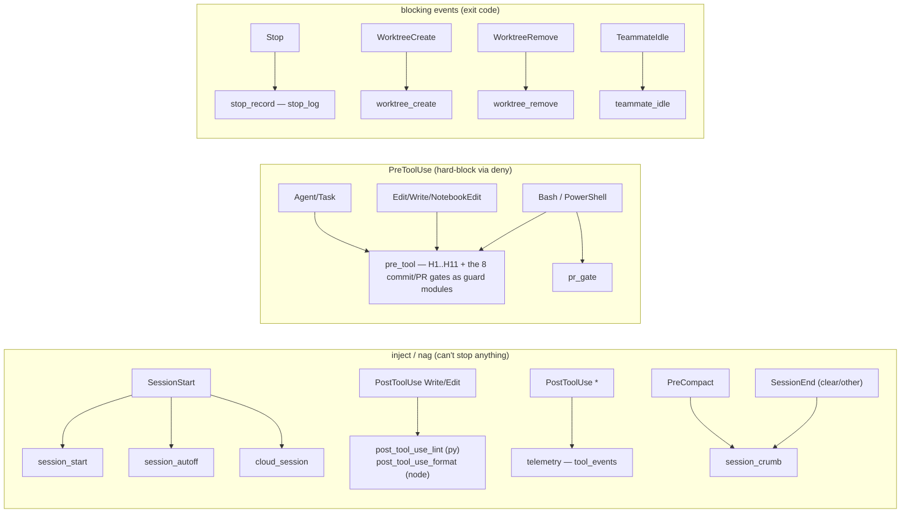

Hooks **self-filter internally** rather than using settings-level `if:` routing — the RTK-prefix
rationale is in `hook-wiring/README.md` (matcher gotchas). PreToolUse is now **2 wired entries**
(down from 11, hook consolidation PR 6): `pre_tool` — the former `pre_tool_use` plus the 8
commit/PR gates (`session_prime_gate` / `grill_gate` / `stale_base_guard` / `tdd_gate` /
`nocommit_guard` / `test_lock_enforce` / `plan_interview_gate` / `parallel_gate`) folded in as
`guards/<name>` modules, one process per call — plus `pr_gate`. `pre_tool`
matches `Bash|PowerShell|Agent|Task|Write|Edit|NotebookEdit|Read`; each guard still self-filters by tool/command
internally (a non-`git commit` Bash call runs no commit gate). A Read/Grep/Glob call therefore starts
at most one hook (`tests/test_hook_speed_budget.sh`, median < 150 ms).

> **claude.ai's Plugins UI shows same-event hooks as "duplicate" rows — expected, not a bug.** The
> web Plugins → Hooks tab labels each wired hook by its **event (+ matcher)**, not by the script name.
> Several *distinct* scripts legitimately bind the same event — e.g. `SessionStart` runs five — so
> they render as repeated rows with identical labels. Nothing runs twice: the 14 wired entries are 14
> distinct commands, no `(event + matcher + command)` triple repeats (one script, `session_crumb`, is
> wired to two *different* events — `PreCompact` and `SessionEnd` — on purpose). Claude Code's
> `hooks.json` has no per-hook display name the UI could surface, so this is a claude.ai display
> limitation, not something the wiring can change. Don't "fix" it by merging distinct scripts — see the
> consolidation note below (merge only for an ordered deny decision or measured spawn latency, via the
> `_dispatch` pattern, never for the UI).

### Consolidated entries — `telemetry` · `stop_record` (hook consolidation PR 4)

Two entry points run their recorders as **modules**, one process per event. The hook diet trimmed
each to its surviving module and removed the third entry, `post_nudges`, entirely (the removed
modules' guidance now lives in `rules/*.md`).

| Entry | Event · matcher | Modules, in run order |
|---|---|---|
| `telemetry` | PostToolUse · `""` | `tool_events` |
| `stop_record` | Stop · `""` | `stop_log` |

- **`_dispatch.{py,cjs}`** is the shared loop. It reads stdin once and runs each module fail-open: a
  module that raises is skipped with a `<entry>: <module> skipped (…)` breadcrumb, and the others
  still run. It prints at most **one** `systemMessage`; when several modules emit on the same call,
  their messages are joined with a newline. Bad stdin behaves as the retired hooks did. For
  `telemetry`, empty, non-JSON or non-object stdin runs nothing. For `stop_record`,
  empty stdin runs every module with `{}`, so the stop is still logged. On non-JSON stdin the node
  `stop_log` still logs, because the old node hook never read stdin; py logs nothing, as before.
  Asking for a module that doesn't exist prints `<entry>: unknown module <name>` to stderr.
- **Byte contract.** Every sink file and line format is unchanged per twin. `tests/test_hook_golden.sh`
  (GOLD-01..04) replays one payload sequence through the entries and compares the output to fixtures
  captured from the pre-PR hooks.
- **Forwarders (removed).** The retired file names (`tool_events.py`, `skill_nudge.py`, …) shipped as
  thin forwarders through PR C's propagate window; the post-propagate cleanup **deleted them** once
  propagate showed no repo still wired to them. The `main(only=<name>)` seam on the consolidated entry
  remains — it is what the test harness's `--only <entry>` uses — but no standalone forwarder file
  calls it any more. `setup.sh --update-hooks --init-missing` still swaps any old wiring for the entries
  (`merge_settings_hooks.py` `RETIRED` map); a custom wrapper or HAND_RECONCILED hook is kept and noted.
- **Twin output differs where it always did.** py writes `session-logs/<date>.jsonl` and node writes
  `session-logs/sessions.log`; JSON spacing also differs. A separate follow-up issue tracks aligning
  the twins.

---

## PreToolUse gates

### Consolidated entry — `pre_tool` (hook consolidation PR 6)

The former `pre_tool_use` (H1..H11) and the 8 commit/PR gates now run as **one `pre_tool` process per
PreToolUse call** instead of 9. Each old gate's body moved verbatim into a `guards/<name>` module
exposing `check(ctx) -> reason | None`; `pre_tool` builds the shared `ctx` once (tool name, command,
cwd, staged diff via a per-call git memo) and runs the guards in a fixed order. The per-gate sections
below still describe each module's behaviour; only the process boundary moved.

| Group (run order) | Tools | Fires on |
|---|---|---|
| `pre_tool_use` (H1..H11) | `Bash\|PowerShell\|Agent\|Task\|Write\|Edit\|NotebookEdit\|Read` | every matched call |
| `session_prime` | `Edit\|Write\|NotebookEdit\|Bash` | first mutation / `git commit` |
| `grill` · `plan_interview` · `parallel` · `tdd` · `nocommit` · `stale_base` | `Bash` | `git commit` (stale_base runs LAST) |
| `test_lock` | `Bash` | a raw suite run |

- **Full mode (default, no `--only`).** All matching guards run; their DENY reasons are **joined into
  one** deny (the #574 chained-ops NOTE is appended once at the end). The block is always the dual-form
  decision (`{"decision":"block"}` + `{"hookSpecificOutput":{"permissionDecision":"deny"}}`, exit 2).
  A degraded guard (an import/parse error) is listed in an `off` set and surfaced on **stdout** as a
  `systemMessage` (`pre_tool_use: guard(s) OFF this call — <names> failed to load or crashed; run
  setup.sh --update-hooks`), never silently dropped — the session is told which protection isn't
  running. Fail-open breadcrumbs (a git read that failed, a check skipped under the time budget, the
  stale-base skip) ride the same `systemMessage` in full mode. The entry is wired with an explicit
  `timeout` (15s) and an internal wall-clock budget (`PRE_TOOL_BUDGET_MS`, default 10000; an empty,
  non-numeric, ≤0 or non-finite value falls back to the default) that is a **hard deadline**: every git
  subprocess (the shared runner and the guards' direct calls) is clamped to the time remaining, and the
  group loop stops once it is spent, emitting the denies collected so far — so a slow/hung git can't
  let the harness kill the hook mid-run and drop a block (fail-open). Once an earlier guard already
  denies, stale-base skips only its network fetch; its local overlap check still runs, so its deny is
  never dropped. A `git show :<path>` read that falls back to the worktree file is not reported as a
  git failure.
- **`--only <entry>`** reproduces each retired guard's output **byte-for-byte**: same exit code and same
  stdout. `--only pre_tool_use` uses the shared `decide.deny`; `--only test_lock_enforce` keeps its exit-0
  `deny_json` form. The seam remains for the test harness; the forwarder files that once called it
  (`main(only=<name>)`) are gone (see below).
- **Equivalence was proven once, at merge.** PR 6 (#979) replayed the 2352-row PreToolUse corpus
  through the old hooks and the new `pre_tool` (byte match per `--only G`, union match in full mode:
  0 mismatches). That one-time harness was deleted after the merge. `tests/test_pre_tool.sh` asserts
  the new behaviour directly (joined denies, the OFF `systemMessage`, the Q3 `CT_ALLOW_UNLOCKED_TESTS`
  → project-`TEST_CMD` allow, the TLE exit-2 form); the Bash-path speed budget runs in the serial
  `tests/test_hook_speed_budget.sh` (HSB-03).
- **Forwarders (removed).** The retired file names (`grill_gate.py`, `session_prime_gate.py`, …) shipped
  as 4-line forwarders into `pre_tool --only <name>` through PR C's propagate window, then the
  post-propagate cleanup **deleted them**; `pre_tool_use.py` is kept as the stack-probe sentinel.
  `setup.sh --update-hooks --init-missing` swaps any old wiring for the single `pre_tool` entry
  (`merge_settings_hooks.py` `RETIRED` map), carrying the READONLY_PATHS stamp across. The `--only`
  seam on `pre_tool` itself remains — the test harness uses it.

### `grill_gate` — no spec/plan/ADR commit without grill findings

The commit-time hard stop behind workflow.md Adherence #5 (grill the design AND the plan). When a
`git commit` stages a file under `docs/superpowers/specs/`, `docs/superpowers/plans/`, or
`docs/decisions/` (skeleton `TEMPLATE*` files exempt), the staged content must contain a
non-empty `## Grill findings` section — "non-empty" meaning a disposition word
(fixed·parked·deferred·accepted·resolved·mitigated·addressed·acknowledged·wontfix·noted·ruled),
a `- C1`-style finding bullet, or any real bullet content.

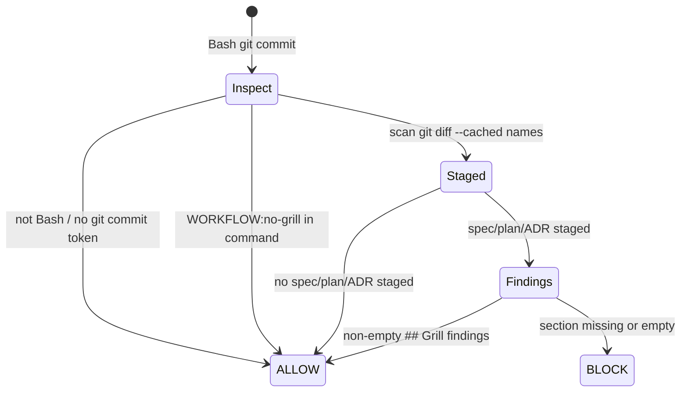

- **I/O**: stdin `{tool_name, tool_input.command, cwd}` → block = dual-form JSON on stdout — legacy `{"decision":"block","reason":…}` (deprecated upstream) **and** the current `{"hookSpecificOutput":{"hookEventName":"PreToolUse","permissionDecision":"deny","permissionDecisionReason":…}}` in the same object — plus the reason on stderr + exit 2; otherwise exit 0. (Same dual-form contract in `pr_gate` and `tdd_gate`.)
- **Bypass**: literal `WORKFLOW:no-grill` in the commit command.
- **Sync merges (#996)**: during a `git commit` with `MERGE_HEAD` present (resolved via
  `git rev-parse --git-path MERGE_HEAD`, worktree-safe), a staged spec/plan/ADR whose blob is
  IDENTICAL to its blob at `MERGE_HEAD` is skipped — it arrived unchanged from the other parent, so
  the branch author can't grill someone else's historical spec. An author edit during the merge
  (staged blob differs from `MERGE_HEAD`) is still checked normally.
- **Structural gap it can't reach**: plan-mode plans live at `~/.claude/plans/*.md` — outside any
  repo, invisible to `git diff --cached`. `grill_nudge` (below) covers that path at write time (#146-T3).
- **Spec-alignment (#709)**: a FINAL spec commit (`docs/superpowers/specs/**`, not `status: draft`)
  also needs a `## Interview` section with >=4 recorded Q&A, counted by a `- **Q...` bullet OR a
  `1. **Q...` numbered-list item (#909 — the numbered form used to silently count as 0). Bypass:
  `WORKFLOW:no-interview`, or mark the spec `status: draft`. Below the count threshold, the block
  reason names the expected marker format so a builder isn't left guessing.
- **Tests**: `tests/test_grill_gate.sh`, `tests/test_hooks_native.sh` (GG-INT1–GG-INT8, py+node parity).

### `session_prime_gate` — no first mutation until isolated + primed

The PreToolUse teeth behind GATE-0 / `autonomy.md` A5 (isolate-then-prime first). SessionStart is
inject-only — it can *instruct* "EnterWorktree then /prime-core" but cannot block — so this gate is
what enforces it. On a **managed** repo (`.claude/worktrees.conf` or `project-context.md` present), the
first *mutation* is denied when either: (1) the session is on the shared PRIMARY checkout, not a
`.claude/worktrees/` linked worktree (same check as `guards/shared_checkout._is_primary_checkout`); or (2) the session
isn't primed for ITS OWN session id — the marker is **session-bound** (hooks-plugin 0.6.224): `/prime-core`
writes the hook input's `session_id` into `.claude/state/primed`, and the gate denies unless the
marker's content matches the CURRENT mutation's `session_id` — an empty marker (a bare `touch`) never
counts, and a marker from a DIFFERENT session (stale, e.g. a new session reopened in an old worktree)
is denied too. A **child session** (a teammate/subagent spawned inside the coordinator's own
worktree) inherits any non-empty marker regardless of its own id, since it shares the coordinator's
prime. When the hook input carries no `session_id` at all (an older harness), the gate falls back to
a plain presence check and breadcrumbs that it did. A mutation = `Edit`, `Write`, `NotebookEdit`, or a
`Bash` `git commit` / `git push` / `gh pr create` / `gh pr merge`; every other tool (including every
other Bash command) passes untouched, so read-only sessions never trip it.

**Scope is the repo's working tree, not every file path (#995).** A worktree only isolates the
repo's OWN tracked tree — it does nothing for a target OUTSIDE the repo (`~/.claude/plans/*.md`,
`~/.claude/CLAUDE.md`) or for a per-user file INSIDE it that's gitignored (`CLAUDE.local.md`); those
have no worktree-shaped fix either way. So for `Edit`/`Write`/`NotebookEdit` the gate first resolves `file_path`
(relative paths joined to `cwd`, symlinks resolved) against the current checkout's `git rev-parse
--show-toplevel`: outside that tree, or inside it but CONFIRMED `git check-ignore`'d (a clean exit
0), the gate exits before the isolation/primed checks even run. Resolution failure (no git / no
toplevel / an unresolvable path) falls back to the pre-#995 behavior — it grants no new bypass, it
just means "couldn't tell, so gate as before." **`git check-ignore` itself erroring (any exit other
than the clean 0/1 pair) fails CLOSED** — treated as NOT ignored, so the mutation falls through to
the normal isolation/primed checks instead of being silently exempted; a check-ignore hiccup on an
in-repo path (a broken symlink, a submodule, a missing git) must not get the same free pass as a
genuinely out-of-tree target. A `Bash` `git commit`/`git push`/`gh pr create`/`gh pr merge` carries
no `file_path` and is unaffected by this scoping.

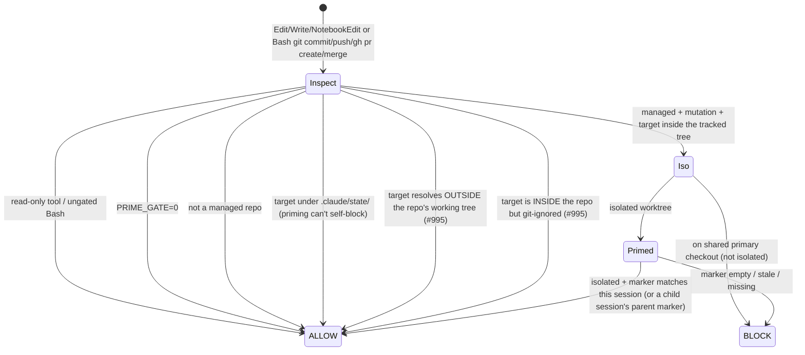

- **I/O**: identical dual-form block contract to `grill_gate` (legacy `{"decision":"block"}` + current `{"hookSpecificOutput":{"permissionDecision":"deny"}}` on stdout, reason on stderr, exit 2; else exit 0). A `git check-ignore` error fails CLOSED (the target is
  treated as not ignored and the gate applies). Any other error fails open, with a breadcrumb when isolation
  is unknown.
- **Bypass**: `WORKFLOW:no-worktree` (skip isolation) · `WORKFLOW:no-prime` (skip primed), inline in the `git commit`/`git push`/`gh pr create`/`gh pr merge`; per-repo opt-out `PRIME_GATE=0` (env). The old `.claude/state/prime-bypass` touch-file bypass is **dropped** (hooks-plugin 0.6.224) — it was forgeable by a bare `touch` and granted blanket exemption regardless of session; the accepted residual is a hand-written marker that happens to match the live session id.
- **Scope**: managed repos only — non-template repos are never gated. The `.claude/state/` write exemption avoids a chicken-and-egg self-block. Within a managed repo, only a target that resolves *inside* the current checkout's tracked working tree is gated at all (#995) — a plan file under `~/.claude/plans/`, `~/.claude/CLAUDE.md`, and a gitignored per-user file like `CLAUDE.local.md` all pass regardless of isolation/primed state. The gated Bash surface now also includes `git push` and `gh pr create`/`gh pr merge` (publishing work from an unprimed session was the same gap as an unprimed commit) — `gh pr view` and every other `gh`/`git` command remain ungated.
- **Prime-ack is a proxy**: the marker proves `/prime-core` ran IN THIS SESSION, not comprehension (same class as the grill-findings gates) — gameable via a hand-written marker that happens to match the session id, a deliberate accepted residual (Q2).
- **Tests**: `tests/test_session_prime_gate.sh` (py + node parity cases SPG-01..26, SPG-N01..N26 — SPG-13..17/N13..17 cover the #995 outside-repo/gitignored/relative-path scoping; SPG-18/N18 cover the fail-CLOSED `git check-ignore`-error case via a self-referential symlink; SPG-19..22/N19..22 cover the session-bound marker — empty/stale/child-inherits/no-session_id-presence-fallback; SPG-23..26/N23..26 cover the `git push`/`gh pr create`/`gh pr merge` scope + inline bypass).

### `plan_interview_gate` — no plan commit without a recorded interview

The commit-time hard stop behind deliverable H (the GATE-1 plan-time interview). An exact sibling of
`grill_gate`: when a `git commit` stages a file under `docs/superpowers/plans/` (skeleton `TEMPLATE*`
files exempt), the staged content must contain a non-empty `## Questions resolved` section — the
durable record of the `writing-plans` AskUserQuestion interview (≥3 prompts + the human's answers).
This keeps the human in the loop at design time even though BUILD runs autonomously (model D). Gating
on a doc SECTION rather than a transcript scan is transcript-independent — AskUserQuestion is
main-session-only, so a delegated builder can't call it, but the section proves the interview happened
regardless of which session authored the plan.

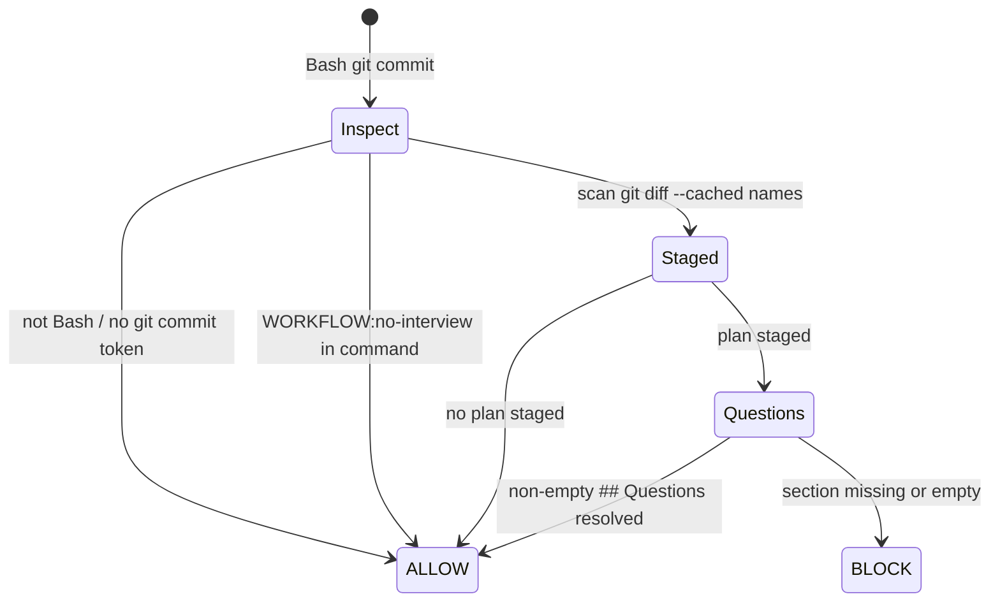

- **I/O**: identical dual-form block contract to `grill_gate` (legacy `{"decision":"block"}` + current `{"hookSpecificOutput":{"permissionDecision":"deny"}}` on stdout, reason on stderr, exit 2; else exit 0).
- **Bypass**: literal `WORKFLOW:no-interview` in the commit command.
- **Scope vs `grill_gate`**: plans-only (`## Questions resolved`); `grill_gate` covers specs/plans/ADRs (`## Grill findings`). Both fire on the same `git commit` PreToolUse event, independently.

### `parallel_gate` — no plan commit whose parallel batches collide on a file

The commit-time hard stop behind the "declare your parallel batches" rule (`rules/agent-delegation.md`).
A sibling of `grill_gate`: when a `git commit` stages a plan under `docs/superpowers/plans/` (skeleton
`TEMPLATE*` exempt), the plan is parsed for `Task <id>` blocks (any `## `..`#### ` heading level; numeric
or letter-prefixed ids like `A1`; their `**Files:**` bullets — the Files block runs until the next heading
at the SAME OR SHALLOWER depth as the task's own heading (a deeper sub-heading, e.g. `#### Steps`, placed
INSIDE a task does NOT end it — #929), a `**Label:**` marker EXCEPT `**Notes:**` (a common in-block
annotation, not a section boundary — #929), or first `- [ ]`/`- [x]` step-checkbox line (step lists mark the
end of the file list); a blank line, `---`, interface decl (`- Produces:`/`- Consumes:`/`- Interfaces:`) or
prose in between is SKIPPED, never a close, so a real path listed after one is still collected. ``` / ~~~
fenced code is stripped ONCE up front (CommonMark matching — a closer is the same char and length ≥ the
opener's, so a `~~~` inside a ``` block or a short inner ``` inside a ```` block does NOT close it) and the
stripped text drives tasks, batches AND the `## Parallelization` check alike, so a fenced example neither
counts nor hides the real section; an unclosed fence at EOF BLOCKs ("plan can't be parsed") rather than
silently swallowing later tasks. A bullet with an explicit write verb (`Create:`/`Modify:`/`Add:`/`Delete:`/
`Edit:`/`Test:`) names any next token as the path (extensionless included, e.g. `Makefile`); a bullet with any
OTHER `Label:` prefix (single- or multi-word, e.g. `Update:`, `Set up:`, `Create/Modify:`) or no prefix at all
needs a path-like first token (backticked — spaces allowed inside —, containing `/` or `.`, or one of a small
set of known extensionless build filenames — `Makefile`/`Dockerfile`/`Containerfile`/`Rakefile`/`Gemfile`/
`Procfile`/`Jenkinsfile`/`Vagrantfile`/`LICENSE` — #929). Backticks + `:line-range` stripped. A write-verb
bullet that lands AFTER a step checkbox is not counted but is surfaced as a stdout `systemMessage` breadcrumb
on the ALLOW path (exit-0 stderr is invisible to the agent). Step titles, interface symbols and fenced
fixtures no longer read as false races, and neither early-closing nor fence miscounting silently drops later
paths (#915))
and a `## Parallelization` callout (`- Batch N: T1, T3`).
A plan with **≥2 tasks** must carry the callout, and no two tasks in the **same batch** may share a
file path. Task ids are normalized so a `T` sigil matches the bare number (`### Task T1` ↔ `- Batch 1: T1`);
a batch that names an id with **no matching task** BLOCKs (listing the unknown + known ids) rather than resolving
to an empty set and passing a real collision through — this check runs against EVERY batch reference regardless
of how many OTHER tasks parsed, so even a single recognized task among ≥2 declared batch members still catches
the unrecognized one (#668 — previously it only ran once ≥2 tasks had parsed, letting a partial parse through).
Single-task plans are skipped; a plan that has a
`## Parallelization` section but **zero** parseable tasks fails loud (BLOCK) rather than collapsing silently. A batch-named task that
HAS a `**Files:**` marker but **zero parsable paths** (bare/prose bullets, a `- Set up: …` label with no path-like token) can't be collision-checked; the gate does
NOT block (prose plans are legitimate) but surfaces a stdout `systemMessage` note ("task `<id>` has a Files block but no parsable paths —
not collision-checked") so the gap is visible. This makes a plan's fan-out declaration machine-verified before a coordinator acts on it.

The parsing (tasks/batches/files, fence-stripping, path extraction) lives in one shared module,
`_lib/parallel_parse.{py,cjs}`, so `parallel_gate` and `parallel_nudge` (below) can never drift apart (#663) —
each hook only decides which of the shared parser's signals BLOCK vs WARN.

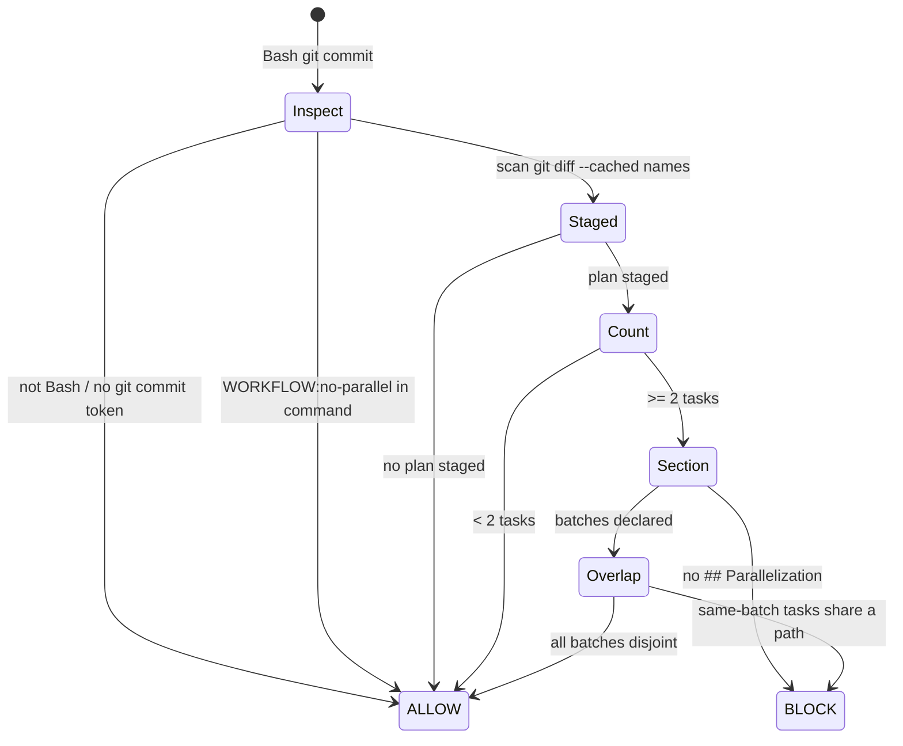

- **I/O**: identical dual-form block contract to `grill_gate` (legacy `{"decision":"block"}` + current `{"hookSpecificOutput":{"permissionDecision":"deny"}}` on stdout, reason on stderr, exit 2; else exit 0). Fail-open on any git/parse error — but NOT silently: the top-level catch (both the stdin-parse and the main-logic catch) emits a stdout `systemMessage` ("parallel_gate: internal error … — plan NOT collision-checked") before exit 0, so a swallowed internal error can't read as "checked and clean".
- **Bypass**: literal `WORKFLOW:no-parallel` in the commit command.
- **Scope**: intra-plan only — cross-plan file overlap is worktree-isolation + merge's job (a hook can't know which plans are concurrently in-flight). Plan-mode plans (`~/.claude/plans/*.md`) are unreachable by a commit gate — `parallel_nudge` covers that path at write time.
- **Tests**: `tests/test_parallel_gate.sh`.
- **Tests**: `tests/test_plan_interview_gate.sh`.

### `pr_gate` — design-before-PR, review-before-merge

One hook, seven checks across the two `gh pr` moments:

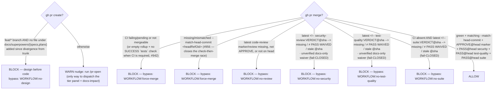

- **The marker protocol**: the gate reads the LATEST `<!-- code-review:(\w+)@([0-9a-f]+) -->` marker
  by timestamp across PR comments and reviews. It requires `APPROVE` with `@sha` == `headRefOid` —
  head-bound, so a bare marker (no `@sha`), an abbreviated sha, or a review of an older commit all
  block, and a post-review push invalidates it. One combined panel comment per round; the verdict
  word comes from `code-reviewer` alone; a later `APPROVE@head` supersedes an earlier `CHANGES` with
  no cleanup. A genuine human GitHub `APPROVED` review counts only on the current head
  (`commit.oid` == `headRefOid`).
- **The SECOND marker — security-review (Deliverable K, fail-CLOSED)**: the gate ALSO reads the
  LATEST `<!-- security-review:(\w+)@([0-9a-f]+) -->` marker (from `/pr-open`'s `security-reviewer`
  dispatch, in the SAME one comment). It requires `PASS` (or attended `WAIVED`) with `@sha` ==
  `headRefOid` (the review covers the CURRENT head — a later push invalidates it). The two regexes
  are non-overlapping (distinct prefix + the `@sha` tail), so neither marker satisfies the other's
  axis. Unlike every other axis this fails **CLOSED** — a missing/FINDINGS/stale marker BLOCKs — but
  only after `gh pr view` succeeds; if `gh` is unreachable the whole gate still fails open. Bypass
  `WORKFLOW:no-security` (attended). The `autonomy: unattended` non-waivable clause is v1-DEFERRED.
- **The THIRD marker — test-quality (Deliverable L, fail-CLOSED)**: a twin of the security axis on
  the LATEST `<!-- test-quality:(\w+)@([0-9a-f]+) -->` marker (from `/pr-open`'s
  `test-quality-reviewer` dispatch, in the SAME one comment). The marker is EARNED by a real run:
  `bin/test-quality-run <committed-ledger>` executes the plan's CHECK/EXPECT gates through the
  vendored unlazy executor (`bin/gate/`, `test-quality-gate.template.md`) + `bin/mutation-check` (the
  negative control), and prints `test-quality:PASS@head` ONLY on a genuine ALL-MET — a nonzero CHECK
  never passes on output-match. The hook still checks marker presence@head (dev + pre-merge, not a CI
  oracle — the `--approve` store is per-machine); the PASS is no longer paste-judged *once the
  producer is run*. ⚠ Wiring `/pr-open` to invoke `bin/test-quality-run` on a committed ledger
  end-to-end is the pending follow-up (#584); until it lands, the marker in the documented `/pr-open`
  flow is still authored by the `test-quality-reviewer` — the producer is the earned path, available
  now but not yet on the default merge path. Same rules as security:
  `PASS`/attended `WAIVED` with `@sha` == `headRefOid`, fail-CLOSED, its own non-overlapping prefix
  (satisfies no other axis, satisfied by no other marker). Bypass `WORKFLOW:no-test-quality`.
- **The FOURTH marker — suite (CI-absent only, fail-CLOSED)**: a twin of the security/test-quality
  axes on the LATEST `<!-- suite:(\w+)@([0-9a-f]+) -->` marker (from `/pr-open`, posted at the final
  synced head once the local full-suite run under `bin/test-lock` is green). This axis is active ONLY
  where CI is **not** required — where CI is required, the CI axis itself already owns regression and
  the suite axis stays inert (`_check_merge`). Same rules as security/test-quality: `PASS`/attended
  `WAIVED` with `@sha` == `headRefOid`, fail-CLOSED, its own non-overlapping prefix. Bypass
  `WORKFLOW:no-suite`.
- **Docs-only auto-waiver (#926)**: on a tier-0 PR (`claude-template pr-tier` says every changed path is
  docs-only markdown), `/pr-open` runs only `code-reviewer` and posts
  `<!-- security-review:WAIVED@<sha> reason=docs-only -->` and `<!-- test-quality:WAIVED@<sha> reason=docs-only -->`;
  where CI is absent it also posts `<!-- suite:WAIVED@<sha> reason=docs-only -->`, re-verified the same way.
  The gate does NOT trust that label: it re-reads `files,changedFiles` from the same `gh pr view` call
  and accepts the waiver only if the list is complete (`changedFiles` == entries returned), every
  entry's `changeType` is ADDED/MODIFIED/DELETED/CHANGED (RENAMED/COPIED hide the old path;
  missing/unknown can't be verified), and every path matches the tier-0 predicate case-insensitively
  (`TIER0_DOC_RE`/`TIER0_DENY_RE`, mirrored byte-for-byte from `bin/pr-tier`, pinned by
  `tests/test_pr_tier.sh` PT-DRIFT; `docs/lessons*.md` and `plugins/*/docs/` are instruction-bearing,
  not docs). Otherwise it BLOCKs naming the first offending path. If `gh pr view` itself fails, the
  gate still fails open but says so in a `systemMessage` naming the PR and the reason. Any other
  `reason=` on a WAIVED blocks as unrecognized; a reason-less `WAIVED` is unchanged (attended; #937).
  Head-binding and the 40-char sha still apply.
- **CI states**: blocks on FAILURE/CANCELLED/TIMED_OUT/ERROR/STARTUP_FAILURE/ACTION_REQUIRED and
  on non-terminal PENDING/QUEUED/IN_PROGRESS/REQUESTED/WAITING (watch first, merge after).
- **Empty rollup when CI is required (#942)**: an empty `statusCheckRollup` is permissive by
  default, but when the repo *expects* CI the gate instead requires a check **named `tests`** with
  conclusion `SUCCESS` for the head and fails **CLOSED** with a visible reason when it is missing,
  `SKIPPED`, or `NEUTRAL` — so a workflow that never triggered (Actions disabled, a YAML error, a
  path filter) no longer merges as if CI were green. "Expects CI" is read from the PR's **base
  branch**, not the PR's own worktree: `git show origin/<baseRefName>:.github/workflows/test.yml`
  (or `gh api repos/<R>/contents/…?ref=<base>` when `-R` is given), so a PR that deletes/renames the
  workflow, a subdirectory cwd, or `-R other/repo` can't switch its own requirement off. An explicit
  `REQUIRE_CI` overrides — env wins, else a `.claude/worktrees.conf` line; `1`/`true` forces
  required, `0`/`false` opts out **with a visible systemMessage**, an empty `REQUIRE_CI=` is unset.
  The `tests` check is matched on name **and** the base workflow's `name:` (`workflowName`) so a
  stray job/app named `tests` from another workflow doesn't count; a legacy commit STATUS named
  `tests` is read via `conclusion or state`. Base detection is **tri-state** — present / absent /
  **unknown**: only a real `HTTP 404` (or a resolved base ref that lacks the file) is *absent*; a
  gh/git error, an unresolvable base ref (no `origin/<base>`, a shallow/single-branch clone), a
  timeout, or a parse failure is *unknown* and must NOT read as "no CI" — it emits a visible
  "could not determine base CI requirement" message and fails **closed** on an empty rollup (a
  non-empty green rollup only warns). Presence is probed with `git ls-tree` (rc 0 + empty output =
  absent; a git error = unknown, never silently absent); over `-R` the value is normalized (scheme,
  `.git` suffix, and the scp `git@host:o/r` form stripped to `owner/repo` + `--hostname`), and only
  an exact `HTTP 404` from `gh api` counts as absent. The base ref is read **without a fetch**, so a
  stale local `origin/<base>` can misreport — the unknown message says so; the gate never fetches. Detection keys on `.github/workflows/test.yml`; a PR editing
  the workflow itself still needs GitHub branch protection (a client-side hook can't replace it).
  Repos whose base has no CI workflow keep the old permissive behaviour.
- **Bypasses are independent** — a PR failing CI *and* review needs both tokens.
- **Fail-open**: `gh` offline or unauthenticated → allow (never brick merges on network).
- **PR-router (#508)**: the create nudge additionally SUGGESTS an existing open PR that already
  touches the same files — one `gh pr list --json number,title,headRefName,files` call, file
  overlap computed against the branch's merge-base diff, the branch's own PR excluded, top 3 by
  overlap named. Suggest, never force (over-batching hurts review/revert granularity); wholly
  fail-open — no suggestion on any git/gh hiccup, so the base nudge is unchanged.
- **Gotchas**: pre-checks run before ANY part of a chained command — `git commit … && gh pr create`
  is evaluated against the pre-commit tree, so commit+push first, then create (#142 also widened
  trunk resolution for repos without `origin/HEAD`).
- **Tests**: `tests/test_pr_gate.sh`.

### `tdd_gate` — no source commit without a test change

Presence-only enforcement of the TDD discipline (issue #150): the staged set may not contain ≥1
source-classified file with 0 test-classified files. Classification is glob-based —
tests: `*.test.*`, `*.spec.*`, `test_*.py`, `tests/**`, `e2e/**`, `__tests__/**` …;
source: `.ts .tsx .js .jsx .py .go .rs .java .rb .php .c .cpp .sh`;
neutral (never counted): docs, configs, styles, lockfiles, images. Override per repo via
`.claude/worktrees.conf` or `TDD_GATE_TEST_GLOBS`/`TDD_GATE_SOURCE_GLOBS` env (env wins).

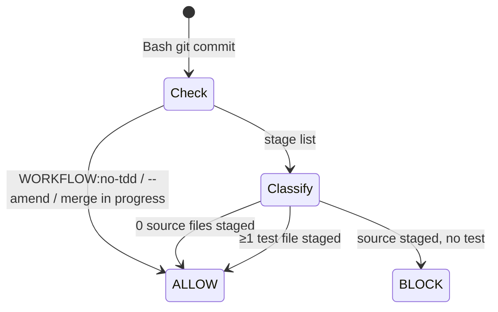

- `--amend` is exempt so the RED-then-GREEN two-commit split works; a merge in progress
  (`MERGE_HEAD` present) is exempt — detected via `git rev-parse --git-path` + file existence,
  because `rev-parse -q --verify MERGE_HEAD` broke on git ≥ 2.50 pseudo-refs (#208).
- (The vendor-lock exemption — a staged path listed in `.claude/vendor.lock` skipped from
  classification — was retired in #1296 with the filtered-vendoring machinery; the fleet moved to
  copy-delivery, so there is no lock-tracked vendored content to exempt.)
- **Tests**: `tests/test_tdd_gate.sh`.

### `stale_base_guard` — no commit on a stale base that overlaps `origin/main`

Gives GATE-0's "sync if behind" (rules A4/A5) real teeth. `session_start` only *injects* the
behind-count; this hook *acts* on it at commit time — but narrowly, only when a collision is
actually possible. On a `git commit`, if HEAD is behind `origin/main` AND the staged files overlap
the set of files that changed on `origin/main` since the merge-base, it DENYs; behind-but-disjoint
downgrades to a WARN (there's nothing to collide), and a base that isn't behind passes silently.

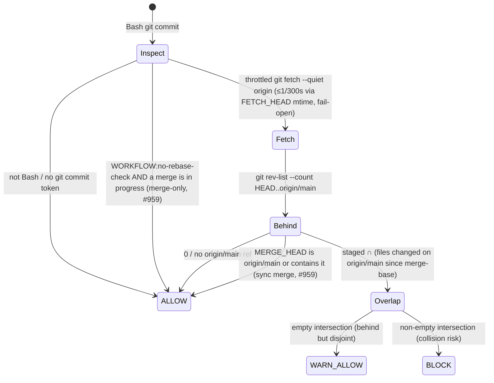

- **Fresh base (throttled fetch, #731)**: before the behind-check the hook runs `git fetch --quiet
  origin`, throttled to at most once per 300s via git's own `FETCH_HEAD` mtime (shared across
  worktrees), fail-open. So a long-lived session — whose `origin/main` was last refreshed at
  `session_start` — checks against the true remote tip instead of a day-old cached ref (which used to
  silently under-warn). A fetch failure/timeout falls back to the cached ref (pre-#731 behavior).
- **Worktree-anchored (#470)**: the repo is resolved from a `git -C <path>` in the commit command
  (absolute, or joined to `cwd`) and falls back to `cwd` — so a cross-worktree commit evaluates its
  OWN target repo, not the invoking session's checkout.
- **I/O**: identical dual-form block contract to `grill_gate`/`tdd_gate` (legacy `{"decision":"block"}`
  + current `{"hookSpecificOutput":{"permissionDecision":"deny"}}` on stdout, reason on stderr, exit 2;
  else exit 0). Fail-open on any git error.
- **Merge-sync exception (#959)**: while a `git merge origin/main` is in progress, HEAD is still the
  pre-merge parent (reads as behind) and the resolved files overlap what landed on `origin/main` — yet
  that merge commit is exactly the act that syncs the branch up. So when `MERGE_HEAD` exists AND it is
  `origin/main` or contains it (`origin/main` is an ancestor), the behind-check is skipped. Force-push
  is denied here, so merging is the only way a PR branch syncs — this used to need
  `WORKFLOW:no-rebase-check` on every sync; it no longer does. A plain commit while behind, or a merge
  of some other branch, still DENYs.
- **Bypass is merge-only (#959 follow-up)**: `WORKFLOW:no-rebase-check` is honoured ONLY while a merge
  is in progress (`MERGE_HEAD` present) — during a merge of `origin/main` OR a deliberate other branch
  it keeps its escape hatch. On a NORMAL commit the token is IGNORED and the block stands. The DENY
  reason spells out the sanctioned recovery:
  `git stash push -u -m <tag>` → `git merge origin/main` (sync commit, no bypass) →
  `git stash apply <sha>` → commit. A refused-bypass attempt is recorded in the denial telemetry
  (`bypass_token` set only when the token was actually present).
- **`-a`/`--all` aware** (#488 Gap B): a `git commit -a`/`-am`/`--all` auto-stages tracked edits at
  commit time, so the overlap check unions the currently-unstaged tracked names (`git diff --name-only`)
  into the staged set — otherwise those edits were invisible. Both twins tokenize a quoted `-C` path
  (#488 Gap A) so cross-worktree resolution matches Python.
- **Tests**: `tests/test_stale_base_guard.sh` (§97).

### `nocommit_guard` — no committing obvious leftover artifacts

Blocks a `git commit` whose **staged diff adds** a merge-conflict marker (`<<<<<<<` / `>>>>>>>`, never
the ambiguous bare `=======`), a standalone `NOCOMMIT` / `DO NOT COMMIT` sentinel (case-insensitive),
or a `.DS_Store` file. Scans ADDED lines only (`+`, excluding `+++`/`---` headers), so a pre-existing
marker on an untouched context line never blocks a later unrelated commit. Extra per-repo patterns are
OPT-IN via `NOCOMMIT_PATTERNS` (env, comma-separated regexes, or a `.claude/worktrees.conf` key — env
wins); a bad opt-in regex is skipped with a stderr breadcrumb, never wedging commits. Bypass:
`WORKFLOW:no-nocommit`.

- **#1015: the sentinel doesn't match when preceded by `no-`.** A doc line naming the bypass token
  itself (`WORKFLOW:no-nocommit`) is never flagged as the standalone sentinel. The exclusion is
  scoped to that literal `no-` prefix only — standalone `\b...\b` boundaries are otherwise unchanged,
  so a real leftover marker like `NOCOMMIT-later` or `pre-NOCOMMIT` still blocks.

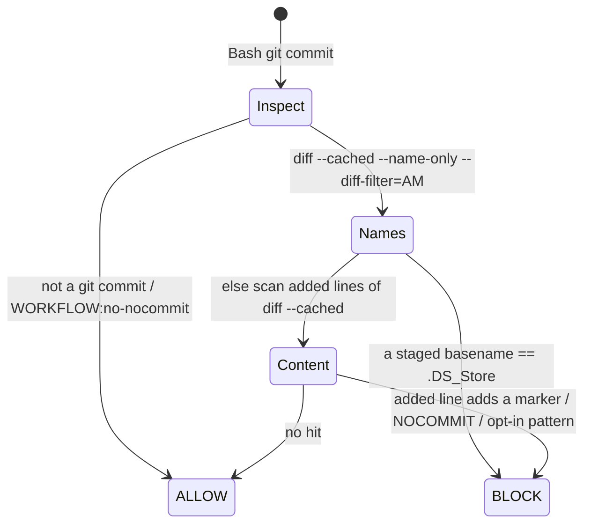

- `.DS_Store` floor is `--diff-filter=AM` (added/modified) — deleting a committed `.DS_Store` is never
  blocked. NO `--amend`/merge exemption (unlike `tdd_gate`): a leftover marker must never enter history
  regardless. Same dual-form deny + exit 2 contract as `tdd_gate`; token-based git-commit detection is
  `git -C <path>`-safe (anchors the diff to the target repo, not cwd, #470).
- (The vendor-lock content exemption — added lines under a lock-listed path skipped from the scan —
  was retired in #1296 with the filtered-vendoring machinery; copy-delivery leaves no lock-tracked
  vendored content to exempt, so every staged path is scanned.)
- **Tests**: `tests/test_nocommit_guard.sh` (py parity).

### `test_lock_enforce` — suites run under the lock, or not at all

The deny-side of `bin/test-lock`. If the Bash command contains the repo's own `TEST_CMD` (read
from the nearest `.claude/worktrees.conf`, walking up from cwd) and is not already wrapped, it is
denied via the **permission system** (`permissionDecision: deny`), with the fix in the message.

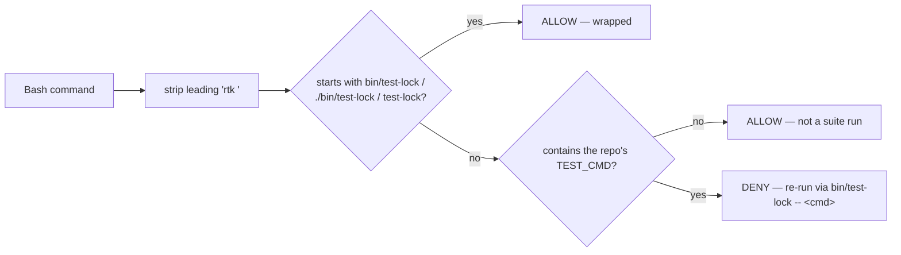

- **Order matters**: the allow-wrapped check runs BEFORE the deny, so a wrapped run never trips.
- **The wrapper itself** (`bin/test-lock`, ~120 lines): mkdir-mutex (macOS has no flock), lock key
  = `git rev-parse --git-common-dir` resolved via `pwd -P` (one lock spans all worktrees; `/var`
  symlink safe), stale-PID reclaim via atomic `mv` rename-steal (a holder-less lock only after a 2 s grace), exit 75 on contention (prints the
  holder), exit 64 on usage error. `--wait [--timeout SECS]` (#961) queues FIFO instead: a ticket
  `<lock>.queue/<seq>` (body = pid) blocks until it is the oldest live ticket AND the lock is free,
  reaps dead-pid and empty tickets, prints holder + queue position + the blocking ticket every ~10 s, and exits 75 on timeout, an unwritable queue, or a vanished own ticket (never hangs silently).
  Agents use `--wait` rather than an exit-75 retry loop (polling has no fairness). The hook's prefix match already allows the `--wait` form.
- **Relation to H1**: the H1 runner check (now a `pre_tool_use` guard under `pre_tool`) catches
  *generic* runners (`npm test`, `pytest` …) by verb; this gate catches the *repo's own* TEST_CMD
  verbatim. Both point at the same wrapper, and both checks live in ONE module, `guards/test_lock`
  (`check_runner` = H1, `check_test_cmd` = this gate); the retired `test_lock_enforce` guard ran via
  `pre_tool --only test_lock_enforce` (`check_test_cmd`) — its forwarder file is removed, the `--only`
  seam remains for the test harness. The "what is a suite run" definition is `_lib/test_cmd`. `CT_ALLOW_UNLOCKED_TESTS`
  is honoured by **both** checks (Q3: it now also covers the project `TEST_CMD`, process-env or
  segment-leading, not H1 only).
- **Tests**: `tests/test_hooks_native.sh` (TL/TLE sections, incl. cjs parity).

### `pre_tool_use` — the guard battery (H1–H11 + bare-alias)

> Since hook consolidation PR 6 this battery is the `pre_tool_use` **group** inside the `pre_tool`
> entry (see the consolidated-entry section above): `pre_tool` runs it first, and `pre_tool --only
> pre_tool_use` (what the kept `pre_tool_use.py` stack-probe sentinel calls) reproduces its old
> byte-for-byte output. The layout below is unchanged — only the process boundary moved.

One dispatcher, self-filtering per tool. **Layout (hook consolidation PR 5, both twins):**
`pre_tool_use.{py,cjs}` is a thin entry: it parses stdin once, builds `READONLY_PATHS` (+ the
readonly seam), then runs an ordered per-tool table of guards, imported lazily so a Read call loads
only the secret-read guard. Each guard is one module in `guards/` (`model`, `readonly`, `env_write`,
`db_ops`, `test_lock`, `conventional_commit`, `secret_scan`, `danger`, `protected_branch`,
`worktree_cwd`, `shared_checkout`, `giant_file`, `secret_file`, `secret_read`, `template_owned`,
`reminders`) exposing `check(ctx) -> reason | None`; shared helpers live in `_lib/` (`shell`, `git`,
`decide`, `test_cmd`). The first DENY wins, in the table's order; a module that fails to load turns
only that guard off (as does a guard that throws), and the hook says so in a `systemMessage` naming it — merged into the same single JSON object as any deny or reminder; a missing `_lib` exits 0 with "ALL guards OFF". Copy-model repos receive `guards/` + `_lib/` from
`setup.sh` (fresh scaffold and `--update-hooks`). To add a guard: a new `guards/<name>` module in
BOTH twins + one row in each entry's table. Bash commands are split into shell segments
(`&&`, `||`, `;`, `|`, newline) and each guard anchors on the segment head after stripping leading
`VAR=x` / `env` / `npx` / path tokens — a nudge-grade parser, deliberately NOT seeing through
`bash -c '…'` or `$(…)` (documented limitation, H1-LIMIT tests).

| Guard | Fires on | Tier | Bypass |
|---|---|---|---|
| H1 test-lock | bare test runner (`npm test`, `pytest`, `jest`, `vitest`, `go/cargo test` …) not wrapped in `test-lock` | BLOCK | `CT_ALLOW_UNLOCKED_TESTS=1` (segment-leading) |
| H2 conventional commit | inline `-m` subject not matching `type(scope)!: subject` | BLOCK | use `-F`/`--file` |
| H3 secret scan | staged diff carries an AWS key (`AKIA…`), private-key header, or token assignment | BLOCK | `CT_ALLOW_SECRETS=1` |
| H5 PR-review reminder | any `gh pr merge` | WARN | — |
| H6 docs staleness | commit touches source but no doc under the one docs map (D1, `DOCS_GLOBS`/`is_doc()`) | WARN | — |
| H7 danger guard | force-push to main, `reset --hard <remote>`, `rm -rf` on sensitive roots, `git clean -f`, `branch -D`, `checkout .`, `restore .`; forced cross-worktree `git worktree remove -f` and `rm -rf <worktree>` targeting a linked worktree root ≠ the caller's own (#483); raw disk-device writes — shell redirect (`>`/`>>`/`>\|`) or `tee` to `/dev/sd*`/`nvme*`/`disk*`/`rdisk*`, `dd of=<device>`, `mkfs*`/`wipefs`/`newfs_*` anywhere in the segment, skipped only when the segment's lead command is a read-only lookup (`man`/`which`/`type`/`whatis`/`apropos`/`info`/`help`/`command -v`/`echo`/`printf`), destructive `diskutil` erase/partition verbs (#980). Known, pinned LIMITs (nudge-grade, not a shell parser): a variable-indirected device (`D=/dev/sda; dd of=$D`), an `xargs`-supplied device (`echo /dev/sda \| xargs -I{} dd of={}`), and the H7-899 shell-executor class (`bash -c 'dd of=/dev/sda'`) | BLOCK | `CT_ALLOW_DANGER=1` |
| H-prune worktree | `git worktree prune` (clears only DEAD metadata, but can race a live sibling agent, #483) | WARN | — |
| H8 protected branch | `git commit` on main/master, or `git push` targeting them | BLOCK | `CT_ALLOW_PROTECTED=1` |
| H8 cwd-assertion (#437) | `git add`/`git commit` whose cwd names a native worktree (`…/.claude/worktrees/<name>`) but `git rev-parse --show-toplevel` resolves elsewhere — the worktree vanished and cwd fell back to the primary checkout, so the staged diff would land on the wrong branch (#483 silent-drop half) | BLOCK | `CT_ALLOW_DANGER=1` |
| H-shared-checkout | a mutating git op on the shared PRIMARY checkout (`git-dir == git-common-dir`) when ≥1 other live session shares it AND it is not clean on `origin/main`; verb matched in command position so `git worktree add`/`git remote add` aren't self-blocked (solo session, linked worktree, clean-main quick op, read-only subcommand all pass) | BLOCK | `CT_ALLOW_SHARED=1` |
| H9 giant file | staging a file > 10 MB (`CT_MAX_FILE_MB`) | BLOCK | `CT_ALLOW_BIGFILE=1` |
| H10 secret file | staging `.env*` (`.env.example/.sample/.test` allowed), `*.pem`, `id_rsa`, `*.key`, `credentials.json`, `*service-account*.json` | BLOCK | `CT_ALLOW_SECRET_FILE=1` |
| H11 secret read (#506) | READING a secret file into context — the **Read tool** on, or a shell dumper (`cat`/`head`/`base64`/…) of, `.env*`, `*.pem`/`*.key`/`*.p12`, `id_rsa`/`id_ed25519`/…, `credentials`, `.netrc`/`.pgpass`/`.npmrc`, or anything under `~/.aws`/`~/.ssh`/`~/.gnupg` (`*.pub` exempt). Complements H10 (staging) — H10 stops secrets going OUT, H11 stops them coming IN | BLOCK | `CT_ALLOW_SECRET_READ=1` (segment-leading for Bash, process-env for the Read tool) |
| template-owned edit | Write/Edit on a **template-owned reference file** inside a managed project — a path listed in `<root>/.claude/template-manifest.tsv` that is STILL byte-identical to its recorded install hash (a pristine template copy of a rule or delivered bin script — agents are NOT manifested, they are plugin-served (cache), never copied). A file the project already forked (hash differs), a project-authored file (not in the manifest, incl. a project's own `.claude/agents/*`), and the template repo itself (has `.claude-plugin/marketplace.json`, or no manifest) are all allowed. Steers a would-be in-place edit to the canonical source (`propagate.sh` flows it back down) or a project-owned file. Reverse counterpart: `bin/harvest.sh` (project → template backflow) | BLOCK | `CT_ALLOW_TEMPLATE_EDIT=1` (process-env) |
| plugin-cache edit | Write/Edit/NotebookEdit whose target resolves under the machine-global plugin cache (`~/.claude/plugins/cache/**` or `~/.claude/plugins/marketplaces/**`) — a disposable copy regenerated by `claude plugin update`, shared by every repo, where an edit never propagates and is silently dropped on the next version switch. Steers the edit to the source upstream (for claude-template, `plugins/<plugin>/<relpath>` in your claude_template checkout). Repo paths and the template repo's own `plugins/.../docs/` are untouched (not under the cache). Claude-side only — a hook can't see a human's external-editor edit. Matches the requested path, NOT realpath, so a repo-side dev-link stays editable. Fail-open on a bad path | BLOCK | `CT_ALLOW_PLUGIN_EDIT=1` (process-env) |
| model allow-list guard | Agent/Task dispatch whose `model:` param is anything but an exact pinned ID — an allow-list (#918): an omitted/empty param or an exact pinned ID matching `claude-<family>-<version>…` passes; bare aliases (`sonnet`/`opus`/`haiku`/`fable`), `opusplan`, `default` and `[1m]`-suffixed variants all float and are rejected | BLOCK | omit `model:` — architectural |

```mermaid
flowchart TD
    IN[tool call] --> K{tool?}
    K -->|Agent / Task| M5{model param an exact pinned id, or omitted?}
    M5 -->|no — bare alias / opusplan / default / [1m]| B5[BLOCK — omit model, the agent def's pinned id wins]
    M5 -->|yes| OK0[ALLOW]
    K -->|Bash| SEG[split into segments · strip leading tokens]
    SEG --> G[run H1 H2 H3 H7 H8 H9 H10 H11 per segment]
    G -->|any hit, no leading CT_ALLOW_* override| BL[BLOCK with the specific guard's message]
    G -->|H5 / H6 match| WN[additionalContext reminder — never blocks]
    G -->|clean| OK1[ALLOW]
```

- **Overrides are segment-scoped**: `CT_ALLOW_DANGER=1 git clean -fd` works;
  `CT_ALLOW_DANGER=1 true && git clean -fd` does NOT (the override must lead the segment that
  matched — real shell semantics, MED fix). A mere *mention* of the token in text never disarms.
- **Gotcha trail**: #111 #123 #190 #208 #230 #240 in the source comments — quote handling in
  heredocs, git global-option smuggling, pseudo-ref changes.
- **Tests**: `tests/test_pretooluse_h1h2.sh`, `_h3h6.sh`, `_h7h8.sh`, `_h9h10.sh`,
  `test_secret_read_guard.sh` (H11) — every payload driven through
  BOTH stacks (lesson #219).

---

### PowerShell tool (hook consolidation PR 8, #908)

Claude Code's PowerShell tool sends its command in `tool_input.command`, the same field Bash uses.
The hooks do not teach each guard a second shell. Instead `ps_to_sh` (`_lib/shell.py`, twinned in
`_lib/shell.cjs`) translates a PowerShell command ONCE into the equivalent bash string: the same
separators and command words, with PowerShell quoting turned into bash quoting. The bash guards then
judge that string unchanged.

- **Where it runs.** `pre_tool` normalizes `tool_name == "PowerShell"` at its entry, so one
  translation covers every guard, group and `--only` entry in that process. The real tool name
  stays on denial telemetry. The transcript reader `_lib/transcript` translates the same way, and the
  inline Bash-name sites (`telemetry`, `session_crumb`, `pr_gate`, `session_prime`) match
  `Bash` or `PowerShell`. A translator crash falls back to the raw command, which is still judged.
- **Translation.** `Remove-Item` / `del` / `erase` / `rd` / `rmdir` / `ri` become `rm -f`, so
  `-Recurse` alone counts as a recursive delete (Q1). `set-location` / `sl` / `chdir` / `push-location`
  / `pushd` become `cd`. Backslash is a path separator, not an escape, so it becomes `/` before any
  guard runs (C2). The backtick is the escape, and it is resolved in quoting (C3). Here-strings are
  handled. `-Path:` colon forms are flattened.
- **Limits (pinned as `PS-LIMIT` rows).** Executor strings (`Invoke-Expression`, `iex`, `cmd /c`,
  `Start-Process`, `pwsh -c`) stay undetected, the same limit as `bash -c` (#744/#899). A pipeline-fed
  delete (`Get-ChildItem <wt> | Remove-Item -Recurse -Force`) carries no target token. A `$env:CT_ALLOW_*=1`
  assignment inside the command is NOT an override: only the process env counts, and the guard fails
  closed (Q2). Command words are matched case-sensitively, so `GIT push --force` is not caught (W3,
  deferred).
- **Matchers.** Matchers name `Bash|PowerShell`. Never write a `PowerShell(...)` `if:` or permission
  pattern, because of #57137 (Q3).

## Stop gates

> `stop_gate` (which folded `close_issue_gate`, `close_gate`, `docs_gate` and `plan_gate` into one
> Stop-event BLOCK over a single transcript pass) was removed in the hook diet, along with its four
> folded gates — `Stop` now wires only `stop_record` (below). Their intent (file follow-ups, reflect,
> reconcile docs, close out a plan's checked boxes) moved to discipline in `rules/*.md`, not a
> machine BLOCK. GATE-2's enforced teeth remain in `pr_gate`'s review panel + merge axes.

> `cost_telemetry` (the per-session `costs.jsonl` token/cost row, #501) and `improvement_proposer`
> (the post-reflect proposal stub) were removed in the hook diet (#1285): cost telemetry duplicated
> what the transcript already records, and the proposal stub is superseded by the on-demand `/improve`
> command. `stop_record` now runs only `stop_log`.

> `close_issue_gate` (file the follow-ups or say there are none, at merge-time Stop) was removed in
> the hook diet along with `stop_gate` — see the note above.

> `precompact_evidence` (the PreCompact snapshot of the transcript's derived merge/commit/reflect
> flags, formerly known limitation #36) was removed in the hook diet (#1285): its only reader was
> `stop_gate`, so once the Stop gate family went, the snapshot had nothing to re-ground and was
> deleted with it. PreCompact now wires only `session_crumb`.

### `session_crumb` — deterministic re-grounding crumb before context loss

Writes the thin **crumb** (current branch · staged files · last observed test command · any
`.claude/NEEDS-HUMAN.md` open questions) to `<cwd>/.claude/state/session_resume/crumb.md` — the
path `session_start`'s folded resume leg reads to re-ground the next session. Wired to **both** `PreCompact` (the
`/compact` path) **and** `SessionEnd` with matcher `clear|other` (the `/clear` path plus normal
session end). `/clear` has no interceptable pre-event, so the deterministic *write* at
`SessionEnd(reason=clear)` — not the clear itself — is the hard gate that keeps the crumb fresh
when the user swaps `/compact` for the cheaper `/clear`.

- **Guarded by `cwd` alone.** The write discriminator: `reason` absent (PreCompact) or in
  `{clear, other}` → write; any other `SessionEnd` reason (`logout`, `prompt_input_exit`) → exit 0,
  no write. Nothing gates on `session_id`/`transcript_path` — that coupling was the original bug.
- **Atomic** (temp file + rename in the same dir); git calls are fixed-argv (`shell=False`) and
  fail-silent; the `last test` transcript scan is best-effort — its failure never blocks the write.
- Fail-open end to end: any error exits 0 silently, never breaking a `/clear` or `/compact`. py and
  node produce byte-identical crumb bodies.
- **Tests**: `tests/test_session_crumb.sh` (§120, py+node parity).

### `stop_log` — turn-boundary breadcrumbs

Appends `{timestamp, session_id, stop_reason}` per stop to
`.claude/session-logs/YYYY-MM-DD.jsonl`, keeps 30 days by mtime, and degrades to a stderr
breadcrumb on any filesystem error — always exit 0, logging never blocks a stop.

---

## Worktree & teammate lifecycle

### `worktree_create` — create + provision on WorktreeCreate

Fires when a native worktree is created (`EnterWorktree`, or Agent `isolation: worktree`). The real
harness payload carries `{name, cwd}` and **no path** — a registered WorktreeCreate command hook
OWNS creation: it `git worktree add`s `<primary>/.claude/worktrees/<name>`, provisions it, and
**echoes the worktree's absolute path on stdout** (the path the harness switches the session into).
All diagnostics go to **stderr** so they never corrupt that single stdout line. (Back-compat: a
payload with an explicit `worktree_path`/`path` is provisioned in place — no creation.) It is wired
on a *blocking* event with a 120s timeout, but by design (grill G8) every network-dependent step
warns-and-continues — offline creation still succeeds.

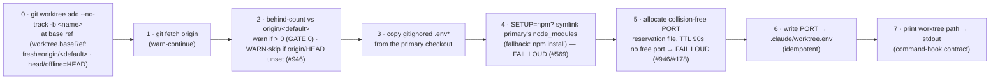

- **Creation**: branch `<name>` off the base ref with **`--no-track`**. Branching off a
  remote-tracking base (`origin/<default>`) with a plain `-b` writes `branch.<name>.remote/merge`
  into the **shared** `.git/config`, so parallel creates race on `.git/config.lock` and the loser's
  add aborts (#927); `--no-track` drops that config write (agent branches needn't track
  `origin/<default>`). On a branch-name collision or an unfetched base (offline) it falls back to a
  `--detach` worktree at the base — the WARN now prints the **full** `-b` output (not just the
  useless "Preparing worktree" line) so the real reason the branch was unavailable is visible, and
  a detached HEAD instead of the named branch is a diagnosable silent degradation (#927).
- **Creation failure is LOUD, not swallowed** (#927): when **both** the `-b` add and the `--detach`
  fallback fail, the hook writes **both** git outputs IN FULL to stderr and **exits 1** — it never
  exits 0 with an empty stdout (the old behaviour, which the harness reported as the opaque
  "returned no worktree path"). The same loud-exit-1-with-a-stderr-reason now covers every
  UNUSABLE-payload path too: malformed JSON, a back-compat `worktree_path`/`path` that does not
  exist, and a missing `name`/primary. A non-`WorktreeCreate` event still passes through silently
  (exit 0). A `WorktreeCreate` telemetry row is appended to `.claude/telemetry/hook-events.jsonl`
  per create — `decision: create` (on its branch), `detached` (fallback) or `error` (both adds
  failed) — honouring the `TELEMETRY` opt-out.
- **`node_modules` provisioning (`SETUP=npm`) — symlink, not install, and FAIL LOUD (#569)**: the
  worktree's `node_modules` is **symlinked to the primary checkout's** installed tree (a per-worktree
  `npm install` is slow and duplicates gigabytes); a real `npm install` runs only as the **fallback**
  when the primary has none. This step no longer warns-and-continues — a symlink error or a failed
  fallback install **exits 1** (a half-provisioned node project is unbuildable, so it must fail loud,
  not echo a path for a broken worktree).
- **PORT allocation — FAIL LOUD when exhausted (#946/#178)**: range 3000–3499, reservation files
  under `~/.cache/claude-template/ports/` (`{port}.port`, mtime-TTL 90s) so two parallel creates
  can't race onto one port — the sibling dev-server / Supabase port-squatting failure class (#178).
  **No free port in range → exit 1** (refusing to provision would collide on the default port); a
  `worktree.env` write error is likewise fatal. An existing `PORT=` assignment is kept (idempotent).
- **behind-check WARN-skip (#946)**: the GATE-0 behind-count is skipped with a WARN
  (`origin/HEAD unset — run: git remote set-head origin -a`) when `origin/HEAD` is unresolved, since
  the base was then branched from local `HEAD` and the behind-check would be meaningless.
- Exit 0 on success; **exit 1 on a creation failure, an unusable payload, OR a FATAL provisioning
  error (node_modules / PORT)**, always with a one-line stderr reason. The network-dependent steps
  (fetch, behind-check, `.env*` carry-in) stay warn-and-continue (G8); the resource-provisioning
  steps (node_modules, PORT) fail loud. A WARN (stderr) is printed when the primary checkout can't be
  resolved.
- **Tests**: `tests/test_hooks_native.sh` (WC + WCn cjs-parity sections; WC5/WCn5 cover the
  name-payload create-and-echo contract; **WC-RACE-1** proves `--no-track` lands the worktree on its
  branch under a held `.git/config.lock`; **WC-LOUD-1** proves a both-adds-fail create exits non-zero
  with EMPTY stdout + git's real error on stderr; **WC-DETACH-1** proves the detached fallback
  surfaces the real git error and logs `decision: detached`; **WC-RET-1/2/3** prove the unusable-payload
  early returns exit non-zero with a stderr reason, **WC-RET-4** that a non-WorktreeCreate event stays a
  silent exit 0 — all py↔node).

### `worktree_remove` — backup safety net on WorktreeRemove

Before a worktree vanishes: enumerate untracked+ignored files (`git ls-files`), copy them to
`~/.local/share/claude-template/backups/<repo>/<worktree>-<timestamp>/`, capture uncommitted
tracked work as `uncommitted.patch` via **`git diff HEAD`** (staged AND unstaged — a bare
`git diff` would drop staged changes, a panel-caught bug), then free the PORT reservation.
Log-only event: enumeration failure prints "backup may be INCOMPLETE", per-file copy failures are
counted ("N FAILED"), and the hook still exits 0 — the worktree is about to vanish, so a partial
backup beats a blocked removal. **Tests**: `tests/test_hooks_native.sh` (WR/WRn, incl. WR4
staged-capture), `tests/test_close_rm_emit.sh` (the P8 teardown emission the docs must carry).

### `teammate_idle` — keep-working on TeammateIdle

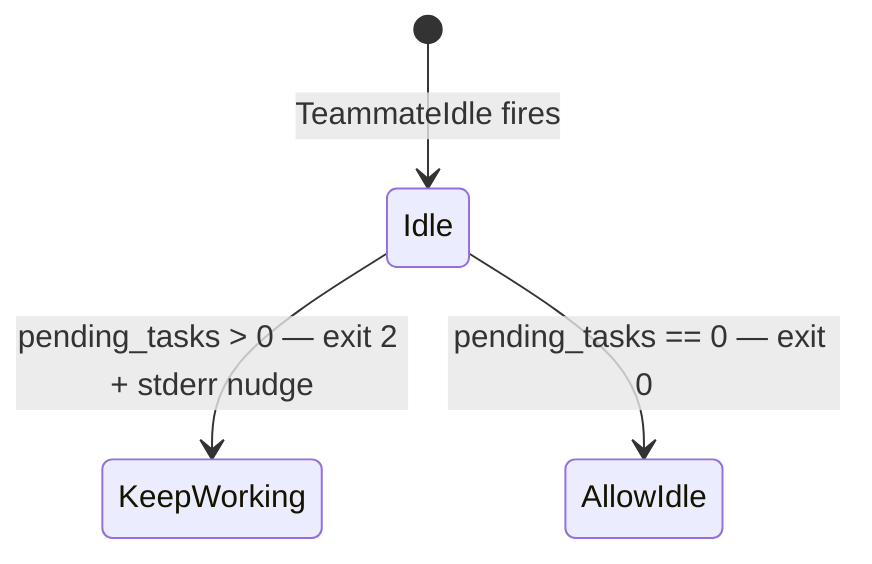

Exit 2 is the keep-working signal; the nudge directs the teammate back to TaskList → claim →
work. This keeps in-process Agent-tool crews working.
**Tests**: `tests/test_hooks_native.sh` (TI section).

---

## Nudges & context injection

### `session_start` — the GATE-0 briefing

On `startup` it prints a full `[Session Context]`: branch + dirty state; the GATE-0 line (one
`git fetch`, timeout 8s, fail-open offline) — behind-count vs `origin/<default>` (H4), ahead-count
when the local default branch carries unpushed commits (#457), and a stale LOCAL default-branch
ref that differs from the origin ref just fetched (#117); the H12 rules-load check (a
`@.claude/rules/*.md` import in CLAUDE.md that's missing — or present but gitignored, so a fresh
clone loads nothing, #194/#198); the `session_prime_gate` first-action cue; **worktree hygiene**
— `git worktree prune` for gone-dir entries, then a reap of MERGED clean `.claude/worktrees/*`
siblings via plain `git worktree remove` (never `--force`: a dirty tree is refused, the branch ref
survives; "merged" is squash-safe — ancestry of the main ref OR a content-identical tree; never the
current tree, the primary, or a worktree a live peer session occupies, #1235); the **concurrent-
session check** (hooks-plugin 0.6.10) — a per-session heartbeat lock keyed by the claude session
PID under `~/.local/share/claude-template/sessions/<repo>/` (redirect via `CT_SESSION_DIR`), WARN
when another *live* session already holds a lock for this repo; pruning is PID-liveness only, so
PID reuse can keep a dead lock looking live (an advisory false-positive, never a block); the
previous session's **crumb** (read-only, `.claude/state/session_resume/crumb.md`, override
`SESSION_CRUMB_PATH`, ~1500-char cap — the writer is the separate `session_crumb` hook); and
`HANDOFF.md`/`TASKS.md` from the PRIMARY worktree (capped 200 lines). On `compact`/`resume` it
emits only the concise reminder (+ the crumb on `resume`). Inject-only — it can never block.

It ALSO has one silent side effect every session: it idempotently registers the `docstamp`
git merge driver in this clone's config (`git config merge.docstamp.driver …`) so the
`.gitattributes` rule `*.md merge=docstamp` has a target — this is what auto-resolves `Last updated:`
stamp conflicts on rebase (an unregistered clone just falls back to git's default text merge). See
`bin/git-merge-docstamp.sh`. In the same pass it registers `pluginver` (`bin/git-merge-plugin-version.sh`,
#963 — **claude_template only**: that driver ships as template source, not into scaffolded repos, so this
registration is a noop where the script is absent): `.gitattributes` routes `plugins/*/.claude-plugin/plugin.json`,
`.claude-plugin/marketplace.json` and `plugins/.hooks-fingerprint` to it; a version-only conflict
resolves to max(ours,theirs)+1 patch (one `pluginver: <path> version X / Y -> Z` stderr line each).
Because it runs **per file**, when only one of a coupled pair (`plugin.json` ↔ `marketplace.json`)
conflicts the two can desync — the driver's stderr then points at `bin/reconcile-plugin-versions.sh`,
which re-syncs the marketplace entry to `max(marketplace, plugin.json)` after the merge (`--check`
reports without repairing; the desync is also caught by `test_plugin_hooks_parity`). Any
other conflict stays real (incl. versions with different component counts), and the fingerprint
is never hand-merged — it stays a conflict with its sha replaced by a `REGENERATE` sentinel (so
`--check` fails loudly if it is `git add`ed as-is) and a message to run `bin/hooks-fingerprint.sh --write`
(same-version bumps never reach the driver, so the `--write` guard still forces a manual bump). Every
3-way merge uses it — revert, cherry-pick, `stash pop` and rebase bump a conflicting version too.
Registration (both drivers): the config is shared by all worktrees, so the script path is built from the
MAIN checkout (parent of `git rev-parse --git-common-dir`), shell-quoted, and re-registered when the
registered script no longer exists; a failed `git config` write leaves one stderr breadcrumb.

**Removed in the 2026-10-14 hook diet** (advisory lines that cost a subprocess or a token every
start and changed no behaviour): the LSP server-binary preflight, the plugin-version-behind
warning (`bin/plugin-doctor` owns it), weekday `reminders.json`, the `session-start.json`
extraNotes seam, the `claude mcp list` MCP-health probe, the cost / plans-in-flight / state-count /
package-manager report lines, and the worktree-hygiene force-remove of a main-pinning entry +
the orphan-dir backup-and-sweep.

**The `session_prime_gate` first-action cue is coordinator-only (hooks-plugin 0.6.220).** It uses
`_lib/session` to go silent for a teammate/subagent, same as `figma_launch`/`rules_refresh`. When
shown, it names ONE action first: `⛔ First action: \`/prime-core\`` (it fast-forwards local main
from origin/main and enters a worktree off it) when not yet primed, or `` `EnterWorktree` `` (fresh
off origin/main) when primed but still on the primary checkout — `/prime-core` already does both
the sync and the worktree entry, so it is never paired with a second named action. **Since
hooks-plugin 0.6.224 the marker is session-bound**, so this producer also removes a STALE marker
(one written by a different session — the common case: a new session opened in an old worktree)
before deciding whether to show the cue, and prefixes the cue with `(stale prime marker from a
previous session removed) ` when it does — or `(… present; could not remove it) ` when the unlink
fails, never claiming a removal that did not happen (PC-10); a coordinator never deletes while running
inside a child session. **Since hooks-plugin 0.6.226, when unprimed the one-line cue is followed by the
`/prime-core` command body** (`_prime_core_body`; lookup `.claude/commands` →
`plugins/claude-template-core/commands` → the newest `claude-template-core/<version>/` in the plugin
cache, two levels up from `CLAUDE_PLUGIN_ROOT`; frontmatter stripped) so the first turn executes it —
a hook can't invoke a command, so this is the closest hard equivalent; nothing injected when primed.
Tests PC-01..10.

**Tests**: `test_session_start_gate0/source/rules_load/concurrent/report/wtclean.sh`,
`test_git_merge_docstamp.sh`, `test_git_merge_plugin_version.sh`.

### `figma_launch` — opt-in Figma design-environment launcher (async)

Second SessionStart wiring, registered with **`"async": true`** so it never delays startup. A pure
convenience side-effect hook for design-heavy repos — it consumes the `FIGMA_LAUNCH=1` /
`FIGMA_FILE_KEY` flags that `rules/design-workflow.md` documents in `.claude/worktrees.conf`.
Fires only when **all** hold: `source == "startup"` (self-filtered, per this repo's
don't-rely-on-settings-matchers convention), the platform is macOS or Linux, and `.claude/worktrees.conf`
carries an uncommented `FIGMA_LAUNCH=1`. It then opens Figma — `open -a Figma` on macOS, `xdg-open` of
the Figma URL on Linux (no native Linux app) — (opening
`https://www.figma.com/design/<FIGMA_FILE_KEY>` in the desktop app when the key is set), and — if
nothing is already listening on the bridge's fixed port (`3055` — the bundled bridge hardcodes it,
no port flag or env) — detach-spawns the ClaudeTalkToFigma websocket bridge via
`npx --package=claude-talk-to-figma-mcp@latest claude-talk-to-figma-mcp-socket`. **Security**: the
conf is repo-tracked, so nothing in it is ever shell-interpreted — the spawn command is hardcoded,
`FIGMA_FILE_KEY` is `[A-Za-z0-9]+`-validated, the port is digits-only, and every spawn is
argv-style (no shell). Fail-open on every path (no Figma, no conf, no npx). On `FIGMA_LAUNCH=1` it
echoes one line — `Bridge channel: <folder>` — to stdout (surfaced in the SessionStart context) so
you can **verify** the ClaudeTalkToFigma plugin auto-joined that channel (the panel derives it from the
open file's name — you no longer type it, provided the file is named after the folder); `<folder>` is
the project folder name, derived with the same git-common-dir parity as the toolkit's `folderChannel()`
so it is identical from any worktree (issue #830). It also **mirrors the vendored (patched) ClaudeTalkToFigma
panel** (`plugins/claude-template-core/vendor/ctf-plugin/` — see its `VENDOR.md`) to a stable path
(`~/.local/share/claude-template/ctf-plugin/`) and echoes that manifest path, so you import it once in
Figma Desktop (**Plugins › Development › Import plugin from manifest**) — the version-keyed plugin
cache never breaks the dev-plugin registration, and the patched panel auto-joins a channel whose base
is `<figma.fileKey>_<figma.root.name>` (the immutable file key + readable name — the key makes it
collision-free across files and rename-safe; name the Figma file after the repo folder so the suffix
matches) instead of a random one. Otherwise its only observability is a breadcrumb log at
`~/.local/share/claude-template/figma-launch.log`.

**Plugin auto-launch (macOS only; `FIGMA_AUTOLAUNCH_PLUGIN`, default on).** After Figma + the bridge
are up, the hook can drive the Figma UI to *run* the plugin for you: it sends `Cmd+P` →
`ClaudeTalkToFigma` → `Enter` (System Events), then **discovers the live channel from the relay
`/status` endpoint** (a no-`--channel` `probe`) so it reports the real open-file channel
(the live `<fileKey>_<fileName>_N`), not the offline guess — falling back to the
`<FIGMA_FILE_KEY>_<folder>` default only when discovery finds nothing — and captures a region-scoped screenshot of the Figma window to
`~/.local/share/claude-template/figma-launch-<channel>.png`. **The probe is the only source of
truth** — keystrokes are capped (≤2 sends) and never trusted, and an `Escape` precedes `Cmd+P` so a
missed Quick-Actions open can never type into the design canvas. It is gated three ways: opt out with
`FIGMA_AUTOLAUNCH_PLUGIN=0`; it is **inert until you import the panel once and `touch
~/.local/share/claude-template/ctf-imported`** (the hook prints the exact steps) — so existing
`FIGMA_LAUNCH=1` users who never imported see no change; and it needs macOS **Accessibility** (for the
keystrokes) + **Screen Recording** (for the shot). On a missing sentinel, denied permission, Figma not
frontmost, or a probe that never reports `CONNECTED`, it prints a one-line manual fallback and
continues (async, never blocks). Linux is a no-op (no Figma desktop app).

**File-identity verification (`FIGMA_FILE_FINGERPRINT`, optional).** Once the plugin is CONNECTED, the
hook reads the probe's `fileKey` (an 8-hex `sha1` of the file's page ids) and, when
`FIGMA_FILE_FINGERPRINT` is set in conf, compares the two: a match prints `Figma file verified:
<page>`; a mismatch prints a `WARNING: Figma file mismatch …` line **and skips the screenshot** (no
misleading wrong-file capture). Unset → it just echoes `Figma file: <page>`; a malformed value (not
`[0-9a-f]{8}`) is ignored with a breadcrumb. **Fail-open** — a wrong, absent, or malformed fingerprint
only warns, never blocks. Capture the expected value once by opening the intended file and running
`figma.mjs probe --channel=<channel>`, then paste its `fileKey` into `FIGMA_FILE_FINGERPRINT`. (The
URL `FIGMA_FILE_KEY` can't be mapped to this fingerprint — the plugin exposes no `figma.root` id — so
the fingerprint must be recorded from a probe.)

> ⚠️ **LAN-EXPOSURE WARNING (issue #305).** The upstream bridge runs `Bun.serve({ port: 3055 })`
> with **no `hostname`**, so Bun binds **`0.0.0.0:3055`** — the WebSocket relay is reachable from
> **anyone on your LAN, unauthenticated**. Upstream `claude-talk-to-figma-mcp@latest` (1.0.0)
> exposes **no flag, env var, or port override** to restrict the interface (confirmed by reading
> its `dist/socket.js` — lesson #246), so the hook **cannot rebind it to loopback**. The hook now
> logs a loud LAN-exposure warning to the breadcrumb file on every spawn, but the exposure itself
> is upstream's. **Mitigate**: only enable `FIGMA_LAUNCH=1` on a trusted network, **firewall
> inbound `:3055`** (e.g. macOS Application Firewall / `pf`, or `ufw deny 3055` on Linux), or stop
> the bridge (`pkill -f claude-talk-to-figma-mcp-socket`) when not actively designing.

**Coordinator-only + relay short-circuit (hooks-plugin 0.6.220).** Fires only in a coordinator,
attended session (`_lib/session`: skips when `CLAUDE_CODE_CHILD_SESSION=1`, `$TMUX` is a
`claude-swarm` socket, or `CLAUDE_CODE_SESSION_ATTENDED=0`). When `:3055` already listens and the
relay `/status` probe reports a CONNECTED channel for this repo's file (`<FIGMA_FILE_KEY>_…`, any
`FIGMA_LANES` key, or the folder channel) it prints `Bridge channel: <ch> — already connected via
relay :3055`, runs the fingerprint check, and does nothing else — no `open -a Figma`, no bridge
spawn, no keystrokes. Probe failure falls through to the full launch. Tests FL-40..47; ADR
`docs/decisions/feat-figma-launch-coordinator-only.md`.

**Tests**: `tests/test_figma_launch.sh` (macOS and Linux; FL-14 asserts the spawn-time LAN-exposure warning; FL-16..FL-24 cover the macOS plugin auto-launch leg — sentinel gate, opt-out, probe-gated keystroke cap, Escape-before-Cmd+P, TCC skip, region-only screenshot, FL-24 the `/status` channel discovery, FL-25..FL-29 the `FIGMA_FILE_FINGERPRINT` verify leg — match/mismatch/unset/malformed, and FL-40..47 the coordinator-only + relay short-circuit leg).

### `cloud_session` — cloud-only session bootstrap + B2 drift check

SessionStart wiring, matcher `startup|resume`, order 30, **not async** (the bootstrap must finish
before the first turn). Exits 0 silently unless `CLAUDE_CODE_REMOTE=true` — a laptop session never
runs it. In a claude.ai cloud session it runs, in order: (1) `docker info`, spawning `dockerd` and
polling ≤ `CS_DOCKER_WAIT` s (default 30) when it is down; (2) `npm ci` and/or `uv sync` (300 s
each, every present lockfile) when sha256 of `package-lock.json` + `uv.lock` (the present ones,
concatenated in that order) no longer matches `.claude/state/cloud-setup.stamp` (refreshed when every
re-sync succeeds) — an **absent** stamp skips the re-sync with a note (`no cloud-setup.stamp —
dependencies not re-synced; run scripts/cloud-setup.sh …`), since the setup script owns the first
install and writes the stamp; (3) `supabase start` (240 s) when `supabase/config.toml` exists
and docker is up; (4) writes `.env.local` + `.env.test` (mode 0600; `setup.sh` gitignores both) from `supabase status -o env` plus the
`# cloud: env` keys of `.env.example` (a key's value comes from `KEY`, else from `CLOUD_KEY`:
claude.ai drops reserved names such as `ANTHROPIC_API_KEY` from the session environment, so those
are stored as `CLOUD_ANTHROPIC_API_KEY` and written back under the real name — T12 canary), headed
`# generated by cloud_session — edits are overwritten`
— a file without that header is kept untouched (`kept hand-edited .env.local`); (5) seeds via
`npm run seed:test`, else notes `supabase/seed.sql`, else `seed: none found`; (6) **B2 drift** —
names each `# cloud: env` key missing from the environment: `cloud env <CLOUD_ENV_NAME> is missing:
KEY, …` (`CLOUD_ENV_NAME` from `.claude/worktrees.conf`, a trailing ` # comment` on that line is
stripped before quote-stripping — T12 canary, dekamer: `CLOUD_ENV_NAME=foo-dev    # the env name`
previously leaked the comment text into the name — default `<repo>-dev`). All notes go out as
ONE stdout JSON object, as both `systemMessage` (shown to the user) and SessionStart
`additionalContext` (shown to the model, so a cloud agent knows e.g. Supabase is down); they carry
key names, step names and exit statuses only, never a value.
A child that cannot run fails only its own step (`not found` / `timed out` / `error <ERRNO>`); any
crash prints `cloud_session: crashed (<ERRNO or exception class>) — cloud bootstrap skipped` and
exits 0. Children run from argv lists (no shell) with their output discarded.

**Tests**: `tests/test_cloud_session_hook.sh` (CS-01..CS-15, both stacks; CS-07 asserts no secret
value reaches stdout/stderr, CS-08 byte-parity of py/node stdout, CS-13 the 0600 mode, CS-15 the
model-visible `additionalContext`).

### `rules_refresh` — auto-sync always-core rules from the plugin (new in hooks-plugin 0.6.17)

Plugin-only SessionStart wiring. Fires only when `source == "startup"` (self-filtered, per this repo's
don't-rely-on-settings-matchers convention). Byte-compares each rule the plugin ships
(`${CLAUDE_PLUGIN_ROOT}/rules/*.md`) against the repo's `.claude/rules/`; if any differ or are
missing repo-side **AND** the git tree is clean, it writes them, stages `.claude/rules/`, and
auto-commits `chore(rules): sync from plugin <ver>`. A **dirty tree** (any staged/unstaged TRACKED
change — untracked files don't count) → **warn + skip**, so it never mixes a rules sync into your
in-flight work. Non-blocking (inject/refresh only, never denies) and fail-open/silent on error.
This retires the manual `propagate.sh --apply` for always-core rules — that path is now a fallback.
When the sync **creates** a rule file that the project's `CLAUDE.md` does not `@import` (a brand-new
always-core rule), it additionally **warns** — for the *refresh* path it never auto-edits `CLAUDE.md`
(project-owned, placeholder-bearing) — so the new rule can't silently fail to load (the #194 class);
reconcile the `## Conventions (always-core)` stub via `setup.sh --update-hooks` / `propagate.sh` (#399,
hooks-plugin 0.6.20).
**UNRESOLVED-@IMPORT WARN (hooks-plugin 0.6.140).** After the sync/heal runs, `rules_refresh`
additionally validates that every `@.claude/rules/*.md` import in `CLAUDE.md` will actually load — any
target **missing from `.claude/rules/`** emits a loud `⚠ always-core rules NOT loaded` WARN listing the
unresolved imports (the #194 silent-context-loss class). It runs on every `startup` regardless of the
heal path (even when heal is skipped on a dirty tree, or when the import name isn't a plugin rule), so
a broken load surfaces immediately instead of failing silently; a healthy or auto-healed repo stays
quiet. Complements the equivalent check in `session_start`.
**BOOTSTRAP (hooks-plugin 0.6.132, #857).** The above assumes `.claude/rules/` already exists. When it
is **entirely missing**, the refresh path can't help (an updater, not a bootstrapper), which silently
broke "old-model" repos that relied on the removed machine-global `~/.claude/rules/*.md` after it was
deleted (#853). So, gated on **`.claude/rules/` absent AND the repo's `CLAUDE.md` still cites
`~/.claude/rules` AND the tree is clean**, `rules_refresh` now **self-heals**: it creates the dir, writes
all bundled rules, **appends the `## Conventions (always-core)` `@import` block to `CLAUDE.md`** (the
list derived from the bundled-rules glob so no rule is omitted — this is why the bootstrap path *does*
edit `CLAUDE.md`, unlike the refresh path), and commits both as `chore(rules): bootstrap always-core
rules from plugin <ver>`. The stub is placed after all existing content (past any RTK-managed block) and
is idempotent via the heading marker. A repo whose `CLAUDE.md` does **not** cite `~/.claude/rules` is
left untouched (no imposing rules it never wanted); if `.claude/rules` is **gitignored** it warns + skips
rather than commit a stub with no tracked files (the #194 trap). **Child sessions never sync (0.6.220):**
teammates/subagents (`_lib/session.is_child_session`) return before any compare or write (#1290, RR-10).
**Plugin-only wiring** — registered in the `claude-template-hooks-py` plugin (`rules_refresh.py`),
NOT in `canonical-settings-hooks.json` (a copy-model project doesn't get it). The node twin went with
the node plugin (#1299).

### `session_autoff` — fleet-freshness auto-ff at session start (Trigger B)

SessionStart wiring (order 45). Runs its OWN fail-open `git fetch` (8s timeout) then, via the
shared `_ff_checkout` primitive, safely **fast-forwards the current repo's main checkout** onto its
resolved trunk (`pr_gate._trunk_ref` logic — never hardcodes `main`) when it is clean and strictly
behind; a dirty / diverged / detached checkout **warns, never mutates**. **#924 — concurrent-session
gate:** even when clean+on-trunk+behind, the primitive **will not mutate the checkout while a live
PEER session is sitting ON the primary** — reading the same per-repo lock dir `session_start`
maintains (`CT_SESSION_DIR` override, else
`~/.local/share/claude-template/sessions/<realpath git-common-dir key>`), a lock counts as a peer
only when its recorded cwd realpath equals the primary's realpath; any pid in the caller's ppid
ancestry is "self", and locks from other worktrees are ignored. On a peer it warns and leaves the
checkout untouched, so an auto-ff can never yank a shared primary's tree out from under a session
actually on it (`_ff_checkout` had previously ff'd shared checkouts unconditionally via
`CT_ALLOW_SHARED=1`). This is the auto-ff counterpart that closes #924; `session_start` stays
inject-only and does NOT itself fast-forward, so a mutating auto-ff can't break that contract. The
primitive returns `(verdict, reason)`; when the direct-leg ff is DECLINED (warn, or a declined noop
that left a breadcrumb — a peer on the primary, an unresolved trunk, a rev-parse/common-dir failure,
the top-level catch) `session_autoff` surfaces that reason on **stdout as a `systemMessage`** — exit-0
stderr is invisible to the agent, so a declined auto-ff can no longer vanish silently (#924). A
genuine up-to-date noop (and a successful ff) stays silent on stdout.
**Untracked files never block the ff (hooks-plugin 0.6.223, #1312):** only non-`??` porcelain lines
count as dirty — an otherwise clean-and-behind checkout with ONLY untracked files still ff's; the
success breadcrumb then appends ` — n untracked file(s) left in place`. A tracked-file change
(staged or unstaged) still declines as before, and git itself refuses an ff that would overwrite an
untracked file origin's new commit adds as tracked (the existing `run it by hand` breadcrumb).
**One breadcrumb (#1311):** the declined reason used to print on BOTH stderr and the surfaced
stdout `systemMessage`; `_say`/`ff_checkout_if_safe` now take an `echo_stderr` flag, and
`session_autoff` calls with `echo_stderr=False` so the reason is surfaced exactly once (on stdout) —
the CLI shim used by tests/`pr-merge-recover` keeps the stderr copy (`echo_stderr` defaults `True`).
Additionally does a best-effort **sideways** check: if a fleet project's `claude_template`
plugin-source primary is behind, it **WARNs only** — it never auto-ffs a repo you didn't open
(Trigger A + direct Trigger B already heal the plugin source). Opt out with `CT_NO_AUTO_FF=1`
(one-off) or a `.claude/worktrees.conf` key (persistent) — an opted-out repo is a **silent noop that
skips the fetch entirely** (#801 T1), not a per-session warn. Fail-open/silent on any error — a
slow/absent network degrades to noop, never blocks startup. **Wired hook** (registry entry) in BOTH
`claude-template-hooks-py` (`session_autoff.py`) and `-node` (`session_autoff.cjs`) as behavioral
twins. **Tests**: `tests/test_session_autoff.sh` (SA1..SA10, py+node parity — incl. the self-double-ff
guard, SA7/SA8 declined-ff-reason-on-stdout vs silent up-to-date, and SA9/SA10 the one-breadcrumb +
untracked-only-ff cases) + `tests/test_ff_checkout.sh` FFC13 (the #924 concurrent-session gate),
FFC20 (the `(verdict, reason)` contract — py+node parity), and FFC21..23 (untracked-only ff, the
tracked-clash refusal, a modified-tracked-file decline, #1312).

### `post_nudges` modules (`grill_nudge`, `parallel_nudge`, `skill_nudge`, `scope_creep`,
`suite_overrun_nudge`, `rtk_nudge`, `merge_autoff`, `spawn_count_nudge`) — REMOVED (hook diet, #1285 PR B)

The whole `post_nudges` PostToolUse entry (8 WARN modules, run from one process on every
`Write|Edit|Bash`) was removed — advisory nudges don't earn their per-call cost once the
equivalent guidance lives in prose. Each module's guidance now lives in `rules/*.md`:
the grill/interview nudges in `design-workflow.md`'s COVER + Interview-convention sections, the
parallel-batch nudge in `agent-delegation.md`'s "a plan batch is concurrent by default" bullet, the
scope-creep nudge in `engineering-conventions.md` R7, the suite-overrun guidance in
`verify-workflow.md`'s test-cadence section, the RTK prefix reminder in the `rtk` skill, and the
post-merge auto-fast-forward in `session_autoff`'s own Trigger-B coverage at SessionStart (the one
behavior that had a non-advisory side effect — the PR-merge-time Trigger-A ff is dropped, not
replaced; `session_autoff` still catches a behind main checkout at the next session start).
The commit-time BLOCKs these nudges shadowed (`grill_gate`, `parallel_gate`) are unaffected — they
still run inside `pre_tool`.

**Tests**: `tests/test_nudges_removed.sh`.

### `post_tool_use_lint` (py) / `post_tool_use_format` (node)

The auto-STATIC leg of GATE 2. Python stack: `uvx ruff check` (policy pinned in `ruff.toml`) on
every edited `.py` — lint errors surface via stderr + exit 2 (the current PostToolUse feedback
channel; PostToolUse has no decision field upstream anymore) alongside the legacy
`{"decision":"block"}` stdout JSON for older harnesses, so a bad edit is fixed
immediately, not at commit. Node stack: `npx --no-install prettier --write` on
ts/tsx/js/jsx/cjs/mjs/css/scss/md/json — silent no-op if prettier isn't installed, never blocks.

### `context_nudge` — REMOVED (hook diet, #1285 PR B)

The SubagentStop WARN on an oversized subagent return (`CONTEXT_NUDGE_RETURN_CHARS`, ~4k tokens)
was removed along with `post_nudges` — SubagentStop now has no wired hook. The "return a summary,
not a dump" discipline it nudged toward stays prose-only in `agent-delegation.md`'s "Fork ≠ free"
section. **Tests**: `tests/test_nudges_removed.sh`.

> `compact_suggester` (the context-occupancy `/compact` nudge, #498) and `loop_detector` (the
> identical-call thrashing WARN, #500) were removed in the hook diet (#1285) — advisory nudges that
> cost a subprocess every tool call. `telemetry` now runs only `tool_events`.

### `tool_events` — per-tool-call metadata telemetry (the miner's raw signal)

PostToolUse (matcher `""`, fires after **every** tool call): appends one metadata-only JSONL row per
call to `.claude/telemetry/tool-events.jsonl` — `{ts (epoch int), kind:"tool", tool, exit,
duration_ms, file (path only), retry_count, session_id}`. **Metadata only, never bodies** — no
`tool_input`/`tool_response`/command/output/content is ever written (a load-bearing secret-exfil
guard). Non-blocking and fully fail-open: a non-dict payload or an unwritable sink leaves a one-line
stderr breadcrumb and returns 0 — it can never brick a tool call. The `kind` discriminator + uniform
epoch-`ts` keep the row format stable for the `/improve` miner. The sink is gitignored (`**/.claude/telemetry/`).
**Tests**: `tests/test_tool_events.sh` (§120, metadata-only + py↔node parity + malformed-payload
fail-open). Consumed by `/improve` (the `claude-template-core` skill) to corroborate recurring lessons
against real retry/thrashing patterns.

> `_denial_telemetry` (the shared helper that logged gate blocks to `hook-events.jsonl`, #782) and
> the `hook_trace` sampler were removed in the hook diet (#1285), along with the `capture_iterations`
> and `capture_failures` telemetry modules. The deny paths still block; only the metadata rows are gone.

### `_telemetry_gate` — shared opt-out gate for local telemetry (default ON)

Not a wired hook — a shared helper (`_telemetry_gate.{py,cjs}`, imported-not-invoked) that the local
telemetry writer consults so a user can turn the template's own telemetry OFF. Resolution, first
decisive wins: env `CLAUDE_TELEMETRY` (set & non-empty; wins) → `.claude/worktrees.conf` `TELEMETRY=`
→ **default enabled**. Disabled only on an explicit falsy value (`0`/`false`/`no`/`off`, trimmed,
case-insensitive); env can re-enable over a conf disable. Fail-open: any error (missing helper,
unreadable conf, exception) → enabled, preserving today's behavior. After the hook diet the one
remaining writer that calls `telemetry_enabled`/`telemetryEnabled` before its sink write is
`tool_events`. **Tests**: `tests/test_telemetry_gate.sh` (TG1–TG5 — resolution + a drift guard that
fails CI on any ungated telemetry writer). Design:
`docs/superpowers/specs/2026-09-09-telemetry-opt-out-design.md`.

> `suite_overrun_nudge` and `merge_autoff` (PR-merge-time Trigger A) were the other two
> `post_nudges` modules removed above; see that consolidated note — Trigger A's post-merge
> fast-forward is dropped (not replaced), since `session_autoff`'s Trigger B still catches a
> behind main checkout at the next session start.

### `lesson_injector` — REMOVED (hook diet, #1285 PR B)

The always-on UserPromptSubmit lesson injection (≈10 KB pushed into every prompt) was removed — its
per-turn token cost was the harness's single largest, and most turns don't need the recall. Lessons
are now pulled ON DEMAND via the `/lessons` skill (keyword recall from `docs/lessons.md`), not pushed.
`docs/lessons.md` is unchanged: `/dev-reflect` still appends to it and `/improve` still mines it.
UserPromptSubmit now has no wired hook.

**Tests**: `tests/test_lesson_injector_removed.sh` (§108, LIR1..LIR5).

---

## `merge_settings_hooks.py` — the wiring reconciler (utility, not a hook)

Called by `setup.sh`: merges `canonical-settings-hooks.json` into a project's
`.claude/settings.json` without ever removing, reordering, or overwriting what's there.

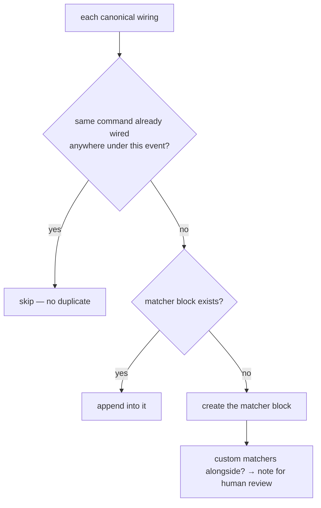

Identity is command-match-within-event (not matcher-string equality) — the fix for the
double-firing bug where a customized matcher plus a canonical addition both matched the same tool
(#94). `--diff` previews, `--write` applies. **Tests**: `tests/test_hook_wiring_merge.sh`.

## See also

`docs/workflow/ENFORCEMENT.md` (the one-screen cross-walk — per phase: which hook fires + which agent to
dispatch; this doc is its per-script depth) · `hook-wiring/README.md` (boundary + event model) ·
`docs/workflow/ENFORCEMENT.md` (roster + bypass table, parity-tested against both stacks by §70
`test_docs_phase_parity.sh`) · `bin/sync-generated.sh` → `bin/build-hook-wiring.sh` / §59 (plugin delivery chain) · `bin/test-lock` (the
wrapper the two test-lock guards point at).
