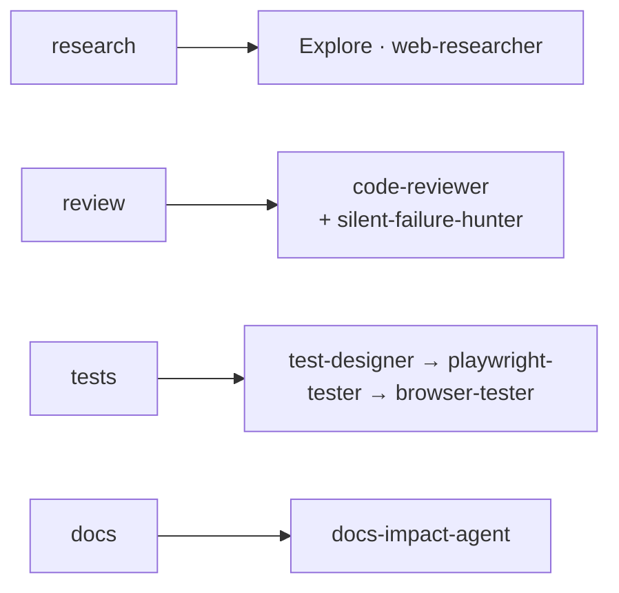

# Canonical Workflow

Last updated: 2026-10-05 02:27

> Per-repo commands (TEST_CMD · RUN_CMD · PROFILE) live in `.claude/worktrees.conf`.

> **THE LAW — Design → Code → Prove.** Shape it before you build it (GATE 1 ⛔), prove it
> with fresh evidence before you call it done (GATE 2 ⛔). Two hard gates, never skipped.
> The full 9-phase spine, the two laws, and the *how* of the Design and Prove legs are canonical
> in `rules/workflow.md` / `rules/design-workflow.md` / `rules/verify-workflow.md` (always-core,
> `@`-imported into every session) — **this page covers only what those rules don't**: the
> project-specific Phase-0 mechanics below, the implementer Builder brief, file-location
> conventions, and the agent roster.

## Phase 0 — PRIME the baseline first

**GATE 0 ⛔ · _Sync, don't assume._** A feature branch / worktree is a **snapshot in time**. Build on
a stale one and you redo work that already exists, verify against the wrong baseline, and let merge
conflicts compound. **Before any design or code, establish the current source of truth THIS
session:**

- **Start by re-reading `rules/workflow.md`** (the canonical workflow rule) and **invoking
  `using-superpowers`** — before any git or code action. A coordinator (or any session) orients on
  the live workflow, not a remembered one; the two hard gates are easy to *know about* and still
  skip from memory. Reading the rule + loading the skill engine is the cheapest guard against that.
  (`using-superpowers` also auto-fires via the plugin's `SessionStart` hook — invoking it explicitly
  makes the P0 step visible rather than implicit.)

```bash
git fetch origin
git rev-list --count HEAD..origin/main   # BEHIND? >0 ⇒ sync before building (unpushed rebases, pushed merges)
git rev-list --count origin/main..HEAD   # AHEAD?  ⇒ what's local-only
# + open / screenshot the LIVE deployed artifact as the reference — not a stale local
```

- **If behind > 0 → sync first.** Solo/unpushed branch ⇒ `git rebase origin/main`; **shared/pushed**
  branch ⇒ `git merge origin/main` (rebase rewrites history — don't force it on teammates). This is
  machine-enforced: the `session_prime_gate` PreToolUse hook BLOCKs the first mutation until you're
  in a `.claude/worktrees/` worktree AND primed (`/prime-core`) — bypass `WORKFLOW:no-worktree` /
  `WORKFLOW:no-prime`.
- **Dirty tree first:** a rebase won't run dirty — commit/stash, and back up untracked work that
  could collide with paths `main` now tracks.
- **A pushed-branch merge-sync passes `stale_base_guard` without a bypass.** The guard blocks a
  behind-base commit whose staged files overlap `origin/main`, but a `git merge origin/main` sync
  commit is exempt (the `WORKFLOW:no-rebase-check` token is honoured only while a merge is in
  progress). Recipe: `git stash push -u -m <tag>` → `git merge origin/main` → `git stash apply <sha>`
  → commit.
- **The deployed/running artifact is the source of truth** — not a stale local, not a mockup. Diff
  it before deciding anything "doesn't match."
- **Verify the plan/brief premise, don't just obey it.** GATE 0 covers the *plan's claims*, not only
  the git base — a plan/PRD is a snapshot too. Before any build, characterize the plan's target
  surface against live code and emit a tagged gap list (`[EXISTS]` / `[PARTIAL]` / `[MISSING]` +
  file:line). If the target (or part of it) already shipped, **re-scope to the real gap and re-enter
  GATE 1** — bring the corrected scope to the user before writing code. Don't rebuild shipped work.
- **A "clean" main can be hiding orphaned WIP.** Before treating `main` (or a sibling worktree) as a
  clean baseline, scan it for orphaned staged/uncommitted work — `git status` and `git stash list` —
  in both `main` and any sibling worktrees; a crashed/abandoned session can leave WIP that a fresh
  `git fetch` + behind-count check alone won't surface.
- **Check for a LIVE concurrent session.** The `session_start` hook's concurrent-session check
  surfaces what other Claude sessions on this machine are working on (which project / which item).
  Two sessions sharing one checkout will switch each other's branch and stomp each other's
  uncommitted work mid-task — a real collision, not hypothetical. If another session is already on
  this project/item, coordinate or move to your own worktree (`EnterWorktree`) before touching
  anything.

## Conventions & file locations

- **`project-context.md`** — the project "constitution"; produced at GATE 1, loaded by every agent.
- **`docs/superpowers/specs/`** + **`docs/superpowers/plans/`** — design specs + TDD plans (auto-written).
- **the behaviour-test suite** — the codified regression (web: `e2e/*.spec.ts`; service: integration
  tests; CLI/lib: golden/property tests; data: fixture-driven tests) — kept green: targeted files while iterating, a full suite per PR for a tier-2 PR (tier-0/1 gates on the affected slice).
- **`docs/`** — **`lessons.md`** (the canonical lessons-learned log, appended by
  `/dev-reflect`), plus project-authored docs if present (e.g. `ARCHITECTURE.md`, `TESTING.md` —
  neither ships from the template); keep current in the DOCUMENT / CLOSE phases.
- **`.git/sdd/progress.md`** — SDD ledger.
- **Worktrees:** native worktrees are canonical (EnterWorktree / Agent `isolation: worktree`,
  provisioned by the `worktree_create` hook); clean up with `git worktree remove <path>` (the
  `worktree_remove` hook backs up first), gitignore `.worktrees/` and `worktrees/`. The branch
  survives removal — delete it separately with `git branch -d <branch>` once merged.

## Delegation — the Builder brief

Delegate substantial work to in-process subagents (see `~/.claude/rules/agent-delegation.md`):
research → Explore / web-researcher; review → `/pr-open` (the tier panel incl. docs-impact-agent);
tests → test-designer → playwright-tester → browser-tester. Trivial things stay inline.

**Builder brief — every implementer dispatch carries this, and the implementer self-checks it before
reporting ready:** a degraded/fail-open path is visible on **stdout** (a hook's `systemMessage`), not
only stderr; a change to a twinned unit (py + node pair) lands in **both** twins, each new test shown
failing first; the repo's deterministic doc checks (docs-drift / inventory-count) are in the targeted
run; docs describing the changed behaviour ship in the same PR; a stale-base bypass token goes only on
a `git merge origin/main` sync commit (never a normal commit).



## Agents

Delegate substantial research/review/test work to subagents — the generic
reviewers/researchers (code-reviewer, code-simplifier, codebase-explorer, comment-analyzer,
docs-impact-agent, pr-test-analyzer, silent-failure-hunter, type-design-analyzer, web-researcher)
and the flow agents (`test-designer`, `playwright-tester`). `Explore` is a built-in
agent type; `browser-tester` is not a separate agent — it's the live-driving **role** played by
`playwright-tester` + the `webapp-testing` skill. Full routing + model table →
`rules/agent-delegation.md`.

## See also

`rules/workflow.md` (the 9-phase spine + both hard gates) · `rules/design-workflow.md` /
`rules/verify-workflow.md` (the *how* of GATE 1/GATE 2) · `FIELD-GUIDE.md` (the at-a-glance index —
hooks, the gate roster, skills, agents) · `rules/agent-delegation.md` (full agent routing + models).
